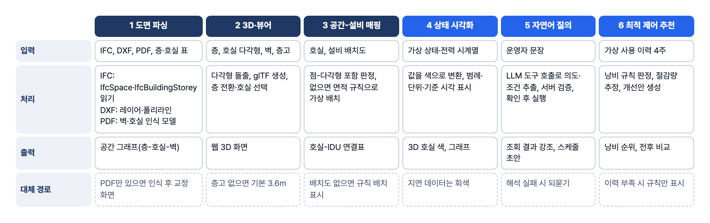
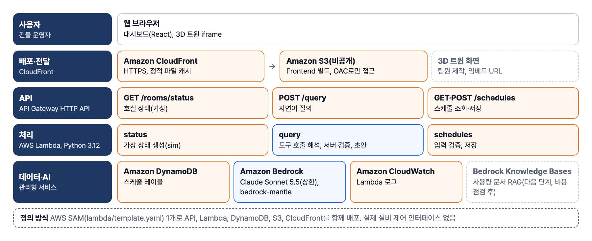
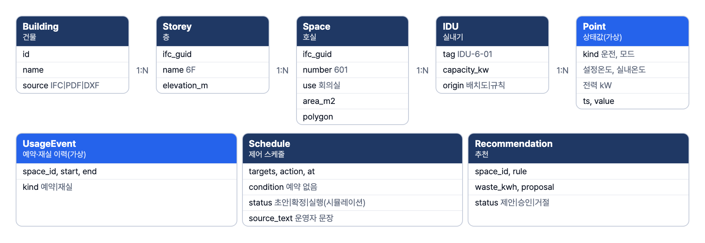
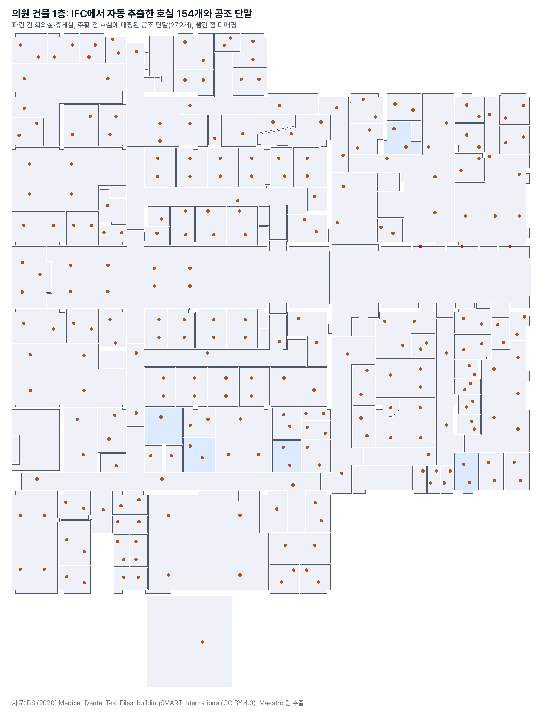
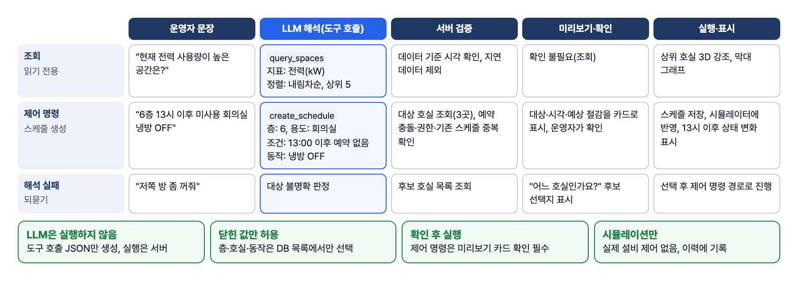
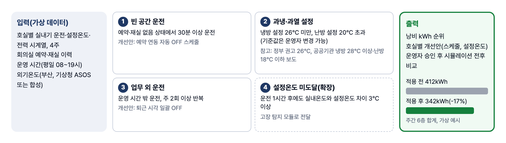
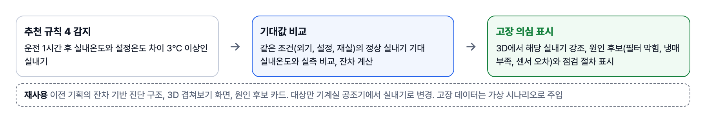

# 시스템 설계: 6단계 처리 흐름과 4계층 구조

> **요약** (기준일 2026-11-20)
>
> - 처리 흐름은 도면 파싱, 3D 생성, 공간-설비 매핑, 상태 시각화, 자연어 질의, 최적 제어 추천 6단계. IFC를 우선 입력으로 쓰고 PDF·DXF는 대체 경로
> - 자연어 질의는 LLM이 도구 호출 JSON만 만들고, 서버가 닫힌 값 검증과 운영자 확인을 거쳐 시뮬레이터에만 반영
> - AWS 서비스로만 구성(2026-11-20 결정): CloudFront·S3(웹), API Gateway HTTP API, Lambda(Python 3.12), DynamoDB, Bedrock Claude Sonnet 5.5(상한). AWS SAM 템플릿 1개로 배포
> - 공개 IFC 실험에서 호실 269개 추출, 공조 단말 448개 매핑, 처리 약 10초를 확인함. Frontend와 Lambda 첫 구현은 `frontend/`, `lambda/`
>
> - 2026-11-20 배포: 웹 https://d2y0m857hv27mz.cloudfront.net, WebSocket 질의 첫 단계 4.7초·완료 11.8초(콜드 스타트 1건), REST 질의 3.8~8.5초(2건), 운영 패널 API 4종 응답 확인
> - 2026-11-20 배포 반영: 운영 패널 API 4종, 여러 건물(4곳, 호실 533개, `building` 쿼리, `GET /buildings`), 전력 분석 API 4종(`/energy/*`), 로그인(Cognito, 전체 API·WebSocket 인증), AI 대화 기록·메모리(`/chat`)
> - 화면 틀: 상단바(로고, 건물 토글, 운영·전력 분석 탭), 왼쪽 사이드바(전체 현황, 층 3F→1F), 오른쪽 AI 운영 도우미(채팅형)
> - 팀 완성안(2026-11-20)은 프런트엔드, 백엔드, AI 서비스, 3D 모델 생성, 모델 학습 5개 영역. 구성 요소 16개의 구현 상태는 12절
>
> **다음 작업**: 질의 테스트 문장 30개 작성(미정)

[서비스 기획](service-plan.md)의 6단계를 구현하는 구조입니다. 기능별 완료 기준은 [요구사항](../reference/requirements.md)에 있습니다.

## 1. 처리 흐름: 6단계와 대체 경로

**1-1. 각 단계는 입력이 부족할 때의 대체 경로를 가지며, 대체 경로로 만든 결과에는 출처를 표시합니다.**

예를 들어 설비 배치도가 없으면 규칙으로 HVAC을 배치하고, 화면에 "규칙 배치"로 표시합니다.



## 2. 시스템 구조: 화면, API, 처리·AI, 데이터

**2-1. AWS 서비스만 사용하며, 웹은 CloudFront·S3로 배포하고 API는 API Gateway와 Lambda로 처리합니다.**

LLM 호출과 도구 실행은 query Lambda가 담당합니다. 모든 HTTP API와 WebSocket 연결은 Cognito 로그인이 필요합니다([로그인과 AI 대화 메모리](decisions/2026-11-20%28%EB%A1%9C%EA%B7%B8%EC%9D%B8%EA%B3%BC%20AI%20%EB%8C%80%ED%99%94%20%EB%A9%94%EB%AA%A8%EB%A6%AC%29.md)). AI에는 원문 대화 대신 최근 10턴 대화 메모리 요약(8KB 이하)만 전달합니다([AI 대화 메모리 10턴 확장](decisions/2026-11-20%28AI%20%EB%8C%80%ED%99%94%20%EB%A9%94%EB%AA%A8%EB%A6%AC%2010%ED%84%B4%20%ED%99%95%EC%9E%A5%29.md)). 실시간 연동은 WebSocket 대신 Frontend가 5초마다 상태를 다시 조회하는 목업이며(값은 5초 구간마다 범위 안에서 변동), Lambda 호출이 실패하면 Frontend 목업(`frontend/src/mock.ts`)으로 대체합니다. 3D 트윈은 팀원이 만든 화면을 iframe으로 임베드하며, 연동 규약은 [3D 트윈 임베드 규약](../reference/twin-embed.md)에 있습니다.



**표 2.1 AWS 구성(2026-11-20 결정)**

| 계층 | 서비스 | 이유 |
|---|---|---|
| 웹 | React, TypeScript, Vite → S3(비공개) + CloudFront(OAC) | 정적 배포, HTTPS |
| API | API Gateway HTTP API(CORS) | Lambda 연동, 요청 단가가 REST API보다 낮음 |
| 실시간 전송 | API Gateway WebSocket API(`ask` 라우트), ws Lambda | AI 질의 단계와 답변 텍스트를 진행 시점에 전송. 연결 실패 시 HTTP API로 대체 |
| 인증 | Amazon Cognito 사용자 풀(기업 코드 가입: 가입 전 검사 signup Lambda, 인증 후 구성원 등록 confirm Lambda), HTTP API JWT 권한 부여자, WebSocket REQUEST 권한 부여자(auth Lambda), 판매사 관리자 그룹 `admin`(기업 관리 API `/admin/*`), 고객사 역할(관리자·운영자)은 구성원 테이블 | 판매사가 기업·건물을 등록하고 고객사는 소속 건물만 조회, 모든 건물 API에서 소속 검사([판매사·고객사 회원 구조](decisions/2026-11-20%28%ED%8C%90%EB%A7%A4%EC%82%AC%C2%B7%EA%B3%A0%EA%B0%9D%EC%82%AC%20%ED%9A%8C%EC%9B%90%20%EA%B5%AC%EC%A1%B0%29.md)) |
| 대화 저장 | DynamoDB 대화 테이블(기록 90일, 메모리 24시간 TTL), chat Lambda(`GET·DELETE /chat`) | 사용자·건물별 대화 기록, 후속 질문 해석용 메모리 |
| 처리 | Lambda Python 3.12(arm64) 6개: api(조회·관리 25개 경로, 1769MB), query(AI 질의), ws(WebSocket), auth(연결 인증), signup(가입 전 검사), confirm(가입 인증 후 구성원 등록). 기본 1024MB | 화면당 콜드 스타트 1회(2026-11-20 통합, 이전 9개 함수는 첫 호출 2.6~2.9초) |
| 데이터 | DynamoDB(스케줄), 건물·호실은 `maestro-twin` 스택 Buildings·Rooms 테이블(실행 환경별 60초 캐시), 도면은 S3 도면 버킷(`GET /buildings/{id}/plan`) | 판매사·고객사 구조에서 건물·도면을 화면으로 추가·수정(2026-11-20 1단계) |
| 자연어 질의 | Bedrock Claude Sonnet 5.5(`global.anthropic.claude-sonnet-5-5`, bedrock-runtime global 추론 프로필) | 사용자 지정 상한, 템플릿에서 Haiku 5.5로만 하향 가능. Mantle은 Sonnet 5.5 미제공([장애 기록](troubleshooting/2026-11-20%28Bedrock%20Sonnet%205.5%20%EB%AA%A8%EB%8D%B8%20ID%20404%29.md)) |
| 정의·배포 | AWS SAM(`lambda/template.yaml`) | 리소스 1개 파일 관리 |
| RAG | Bedrock Knowledge Bases, S3 Vectors, Titan Text Embeddings V2 | 규정·쾌적 기준 문서 7건, 사용량 과금([기술 선택 기록](decisions/2026-11-20%28%EA%B7%9C%EC%A0%95%20%EB%AC%B8%EC%84%9C%20RAG%20%EB%B2%A1%ED%84%B0%20%EC%A0%80%EC%9E%A5%EC%86%8C%29.md)) |

주: 결정 경위는 [AWS 아키텍처와 기술 스택](decisions/2026-11-20%28AWS%20%EC%95%84%ED%82%A4%ED%85%8D%EC%B2%98%EC%99%80%20%EA%B8%B0%EC%88%A0%20%EC%8A%A4%ED%83%9D%29.md).

**2-2. 운영자는 건물 여러 곳을 관리하므로 모든 조회 API는 건물을 지정하고, `GET /buildings`가 문제 건물을 먼저 반환합니다.**

건물은 본관(`main`, 공개 IFC 의원 원본)과 가상 건물 3곳(`office`, `edu`, `lab`)입니다. 가상 건물은 의원 도면의 층을 복제·반전하고 용도와 운영 시간을 바꿔 만들었으며, 응답의 `virtual`과 `basis`로 표시합니다. 원본은 `lambda/src/buildings.json`입니다.

**표 2.2 건물 지정 규칙(2026-11-20)**

| API | 건물 지정 | 비고 |
|---|---|---|
| `GET /rooms/status`, `/recommendations`, `/anomalies`, `/rooms/history` | 쿼리 `building`(없으면 `main`) | 상태 응답에 `building`(건물 정보), `floors`(그 건물의 층) 추가 |
| `GET /schedules` | 쿼리 `building` | `buildingId`가 없는 이전 항목은 `main` |
| `POST /schedules` | 본문 `buildingId` | `roomIds`가 그 건물의 호실이 아니면 400. 저장 항목에 `buildingId` 기록 |
| `POST /query`, WebSocket `ask` | 본문 `buildingId` | 시스템 프롬프트에 건물 이름·층·용도, 도구 인자는 그 건물 기준으로 검증 |
| 모든 API | 목록에 없는 건물 | 400 `알 수 없는 건물: <id>`. WebSocket은 모델 호출 없이 `error` 이벤트 |

주: 도구 정의의 층 enum은 전체 건물 합집합(`1F`, `2F`, `3F`, `all`)입니다. 질의 건물에 없는 층·용도는 `tools.run`이 허용 값 목록을 포함한 도구 오류로 반환하고, 모델은 다음 라운드에서 값을 다시 선택합니다.

**표 2.3 `GET /buildings` 응답(전체 현황)**

| 필드 | 내용 |
|---|---|
| `generatedAt`, `virtual` | 기준 시각, 가상 데이터 여부(항상 `true`) |
| `buildings[]` 정적 정보 | `id`, `name`, `use`, `virtual`, `basis`, `floors`, `roomCount`, `areaM2` |
| `buildings[].now` | 지금 운전 대수 `on`, 정지 `off`, 이상 `anomaly`, 전력 `powerKw`(호실마다 상태 1회 계산) |
| `buildings[].todayKwh` | 오늘 0시~현재 사용량. `GET /rooms/history` 오늘 합계와 같은 15분 표본 방식 |
| `buildings[].savingKwh` | 절감 가능량(kWh/일, 가상). `GET /recommendations` 건물 전체 합계와 같은 값 |
| `buildings[].level` | `alert` 이상 1건 이상, `warn` 절감 가능량이 오늘 사용량의 10% 이상, `ok` 그 외 |
| 정렬 | `alert`, `warn`, `ok` 순, 같은 등급은 이상 건수 내림차순 |

주: 계산 시간은 로컬(Apple Silicon, Python 3) 5회 0.42~0.43초입니다. Lambda(arm64, 512MB) 실측은 배포 후 확인합니다. 화면은 60초마다 다시 조회합니다.

## 3. 데이터 모델: 건물에서 상태값까지 5단계

**3-1. 공간은 IFC GUID를 키로 유지하고, HVAC과 상태값은 호실에 연결합니다.**

가상 데이터(상태값, 예약·재실 이력)는 별도 표시 컬럼을 추가해 실제 데이터와 구분합니다.



## 4. 도면 파싱과 3D 생성: IFC 우선, PDF는 교정 화면

**4-1. IFC는 IfcBuildingStorey와 IfcSpace를 읽어 층·호실 바닥 다각형을 만들고, PDF는 인식 결과를 교정 화면에서 확정합니다.**

| 입력 | 방법 | 확인 상태 |
|---|---|---|
| IFC | 공간 형상의 최저 높이 삼각형을 합쳐 바닥 다각형 생성 | 의원 건물에서 호실 269개, 약 10초 |
| DXF | 벽·호실 레이어와 닫힌 폴리라인 | 미실험 |
| PDF | 벽·호실 인식 모델(CubiCasa5K 사전학습) 후 교정 | 미실험 |
| 도면 실내기 기호 | YOLO 기호 검출(합성 데이터와 실제 도면 라벨 학습) 후 유형별 LG 모델 표(`ml/hvac_types.json`) 조회 | v1 실제 도면 mAP50 0.006, v2 재학습 준비(12-2절) |
| 층·호실 표 | 호실 번호, 용도(회의실 등)를 다각형과 이름으로 연결 | 미실험 |

3D는 바닥 다각형을 층고만큼 돌출해 glTF로 만듭니다. 층고 정보가 없으면 3.6m를 기본값으로 씁니다.

## 5. 공간-설비 매핑: 배치도 우선, 없으면 규칙 배치

**5-1. 설비 위치가 있으면 점-다각형 포함 판정으로 호실에 연결하고, 없으면 호실 면적 규칙으로 HVAC을 가상 배치합니다.**

의원 건물 실험에서 공조 단말 451개 중 448개가 호실에 매핑됐습니다. 정답 대조는 하지 않았습니다. 규칙 배치의 면적 기준값은 구현 시 정하며, 결과에 "규칙 배치" 출처를 저장합니다.



## 6. 가상 데이터 생성: 예약·재실, 운전, 전력

**6-1. 실제 설비가 없으므로 호실 용도별 사용 패턴과 외기온도로 4주 분량의 상태·전력 시계열을 생성합니다.**

| 데이터 | 생성 방법 | 간격 |
|---|---|---|
| 예약·재실 | 용도별 패턴(회의실 1~2시간 예약 블록, 사무실 업무 시간) + 난수 | 이벤트 |
| 운전·모드·설정온도 | 운영 시간·예약 기반, 일부 호실에 낭비 패턴(빈 공간 운전, 과냉) 주입 | 5분 |
| 실내온도 | 설정온도·외기온도·운전 여부로 1차 지연 모델 | 5분 |
| 전력 | 운전 시 정격 용량 × 부하율(외기·설정온도 차이 기반) | 5분 |
| 외기온도 | 부산 기상청 ASOS 시간별 기온 또는 합성 곡선 | 1시간 |

주: 난수 시드를 고정해 같은 데이터를 재생성합니다. 낭비 패턴 주입 비율은 추천 결과 검증용으로 기록합니다.

## 7. 자연어 질의: LLM 도구 호출과 서버 검증

**7-1. LLM은 도구 이름과 인자만 생성하고, 서버가 인자를 DB 목록으로 검증한 뒤 실행합니다.**



| 도구 | 인자 | 동작 | 상태 |
|---|---|---|---|
| `query_spaces` | 층, 용도, 지표(전력·온도·습도·설정온도), 정렬, 개수, 표시 방식 | 조건에 맞는 호실 조회, 화면 강조, 호실 순위 막대 | 구현 |
| `aggregate_spaces` | 층, 용도, 묶음(층·용도), 지표(전력 합계·운전 대수·이상 건수·평균 온도), 표시 방식 | 묶음별 합계·평균, 묶음 막대 | 구현(2026-11-20) |
| `energy_trend` | 기간(일·주·월), 표시 방식 | 건물 전력 사용량 추이와 이전 기간 비교, 증감률(`changePct`, 이전 기간 같은 시점 대비 %), 선 그래프(`GET /energy/trend` 계산 재사용) | 구현(2026-11-20) |
| `create_schedule` | 층, 용도, 동작(off·on·setpoint), 시각, 조건(unused·always), 설정온도 | 초안, 적용 전후 시간별 전력 선 그래프, 예상 절감량(그래프와 같은 계산) | 구현 |
| `search_documents` | 검색 문장 | Knowledge Base 상위 4개 발췌(문서명, 시행일, 원문 주소), 답변 근거 목록(`sources`) | 구현(2026-11-20) |
| `comfort_index` | 층, 용도, 정렬, 개수, 표시 방식 | 호실별 불쾌지수(기상청 식)·단계, PMV·PPD(ISO 7730, 가정값 함께 반환), 불쾌지수 막대 | 구현(2026-11-20) |
| `recommend` | 층 또는 건물, 기간 | 낭비 순위와 개선안 반환 | 다음 단계(규칙은 `GET /recommendations`로 구현, LLM 도구 미연결) |

주: 증감률처럼 계산이 필요한 값은 도구가 계산해 결과에 넣고, LLM은 그 값을 그대로 씁니다. 스케줄 저장 방법과 설비 미제어 안내는 답변 대신 화면의 초안 카드에 고정 표시합니다(답변 3문장 규칙, [도구 선택 평가](research/ai-tool-eval.md) 5절).

주: AI 답변 그래프는 도구가 결과 데이터로 만든 정의(`charts`: 막대 또는 선)를 응답에 붙여 화면이 그립니다. 숫자는 항상 도구 결과에서 가져오고, LLM은 표시 방식(`view`: auto, chart, table)만 제안합니다. 말풍선 안 작은 그래프와 표 전환, 크게 보기 창으로 표시합니다. 문서 검색 결과는 `sources`(문서명, 원문 주소, 시행일, 원문 확인일)로 붙어 그래프 아래 근거 목록으로 표시합니다.

주: 답변은 구조화 응답(`output_config.format`, 결론·근거·조치 3칸)으로 받고 칸마다 첫 문장만 표시해 3문장 이하를 보장합니다. 스트리밍 중에는 서버가 부분 JSON에서 칸 텍스트만 화면에 보냅니다([AI 답변 구조화 응답](decisions/2026-11-20%28AI%20%EB%8B%B5%EB%B3%80%20%EA%B5%AC%EC%A1%B0%ED%99%94%20%EC%9D%91%EB%8B%B5%29.md)).

주: 도구 정의 원본은 `lambda/src/tools.py`. 모든 도구는 `strict: true`이며, Sonnet 5.5는 강제 `tool_choice`를 지원하지 않아 시스템 프롬프트로 도구 사용을 유도합니다.

검증 규칙은 4가지입니다.

- 층·호실·동작은 DB 목록에 있는 값만 허용합니다.
- 대상이 0곳이거나 불명확하면 되묻습니다. 층을 말하지 않은 제어 요청의 전체 층 초안은 서버가 실행하지 않고 되묻게 합니다(`query.floor_given`).
- 같은 시각 같은 호실의 스케줄 충돌을 검사합니다.
- 제어 동작은 미리보기 확인 없이 저장하지 않습니다.

**7-2. 질의 처리는 단계가 실제로 바뀌는 시점마다 WebSocket으로 이벤트를 보내고, 같은 기록을 `POST /query` 응답의 `steps`로도 반환합니다.**

Frontend는 `VITE_WS_URL`이 있으면 WebSocket API의 `ask` 라우트로 질의합니다. 연결이 첫 이벤트 전에 실패하면 `POST /query`로 처리하고, 응답 전까지 "분석 중" 단계 1개만 표시합니다. 서버 단계를 알 수 없는 상태에서 단계를 만들어 표시하지 않기 위한 규칙입니다.

**표 7.2 질의 단계 이벤트(모든 이벤트에 요청의 `requestId` 포함)**

| 방향 | 형식 | 내용 |
|---|---|---|
| 화면 → 서버 | `{action: 'ask', requestId, text, buildingId}` | 질의 1건, text 1~500자, buildingId 없으면 `main` |
| 서버 → 화면 | `{type: 'step', id, status, label, detail?, chips?, ms?}` | id는 understand, query, review, answer. status는 active, done, error |
| 서버 → 화면 | `{type: 'delta', text}` | 답변 텍스트 조각 |
| 서버 → 화면 | `{type: 'done', result: {answer, highlight, draft, steps}, ms}` | 최종 결과. 화면의 답변은 이 값으로 교체 |
| 서버 → 화면 | `{type: 'error', message}` | 처리 실패 |

주: 단계 순서는 요청 해석(understand), 데이터 조회(query), 결과 검토(review), 답변 작성(answer). 도구 없이 되묻는 경우 understand 다음 answer. query의 chips는 도구 인자를 한국어로 바꾼 조건(예: `2F`, `회의실`, `13:00 이후`), 완료 detail은 결과 호실 수. 도구 호출 앞 텍스트는 답변에서 제외. 원본은 `lambda/src/query.py`, `lambda/src/ws.py`.

**7-3. AI 답변 품질 평가는 운영 질의 경로 밖의 개발용 스크립트로 수행하며, 답변 판단용 JEV 호출은 운영 질의 경로에 연결하지 않습니다.**

| 구분 | 운영 질의 | 품질 평가 |
|---|---|---|
| 실행 위치 | AWS(WebSocket API → ws Lambda → Bedrock) | 개발자 PC(`lambda/tools/eval_ai.py`) |
| 질의 처리 | `query.converse`(기록·메모리 저장 포함) | 같은 `query.run`을 직접 호출(기록·메모리 저장 없음) |
| 판단 | 없음 | 도구 선택은 정답 비교(`lambda/eval/questions.json`), 답변 글은 TypeSafe JEV 선택형 판단 |
| 외부 전송 | 없음(AWS 안에서 완료) | 평가 질문, 도구 결과, 답변을 TypeSafe API로 전송 |

주: 평가 결과와 근거는 [AI 운영 도우미 도구 선택 평가](research/ai-tool-eval.md), JEV 선택 근거는 [판단 특화 모델 JEV 조사](research/judge-model-jev.md).

## 8. 최적 제어 추천: 규칙 3종과 전후 비교

**8-1. 추천 엔진은 규칙으로 낭비 구간을 찾고, 개선안을 시뮬레이터에 적용한 전후 전력량 차이로 효과를 표시합니다.**



| 규칙 | 판정 조건(기본값) | 근거 |
|---|---|---|
| 빈 공간 운전 | 예약·재실 없음 상태 30분 이상 운전 | 비재실 시간 운전 낭비(PNNL 2008) |
| 과냉·과열 설정 | 냉방 설정 26℃ 미만, 난방 설정 20℃ 초과 | 냉난방온도 제한 냉방 26℃ 이상·난방 20℃ 이하(시행규칙 제31조의2), 공공기관 냉방 평균 28℃ 이상·난방 18℃ 이하(고시 제14조) |
| 업무 외 운전 | 운영 시간 밖 운전 주 2회 이상 | 과제 예시(13시 이후 미사용 회의실) |
| 설정온도 미도달(확장) | 운전 1시간 후 실내·설정온도 차 3℃ 이상 | 고장 탐지 모듈로 전달 |

주: 기준값은 운영자가 바꿀 수 있습니다. 조문 원문은 [KB 수록 자료 조사](research/kb-sources.md) 2~3절에서 2026-11-20 확인했습니다.

**8-2. 규칙 3종은 `GET /recommendations`(`lambda/src/recommend.py`)로 구현했고, 추천 1건마다 바로 저장할 수 있는 스케줄 초안을 포함합니다.**

**표 8.2 추천 API 구현 기준(2026-11-20)**

| 항목 | 기준 |
|---|---|
| 빈 공간 운전 | 지금, 15분 전, 30분 전 모두 재실 0명으로 운전 |
| 업무 외 운전 | 최근 7일 중 건물 운영 시간 밖에 재실 없이 운전한 날 2일 이상(주 2회 기준). 본관 평일 09~18시, 주말 운영 건물은 주말도 같은 시간 |
| 과냉·과열 설정 | 냉방 설정 26℃ 미만, 난방 설정 20℃ 초과. 초안은 26℃ 또는 20℃로 변경 |
| 초안 | OFF 규칙은 `00:00 이후 재실 없을 때 OFF`, 설정 규칙은 `00:00 이후 항상 설정온도 변경`. 스케줄이 매일 지정 시각부터 적용되므로 하루 전체에 적용 |
| 호실당 추천 수 | 1건. OFF 규칙이 설정 규칙보다 우선이라 절감 합계에 중복 없음 |
| 예상 절감량 | 초안 적용 전후 시뮬레이터 전력 차이를 초안 시각부터 24시까지 1시간 간격으로 합산한 1일 값(가상) |
| 정렬, 제외 | 절감량 내림차순, 절감량 0인 추천 제외 |
| 저장 후 동작 | 판정에 저장된 스케줄을 적용하므로 초안을 저장하면 다음 조회부터 해당 추천이 빠짐 |

주: 시뮬레이터는 지정 시각이 지난 스케줄을 저장 순서대로 모두 적용합니다. 운전 ON·OFF는 마지막 스케줄이 우선이고, 설정온도 변경은 ON·OFF와 별개로 유지됩니다(2026-11-20 변경, 이전에는 마지막 스케줄 1건만 적용). 전력 추이(`GET /rooms/history`)는 스케줄을 생성 시각 이후 구간에만 적용해 저장 전후 차이를 그래프에 표시합니다.

## 9. 경계 확장: 고장 탐지

**9-1. 설정온도 미도달 HVAC을 같은 조건의 정상 HVAC 기대값과 비교하고, 잔차가 크면 고장 의심으로 3D에 표시합니다.**

잔차 계산, 원인 후보 카드, 3D 겹쳐보기는 이전 기획의 설계를 재사용합니다. 고장 데이터는 가상 시나리오로 주입합니다.

**9-2. 이상 감지 상세는 `GET /anomalies`(`lambda/src/anomalies.py`)로 제공하며, 원인 후보는 진단이 아니라 규칙 기반 추정입니다.**

**표 9.1 이상 감지 API 구현 기준(2026-11-20)**

| 항목 | 기준 |
|---|---|
| 대상 | 지금 `setpoint_unreached`(운전 중 설정온도 미도달)인 HVAC |
| 기대 온도 | 같은 용도·같은 모드로 운전 중인 정상 HVAC의 (실내온도 − 설정온도) 평균 + 이 호실 설정온도. 같은 용도가 없으면 같은 모드 전체 |
| 잔차 | 실내온도 − 기대 온도. 잔차 절댓값 내림차순 정렬 |
| 지속 시간 | 오늘 00:00부터 5분 간격으로 처음 미도달이 판정된 시각부터 현재까지 |
| 압축기·냉매 계통 성능 저하 | 정격 대비 출력 90% 이상이면 높음, 그 외 보통 |
| 필터·열교환기 오염 | 지속 60분 이상이면 보통, 그 외 낮음 |
| 재실 인원 대비 용량 부족 | 재실 밀도 0.15명/㎡ 이상이면 보통, 그 외 낮음 |

주: 응답의 `causeBasis: "rule"`이 규칙 기반 추정임을 표시합니다. 가능성 판정 기준값은 실제 고장 이력으로 검증하지 않았습니다.



## 10. 저장소 구조: frontend, lambda, docs

**10-1. 코드는 `frontend/`(웹 화면)와 `lambda/`(API·인프라) 두 폴더이며, 3D 트윈은 팀원 저장소에서 임베드 URL로 제공합니다.**

```text
frontend/          React 대시보드(heat.ts 색 척도, twin.ts 임베드 연동, api.ts API 호출, panels/ 운영 패널, portfolio/ 전체 현황)
lambda/src/        Lambda 코드(status, query, schedules, recommend, anomalies, history, portfolio, tools, sim, buildings.json, rooms.json)
lambda/tests/      가상 데이터·도구 검증 테스트
lambda/template.yaml  AWS SAM 템플릿(API, Lambda, DynamoDB, S3, CloudFront)
ml/                도면 실내기 기호 검출 학습(synth.py 합성, train.py 학습, sagemaker.sh CLI 실행), hvac_control/ 제어 비교
docs/              문서(현재 구조 유지)
```

실행과 배포 명령은 각 폴더 README에 있습니다.

## 11. 에너지 분석: 건물 비교, 기간 추이, 요일×시간 히트맵, 사용 구성

**11-1. `GET /energy/*` 4종은 가상 상태를 시간마다 1회 표본으로 적산하고, 지난 날짜 결과는 Lambda 실행 환경 메모리에 보관합니다.**

| 경로 | 인자 | 응답 핵심 필드 |
|---|---|---|
| `/energy/compare` | `period=day\|month` | 건물 4개의 `kwh`, `prevKwh`(어제 같은 시각, 지난달 같은 날짜·시각), `kwhPerM2`, `costKrw`, `unitPriceKrw`, `priceBasis` |
| `/energy/trend` | `building`, `period=day\|week\|month` | `current`, `previous`의 `[{label, kwh}]`(24시간, 월~일 7일, 달의 일수), `totalKwh`, `prevTotalKwh`, `prevSameKwh` |
| `/energy/heatmap` | `building`, `weeks=1~8`(기본 4) | `cells[7][24]`(월~일 × 0~23시 평균 kW, 오늘 제외), `max`, `hours`, `weekend` |
| `/energy/breakdown` | `building`, `period=day\|week\|month` | `name`, `totalKwh`, `floors[{floor, kwh, uses[{use, kwh}]}]` |

주: `building` 기본값은 `main`입니다. 잘못된 `building`, `period`, `weeks`는 400과 한국어 `error`를 반환합니다. 모든 응답에 `generatedAt`, `virtual: true`가 있습니다. `prevSameKwh`는 지난 기간의 같은 경과 시점까지 합계이며 증감률의 비교 기준입니다.

**11-2. 표본 오차는 일 합계 1% 이하이고, 정지 상태 호실의 상태 계산 생략으로 첫 호출 시간을 단축했습니다.**

| 항목 | 방식 | 측정·근거 |
|---|---|---|
| 표본 | 시간마다 HH:30 상태 1회 × 1시간, 현재 시간은 경과 구간 중간 시각 × 경과 시간 | 5분 간격 12회 평균 대비 건물 일 합계 최대 0.82%, 건물 시간 값 최대 5.3%(3일 × 건물 4개) |
| 캐시 | (건물, 날짜, 그날 적용 스케줄)별 층·용도 시간별 kWh를 `lru_cache`(1,024개)에 보관, 오늘은 요청마다 계산 | 두 번째 요청 응답 동일(`test_energy.py`) |
| 상태 계산 생략 | 재실 0명, 빈 공간 운전 시간 밖, 스케줄 대상 아님을 모두 만족하면 정지(0kW)로 처리 | 전체 계산 결과와 동일(건물 4개 × 2일), 1주 기준 `sim.state` 호출 67% 감소 |
| 스케줄 | `buildingId`(없으면 `main`)가 같은 스케줄만 `createdAt` 이후 시각에 적용 | 시간 중간에 시작하는 스케줄은 HH:30 판정이라 호실당 하루 최대 1시간 차이 |
| 메모리·제한 시간 | `EnergyFunction` 1,769MB(vCPU 1개), 29초 | 512MB는 vCPU 약 0.3개라 월말 첫 `compare/month`가 8초 초과 예상 |
| 전기요금 | 134.2원/kWh, 기본요금·부가가치세·기금 제외 | [일반용 전기요금 단가 조사](research/electricity-tariff.md) |

**표 11.1 로컬 처리 시간(Python 3.12, Apple Silicon, 스케줄 조회 제외)**

| 경로 | 첫 호출 | 첫 호출(월말) | 두 번째 이후 중앙값 |
|---|---:|---:|---:|
| `compare?period=day` | 67ms | 77ms | 27ms |
| `compare?period=month` | 1,336ms | 1,978ms | 28ms |
| `trend?period=day` | 26ms | 30ms | 11ms |
| `trend?period=week` | 153ms | 143ms | 11ms |
| `trend?period=month` | 595ms | 717ms | 13ms |
| `heatmap?weeks=4` | 337ms | 326ms | 1ms 미만 |
| `breakdown?period=day` | 11ms | 15ms | 11ms |
| `breakdown?period=month` | 241ms | 370ms | 11ms |

주: 기준 시각은 2026-11-20 15:10, 월말은 2026-12-31 22:50입니다. `compare`는 건물 4개(호실 533개), 나머지는 업무동(호실 198개) 기준입니다. 측정 횟수는 첫 호출 1회, 이후 5회입니다. 목표는 Lambda 첫 호출 8초 미만, 이후 중앙값 1.5초 미만이며 Lambda arm64 실측은 배포 후 확인할 항목입니다.

**11-3. 화면은 `frontend/src/energy/`의 컴포넌트 2개이며, 차트는 라이브러리 없이 SVG로 그립니다.**

| 컴포넌트 | 표시 |
|---|---|
| `BuildingCompare` `{ onOpen(buildingId) }` | 오늘, 이번 달 전환. 건물별 가로 막대(kWh 내림차순)와 지난 기간 같은 시점 눈금, 1㎡당 kWh, 전기요금, 증감. 행을 누르면 `onOpen` 호출 |
| `EnergyPage` `{ building }` | 일, 주, 월 전환(추이와 사용 구성에 적용). 기간 추이 선 그래프, 사용 구성 흐름도(건물, 층, 용도)와 용도별 표, 최근 4주 요일×시간 히트맵(운영 시간 테두리, 운영 시간 밖 사용 비율) |

주: 모든 패널에 데이터 기준 시각, 범례·단위, 표로 보기, 마우스·키보드 툴팁이 있습니다. API 호출이 실패하면 `src/energy/mock.ts` 목업으로 대체하고 `목업`을 표시합니다. 히트맵 색은 0kW 무채색과 순차 파랑 5단계이며 `primary`는 사용하지 않습니다.

## 12. 목표 구조: 2026-11-20 완성안, 5개 영역

**12-1. 팀 완성안은 프런트엔드, 백엔드, AI 서비스, 3D 모델 생성, 모델 학습(오프라인) 5개 영역으로 구성됩니다.**

완성안은 2026-11-20 사용자가 공유한 구조도 기준입니다. 2절 표 2.1은 현재 배포 구성입니다. 이 절의 표는 완성안 대비 상태를 기록합니다. 구조도 이미지 파일은 저장소에 아직 없습니다.

**표 12.1 완성안 구성 요소와 현재 상태(2026-11-20 기준)**

| 영역 | 구성 요소 | 역할 | 상태 |
|---|---|---|---|
| 프런트엔드 | Cognito | 로그인 | 구현됨 |
| 프런트엔드 | CloudFront, S3 | React·Three.js 정적 웹, 3D 모델 | 웹 구현됨. 3D는 도면 JSON(`public/floorplans/`), glb 미구현 |
| 백엔드 | API Gateway | REST, WebSocket | 구현됨(REST 대신 HTTP API) |
| 백엔드 | Lambda | 백엔드 로직 | 구현됨 |
| 백엔드 | DynamoDB | 설비 상태·이력 | 일부 구현(스케줄, 대화). 상태는 요청 시 계산(6절) |
| 백엔드 | EventBridge | 1분 실내 온도·전력 계산, 5분 빈 방·이상 판단 후 제어 | 계획 |
| 백엔드 | CloudWatch | 모니터링 | Lambda 기본 로그만 사용. 경보·대시보드 없음 |
| 백엔드 | S3 | 도면, 3D 모델 | 계획 |
| AI 서비스 | Bedrock Agent(Claude) | 챗봇 질의, 도구 호출 | 현재는 query Lambda가 Bedrock 도구 호출을 직접 수행(7절) |
| AI 서비스 | Bedrock Knowledge Base, S3, S3 Vectors | 규정·쾌적 기준 문서 RAG, 답변 근거 목록 | 구현(FR-18). query Lambda가 Retrieve API로 조회(7절) |
| AI 서비스 | Jev(TypeSafe AI) 판단 API(외부) | 빈 방·이상 판단 | 규칙 기반과 비교 실험 중(`ml/hvac_control/`) |
| AI 서비스 | SageMaker Endpoint | DRL 최적 제어 추천 | 계획. 현재 추천은 규칙 3종(8절) |
| 3D 모델 생성 | Step Functions | 도면 변환 워크플로 | 계획 |
| 3D 모델 생성 | SageMaker Endpoint | 도면 인식 | 계획. 학습 모델은 12-2 |
| 3D 모델 생성 | Lambda(컨테이너) | IFC·glb 생성 | 계획. IFC 추출은 실험 스크립트만 존재(4절) |
| 모델 학습 | S3, Processing, Training, Model Registry | 학습 데이터, 전처리, 학습, 모델 등록 후 Endpoint 배포 | 도면 인식 구현 중(12-2). DRL, EnergyPlus 보정은 계획 |

**12-2. 도면 인식 학습은 실내기 기호 검출부터 구현했으며, 코드는 `ml/`입니다.**

CubiCasa5K 평면도에 실내기 기호 6종(단순 선 기호와 국내 CAD 기호)을 합성한 데이터와 나라장터 실제 설계도면 라벨로 YOLO를 미세조정합니다. 합성 기호만 학습한 v1은 실제 도면 mAP50 0.006이었습니다. 학습은 SageMaker Processing(합성)과 Training(학습)으로 실행하고, 학습 결과는 Model Registry에 승인 대기 상태로 등록합니다. 도면 인식 Endpoint는 3D 변환 워크플로를 만들 때 배포합니다. 선택 근거와 결과는 [도면 실내기 기호 검출 모델](decisions/2026-11-20%28%EB%8F%84%EB%A9%B4%20%EC%8B%A4%EB%82%B4%EA%B8%B0%20%EA%B8%B0%ED%98%B8%20%EA%B2%80%EC%B6%9C%20%EB%AA%A8%EB%8D%B8%29.md) 기록에 있습니다.

## 다음 작업

| 작업 | 기한 | 담당 |
|---|---|---|
| 완성안 구조도 이미지를 `img/`에 추가하고 12절에 연결 | 미정 | 사용자 |
| 도면 인식 Endpoint 배포와 Step Functions 3D 변환 워크플로 구현 | 미정 | 미정 |
| LLM 도구 정의 초안과 질의 테스트 문장 30개 작성 | 미정 | 미정 |
| 가상 데이터 생성 규칙의 계수(정격 용량, 부하율) 확정 | 미정 | 미정 |
| 추천 LLM 도구(`recommend`)를 `GET /recommendations` 규칙과 연결 | 미정 | 미정 |
| 운영자 계정 발급 후 로그인 상태 실서버 화면 확인(밝은·어두운 화면, 1440px, 390px) | 미정 | 사용자, 주 작업자 |
| `GET /buildings`, `/energy/compare?period=month` Lambda 응답 시간 측정 | 미정 | 주 작업자 |

## 관련 자료

- [서비스 기획](service-plan.md)
- [요구사항](../reference/requirements.md)
- [공개 IFC 샘플 검토와 추출 실험](research/ifc-sample-feasibility.md)
- [기계실 도면과 공개 도면 데이터셋 비교](research/mechanical-room-drawing-datasets.md)
