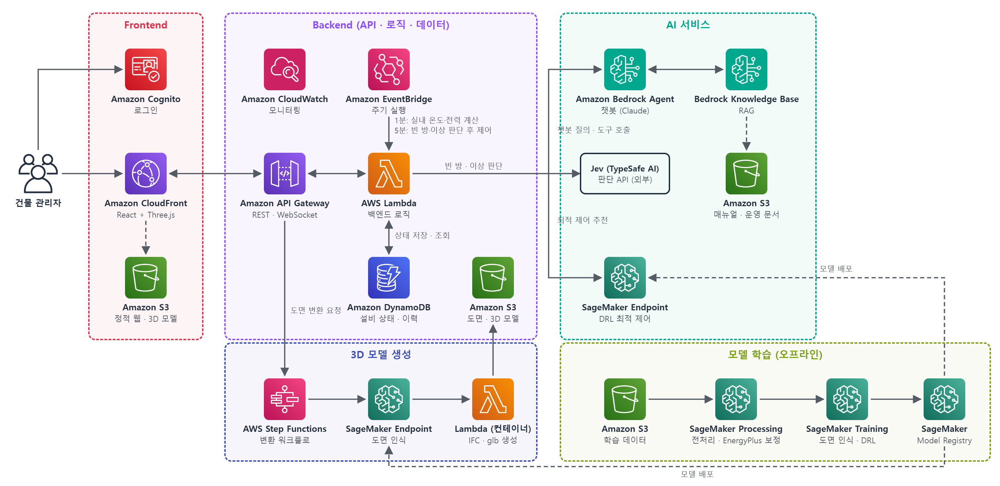

# 외부 판단 API JEV 운영 사용

> **요약** (기준일 2026-11-20)
>
> - 채택: 완성안대로 "AWS 서비스만 사용" 원칙에 외부 판단 API 1개(TypeSafe JEV) 예외를 둠. 용도는 5분 주기 빈 방·이상 판단 후 제어
> - 이유: 사용자 결정(2026-11-20, 완성안 구조도 공유 후 예외 확정 선택). EnergyPlus 14일 비교에서 JEV 기반이 규칙 기반 대비 냉방 전력량 26.9%, 난방 79.4% 감소
> - 조건: API 장애 시 규칙 기반 제어로 대체, 외부 전송 데이터는 공간 상태(시뮬레이터 값)만. 공실 OFF 규칙과의 비교는 남은 검증 과제
>
> | 항목 | 이전([AWS 아키텍처와 기술 스택](2026-11-20%28AWS%20%EC%95%84%ED%82%A4%ED%85%8D%EC%B2%98%EC%99%80%20%EA%B8%B0%EC%88%A0%20%EC%8A%A4%ED%83%9D%29.md)) | 변경 |
> |---|---|---|
> | 외부 서비스 | 없음(AWS 서비스만) | TypeSafe JEV 판단 API 1개 |
> | JEV 사용 범위 | 개발용 평가 스크립트 | 개발용 평가 + 운영 빈 방·이상 판단 |
> | 장애 대응 | 해당 없음 | 규칙 기반 제어로 대체 |
>
> **다음 작업**: 공실 OFF 규칙 비교, 운영 호출 단위와 월 비용 산정, API 키 보관 방식 결정(모두 미정)

주: 2026-11-20 [공실 OFF 규칙과 JEV 비교](2026-11-20%28%EA%B3%B5%EC%8B%A4%20OFF%20%EA%B7%9C%EC%B9%99%EA%B3%BC%20JEV%20%EB%B9%84%EA%B5%90%29.md)에서 공실 OFF 규칙(30분 전 재가동)이 JEV 대비 전력량 냉방 25.9%, 난방 32.0% 낮았습니다. 7절 재검토 조건에 해당하며, 결정 유지 여부는 사용자 확인 대기입니다.

## 1. 배경: 완성안의 외부 판단 API

**1-1. 2026-11-20 팀 완성안은 EventBridge 5분 주기로 Lambda가 JEV에 빈 방·이상 판단을 요청한 뒤 제어하는 구조입니다.**

이전 기록은 사용자 지시에 따라 AWS 서비스만 사용하기로 정했습니다. 완성안의 JEV(TypeSafe AI)는 AWS 밖의 외부 API라 이 원칙과 충돌했습니다. [HVAC 제어 방식 비교](2026-11-20%28HVAC%20%EC%A0%9C%EC%96%B4%20%EB%B0%A9%EC%8B%9D%20%EB%B9%84%EA%B5%90%29.md) 기록은 이 예외 여부를 미정으로 남겼고, 사용자가 완성안대로 확정했습니다.

## 2. 평가 대상: 제어 비교와 답변 판단 평가

**2-1. JEV 운영 사용의 근거는 다음 2가지 측정입니다.**

| 측정 | 대상 | 기록 |
|---|---|---|
| HVAC 제어 비교 | EnergyPlus 26.2.0, 부산 기상, VRF 5구역, 냉방·난방 각 14일 | [HVAC 제어 방식 비교](2026-11-20%28HVAC%20%EC%A0%9C%EC%96%B4%20%EB%B0%A9%EC%8B%9D%20%EB%B9%84%EA%B5%90%29.md) |
| AI 답변 판단 | 실제 Bedrock 답변 35문항, 수치 일치·되묻기·이해 쉬움 | [AI 운영 도우미 도구 선택 평가](../research/ai-tool-eval.md) |

## 3. 측정 방법: 기존 기록의 조건 그대로

**3-1. 두 측정의 조건과 반복 횟수는 각 기록에 있으며, 이 기록은 결과만 인용합니다.**

JEV 비용은 입력 토큰 × 100만 토큰당 0.042달러, 출력 무료입니다([TypeSafe 모델 목록](https://docs.typesafe.ai/models)).

## 4. 후보: 판단 방식 4가지

**4-1. 빈 방 판단 방식 후보는 4가지이며, 공실 OFF 규칙과 Bedrock 판단은 측정하지 않았습니다.**

| 후보 | 외부 API | 측정 | 판단 |
|---|---|---|---|
| 규칙 기반(명세, OFF 없음) | 없음 | 냉방 982.3kWh, 난방 1,000.8kWh(14일) | 장애 시 대체 제어로 유지 |
| JEV 기반 | TypeSafe | 냉방 718.1kWh(-26.9%), 난방 206.5kWh(-79.4%) | 채택 |
| 규칙 기반 + 공실 OFF | 없음 | 미측정 | 남은 검증 과제 |
| Bedrock 모델 판단(AWS 안) | 없음 | 미측정 | 완성안에 없음. 공개 비교(다른 과제)에서 LLM 판단 지연 2.9~4.3초, JEV 0.6~1.2초([JEV 조사](../research/judge-model-jev.md) 1절) |

## 5. 결과: 전력량 감소, 냉방 최대 전력 증가

**5-1. JEV 기반은 야간·주말 OFF로 전력량이 감소했지만, 냉방 최대 전력은 22.4% 높았습니다.**

- 냉방 재실 중 쾌적 범위 이탈은 두 방식 모두 0시간이었습니다.
- 평가 기간 JEV 호출 2,688회 중 오류는 0회였고, 요청 1회 입력은 약 5,100토큰(5구역)이었습니다.
- 냉방 평일 업무시간 전력량은 JEV가 6.4% 많았습니다. 원인 분석은 HVAC 비교 기록 5절에 있습니다.

## 6. 결정: AWS 서비스 + JEV 1개 예외

**6-1. 외부 API는 JEV 1개로 한정하고, 빈 방·이상 판단과 AI 답변 평가에만 사용합니다.**

| 조건 | 내용 |
|---|---|
| 용도 | 5분 주기 빈 방·이상 판단 후 제어(완성안), 개발용 AI 답변 평가 |
| 장애 대응 | 재시도 후 실패하면 그 주기는 규칙 기반 제어로 대체(HVAC 비교 하네스와 같은 구조) |
| 전송 데이터 | 공간 상태(재실, 온도, 운전, 일정). 시연 데이터는 시뮬레이터 값이며 개인정보 없음 |
| 그 외 서비스 | AWS 서비스만 사용 원칙 유지 |

## 7. 운영 시 주의: 비용, 키, 실제 데이터

**7-1. 운영 호출 단위와 비용, 키 보관 방식, 실제 건물 데이터 전송 조건은 정하지 않았습니다.**

- 5분 주기는 건물 1곳 기준 하루 288회입니다. 요청 1회가 5구역 측정값(약 5,100토큰)과 같다면 하루 약 0.06달러(추정)입니다. 호실 533곳을 한 요청에 넣을지 층별로 나눌지에 따라 달라지므로 구현 시 측정하십시오.
- API 키는 코드와 저장소에 넣지 마십시오. Lambda에서 사용할 보관 방식(예: AWS Secrets Manager)은 구현 시 정하십시오.
- 실제 건물 데이터를 보내기 전에 TypeSafe 이용 약관([MCA](https://typesafe.ai/legal/mca))과 데이터 처리 조건을 확인하십시오.
- 공실 OFF 규칙이 JEV와 비슷한 절감을 보이면 외부 API 없이 운영할 수 있으므로 이 기록을 다시 검토하십시오.

## 관련 자료

- [HVAC 제어 방식 비교](2026-11-20%28HVAC%20%EC%A0%9C%EC%96%B4%20%EB%B0%A9%EC%8B%9D%20%EB%B9%84%EA%B5%90%29.md), [판단 특화 모델 JEV 조사](../research/judge-model-jev.md)
- [시스템 설계](../architecture.md) 12절(완성안 구성 요소와 현재 상태)
