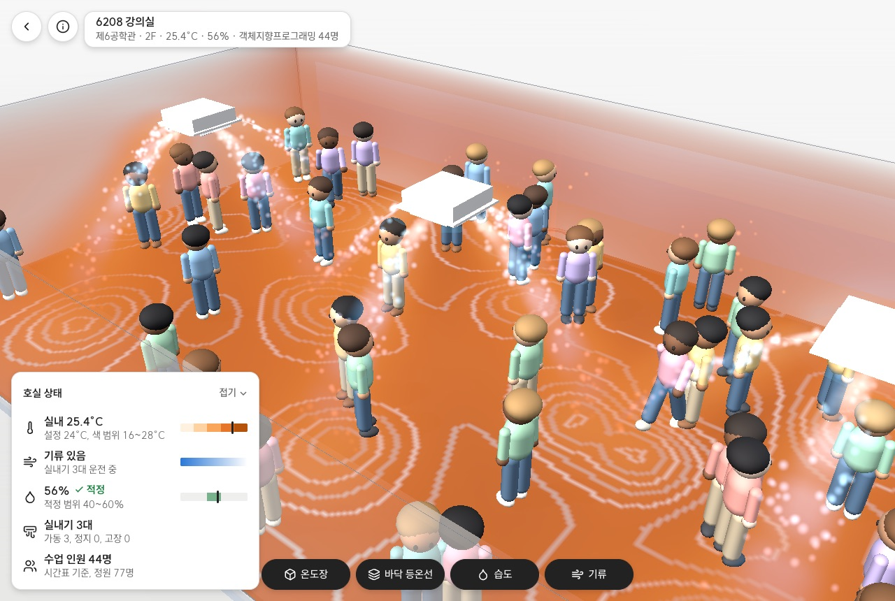

# 재실자 클레이 인형 표시

> **요약** (기준일 2026-11-21)
>
> - 3D 트윈의 걷는 재실자가 캡슐 몸통, 공 머리, 다리 2개라 사람으로 보기 어려웠음. 사용자가 사람 캐릭터와 클레이 느낌을 요청함
> - 큰 둥근 머리, 머리카락, 눈, 짧은 몸통, 팔, 손, 다리, 신발로 된 무광 클레이 인형으로 바꿨음. 걸을 때 팔과 다리가 엇갈려 움직임
>
> | 항목 | 이전 | 변경 |
> |---|---|---|
> | 부위 | 몸통, 머리, 다리 2개 | 머리, 머리카락, 눈 2개, 몸통, 팔·손 2개, 다리·신발 2개 |
> | 부위별 인스턴스 묶음 | 3개 | 8개 |
> | 사람당 인스턴스 | 4개 | 13개 |
> | 재질 거칠기 | 0.68 | 0.9(무광) |
> | 색 | 상의 5종 | 상의 7종, 하의 5종, 피부 5종, 머리카락 5종, 신발 4종 |
> | 걷기 동작 | 다리 흔들기, 몸 상하 | 다리 ±0.36rad, 반대쪽 팔 ±0.45rad, 몸 높이 하강, 좌우 기울기 |
>
> **다음 작업**: 운영 사이트 실제 기기에서 층 3D 120명 표시 프레임 속도 확인

## 1. 배경: 사람으로 보기 어려운 재실자 모양

**1-1. 층 3D와 방 3D는 재실 인원만큼 걷는 사람을 표시하지만, 이전 모양은 캡슐과 공 조합이라 확대해도 사람 형태가 약했습니다.**

사용자가 2026-11-21 "걸어다니는 사람을 조금 더 사람 캐릭터처럼, 클레이 느낌으로" 요청했습니다.

## 2. 변경: 부위별 클레이 인형

**2-1. 부위마다 `InstancedMesh`를 1개씩 두고, 한 번의 갱신 루프에서 모든 사람의 관절 위치를 계산합니다.**

| 항목 | 값 |
|---|---|
| 크기 | 키 약 1.62m, 머리 지름 0.38m(몸 대비 큰 머리), 팔 바깥까지 반폭 약 0.28m |
| 재질 | 거칠기 0.9, 금속성 0 |
| 색 결정 | 인스턴스 번호 해시, 같은 순번은 항상 같은 색 |
| 정지 동작 | 모든 관절 0 |
| 화면당 최대 인원 | 120명(변경 없음) |

주: 걷기 경로는 벽에서 0.23m 이상 떨어진 점만 사용하므로, 벽과 나란히 걸을 때 팔 끝이 벽 선에 최대 약 5cm 겹칠 수 있습니다.

## 3. 검증: 방 3D와 층 3D 화면

**3-1. 표본 실시간 데이터(13:40, 6208 강의실 수업 44명)로 방 3D를 열어 밝은 화면과 어두운 화면을 확인했고, 페이지 오류는 0건이었습니다.**

층 3D(2F)도 같은 인형을 표시했습니다. 헤드리스 소프트웨어 렌더링이라 프레임 속도는 측정하지 않았습니다.

## 관련 자료

- 코드: `frontend/twin/digital-twin.html`(`peopleMesh`), `frontend/twin/README.md`(재실자 3D 표시)
- PR: Frontend #102(dev), #103(main, 2026-11-21 웹 배포)
