# 건물 운영자 문제 전수조사

> **요약** (기준일 2026-11-20)
>
> - 운영자는 공간·설비 상태를 BMS보다 재실자 민원으로 파악합니다. 독일 운영자 인터뷰에서 재실자 피드백 언급은 BMS 데이터 언급의 2배였고, 온도는 FM 설문 3건에서 모두 불만 1위입니다.
> - 상태 파악이 어려운 원인은 데이터 분산, 쓰기 어려운 BEMS와 과다 경보, 낭비 위치 미파악, 인력·숙련 부족 4가지입니다. 국내 학교 43곳 중 BEMS 기능을 잘 활용한다는 응답은 32%입니다.
> - 운영자가 요구한 기능은 통합 화면, 고장 조회와 일괄 on/off, 재실 확인, 민원 위치 기록입니다. 3D 화면과 자연어 질의를 직접 요구한 조사는 없으며, 모니터링 용도는 2D가 3D보다 빠르다는 평가가 있습니다.
>
> | 항목 | 값 | 비교 기준 |
> |---|---|---|
> | 수록 자료 | 99건 | 검토 155건, 제외 56건 |
> | 온도가 최대 민원이라는 FM 응답 | 68% | 화장실 10%, 주차 5% |
> | 온도 민원 1건 대응 시간 | 더움 1.6시간, 추움 2.1시간 | 인건비 35달러/시간 기준 비용 환산 |
> | BEMS 기능을 잘 활용하는 학교 | 32% | BEMS 인지 81% |
> | 건물 시스템을 완전히 통합한 조직 | 10% | 3,445명, 25개국(판매 기업 조사) |
> | 예약 시간 중 빈 회의실 | 31.2% | 실제 사용 68.8% |
>
> **다음 작업**: 서비스 기획 2절 문제 근거 갱신 여부 결정, 2D 평면 보기 검토, 검증 지표 측정 방법 확정(미정)

[서비스 기획](../service-plan.md)의 문제 정의 "건물 운영자는 공간 현황과 설비 상태를 직관적으로 파악하기 어렵다"의 상세 근거입니다. 정비 기술자의 문제는 [공조 설비 정비 문제 배경](maintenance-background-market.md), 기술 동향은 [디지털트윈 조사](digital-twin-survey.md)에 있습니다.

자료 번호(A1, B1 등)의 출처와 확인 수준은 [국내·업계 자료 목록](building-operator-problems-sources.md)과 [논문 자료 목록](building-operator-problems-papers.md)에 있습니다. 같은 내용의 PDF는 [2026-11-20 보고서](../../../reports/2026-11-20-operator-problems/report.pdf)입니다.

## 1. 조사 방법: 4개 갈래, 자료 155건 검토, 99건 수록

**1-1. 2026-11-20에 에이전트 4개가 갈래별로 조사했고, 주 작업자가 핵심 문장 35건을 원문과 대조했습니다.**

에이전트 4개의 도구 호출은 합계 486회입니다. 주 작업자는 수치 문장을 PDF 텍스트에서 다시 검색했고, 25건은 원문 강조 캡처로 첨부했습니다.

| 갈래 | 대상 | 수록 | 원문 확인 | 판매 기업 |
|---|---|---|---|---|
| A 국내 | 실태조사, 논문, 기관 보고서, 기사 | 27건 | 17건 | 3건 |
| B 해외 업계 | IFMA, BOMA, JLL, 판매 기업 설문 | 27건 | 21건 | 19건 |
| C 정성 연구 | 운영자 인터뷰, 현장 관찰, 사용성 평가 | 19건 | 13건 | 0건 |
| D 정량 연구 | 민원 분석, 실측, 통제 실험 | 26건 | 18건 | 0건 |

주: D는 B와 중복된 2건(NIST 2004, IFMA 2009)을 B로 병합한 수. 원문 확인 외 자료는 초록 13건, 2차 보도 15건, 검색 발췌 2건.

## 2. 문제 지도: 9개 유형, 상태 파악 실패는 4개 원인의 결과

**2-1. 수록 자료를 문제 유형 9개로 분류하면 인력 부족이 48건으로 가장 많고, 경보 과부하가 8건으로 가장 적습니다.**

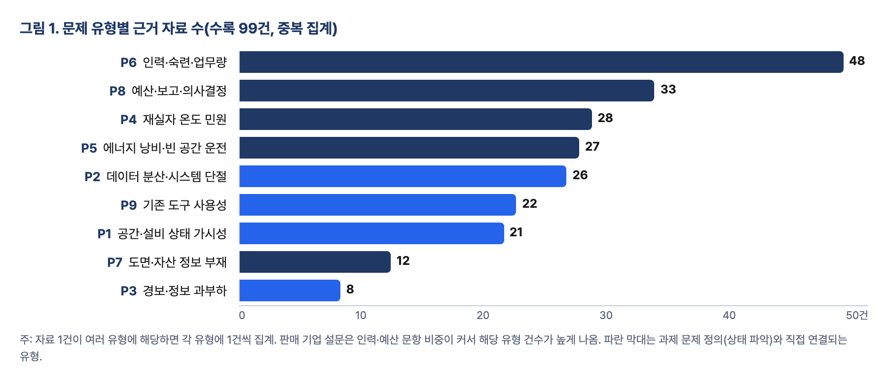

**2-2. 과제 문제 정의인 상태 파악 어려움은 단독 문제가 아니며, 운영자는 현재 민원 접수에서 현장 확인까지 수작업 경로로 상태를 파악합니다.**

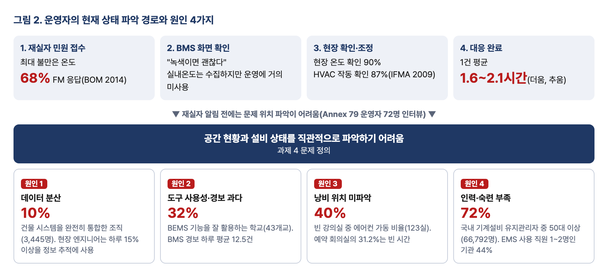

## 3. 상태 파악 경로: 운영자는 BMS보다 재실자 민원으로 문제 인지

**3-1. 운영자 인터뷰 연구에서 운영자는 문제 위치를 주로 재실자 알림으로 파악했습니다.**

IEA EBC Annex 79의 7개국 운영자 72명 인터뷰에서 일부 운영자는 재실자가 알리기 전까지 문제 위치를 알기 어렵다고 답했습니다(C3). 독일 운영자 10명 인터뷰에서는 재실자 피드백 언급이 BMS 데이터 언급의 2배였습니다(C2). 실내온도는 대부분 수집하지만 운영에 거의 사용하지 않았고, 현재 센서값으로 운영하는 곳은 10곳 중 1곳이었습니다.

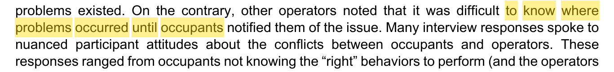

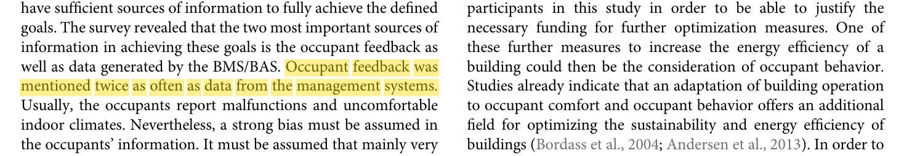

캘리포니아 운영자는 BMS 화면이 정상 표시이면 민원을 종결한다고 답했습니다(C6). 매사추세츠 26개 기관 조사에서 60%가 "최적 운영"이라고 답했지만, 화면을 제출한 5곳 모두에서 센서 보정 오류와 설정값 미달이 발견됐습니다(C8).

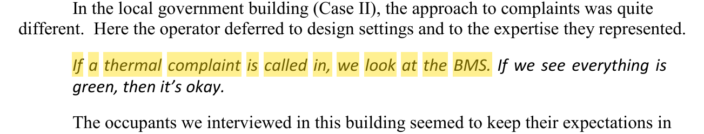

**3-2. 온도 민원은 운영자 업무에서 가장 큰 비중을 차지합니다.**

| 조사 | 표본 | 결과 |
|---|---|---|
| BOM 2014(B3) | FM 응답 134~318명 | 최대 민원 온도 68%, 화장실 10% |
| IFMA 2009(B2) | IFMA 회원 473명 | 추움 민원 94%, 더움 민원 91% |
| Building Engines·BOMA 2024(B14) | 236명 | 임차인 요청 1위 쾌적성 66%, 최대 시간 소모 업무 임차인 이슈 46% |
| JLL Technologies 2023(B11) | 북미 FM | 반응형 작업지시 1위 HVAC 72.4% |
| Federspiel 1998(D1) | 690동, 재실자 23,500명 | 열감 민원이 전체 민원 유형 중 1위 |
| CBE 2021(D6) | 897동, 응답 93,662건 | 온도 불만족 39%, 16개 항목 중 2위 |
| 위성곤 의원실 2025(A16) | 국내 공무원 12,027명 | 냉방 규정 부적절 84.6%, 개인 냉방기 사용 73.0% |

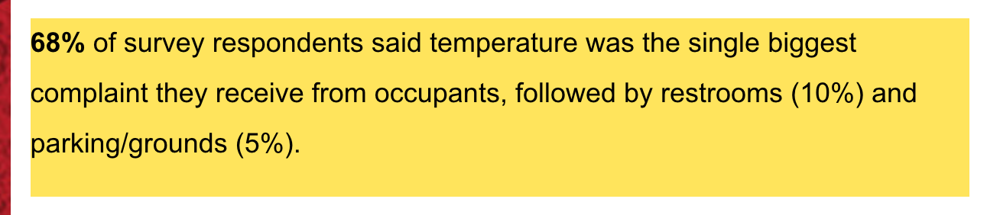

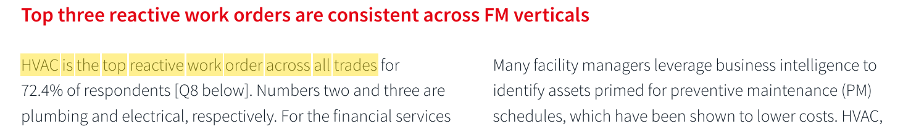

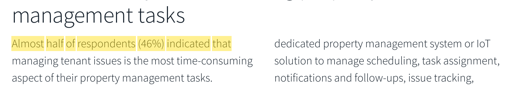

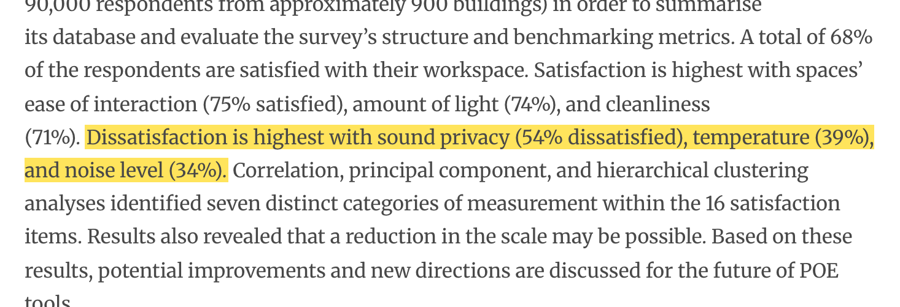

민원 1건의 평균 대응 시간은 더움 1.6시간, 추움 2.1시간입니다(D2). Federspiel은 열감 민원 빈도를 줄이면 HVAC 유지보수 인건비를 20% 줄일 수 있다고 추정했습니다(D1, 초록).

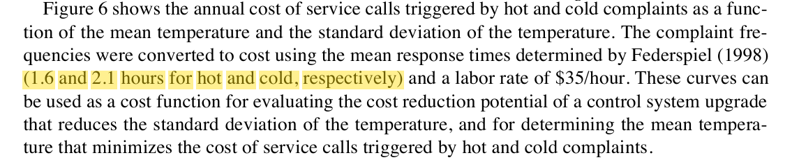

**3-3. 민원 대응 방식은 보수적 운전과 수동 오버라이드로 이어집니다.**

민원에 민감한 조직은 재실 시간보다 일찍 켜고 늦게 끄는 HVAC 스케줄을 사용합니다(C7). 운영자는 소수의 민원에도 설정을 바꾸고(C6), BAS를 수동 또는 오버라이드 상태로 유지합니다(C9).

## 4. 데이터 분산: 시스템 완전 통합 10%, 정보 추적에 하루 15%

**4-1. 운영자는 BAS, 계량기, 작업지시, 도면, 스프레드시트를 오가며 상태를 확인합니다.**

| 조사 | 결과 |
|---|---|
| JCI·Forrester 2023(B13, 판매 기업) | 건물 시스템을 완전히 통합한 조직 10%, 3,445명 |
| IFMA·Autodesk 2023(B12) | 60% 이상이 데이터 품질·통합 문제로 자원 시간 10~20% 낭비 추정 |
| VTS 2025(B21, 2차 보도) | 부동산 관리자 하루 평균 운영 시스템 5개, 보고 도구 3개 사용 |
| MRI 2025(B22, 판매 기업) | 여러 시스템 병행 46%, 기술에 매우 만족 13% |
| Lehrer 2010(C10) | 에너지 정보 접근자의 76%가 월 1회 이하 열람, 시스템 수와 통합 부재가 주요 문제 |

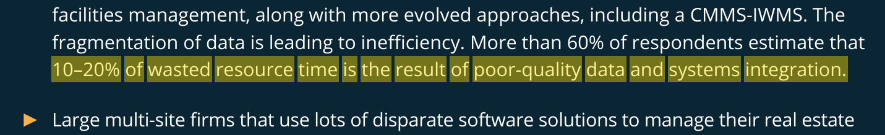

**4-2. 정보 탐색 시간은 현장 엔지니어 근무 시간의 15% 이상입니다.**

NIST 2004 보고서는 상호운용성 부족 비용 연 158억 달러 중 57%가 운영·유지 단계에서 발생한다고 추정했습니다(B1). 같은 보고서에서 현장 엔지니어는 하루의 15% 이상을 정보 추적에 사용했습니다. 유지보수 58건 섀도잉에서는 정보 지원으로 작업 시간을 12% 이상 개선할 여지가 확인됐습니다(D18, 초록).

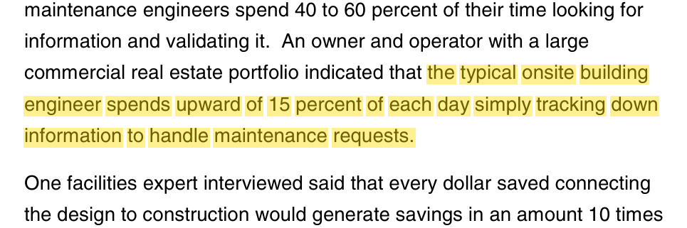

**4-3. 국내 운영 현장도 데이터를 쌓기만 하고 확인하지 않습니다.**

서울에너지드림센터장은 대부분의 건축물이 데이터를 쌓기만 하고 확인하지 않는다고 말했습니다(A4). 판매 기업 대표 기고는 주요 기계설비 상태를 고장 전까지 파악하기 어렵다고 기술했습니다(A5).

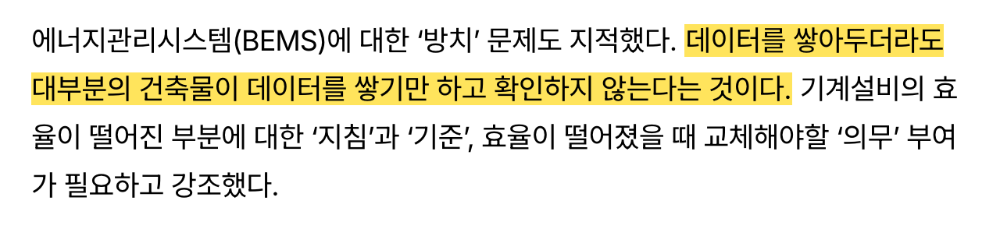

## 5. 기존 도구: BEMS 활용 32%, BMS 경보 하루 12.5건

**5-1. 국내 학교 BEMS는 설치 후에도 대부분 사용하지 않습니다.**

학교 43곳 설문에서 BEMS 인지는 81%였지만, 기능을 잘 활용한다는 응답은 32%였습니다(A1). 현장조사 5곳 중 4곳은 BEMS를 에너지 관리에 사용하지 않았습니다. 응답자는 대시보드 복잡성, 업체 사후지원 부재, 전문인력 부재(71%), 담당자 교체 시 인수인계 어려움을 문제로 기록했습니다.

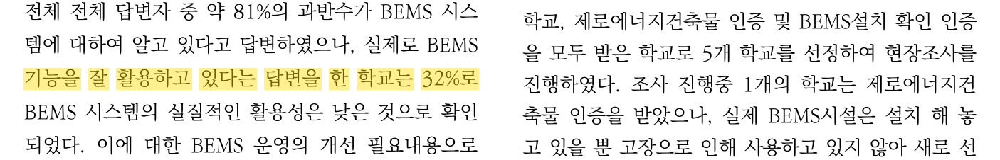

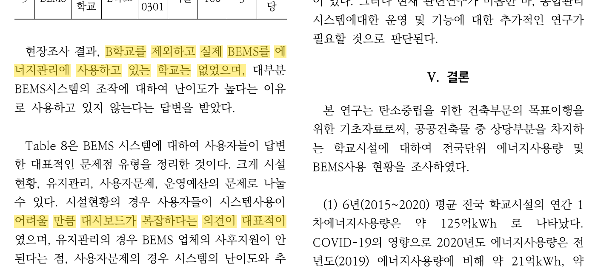

판매 기업 임원은 BEMS가 구축 후 1~2년 사이 무용지물이 되는 경우가 대부분이라고 말했습니다(A3). 운영자 교육은 시공사 교육 1~2회가 전부입니다(A5).

**5-2. 경보는 너무 많고, 운영자는 경보보다 경험으로 판단합니다.**

영국 FM 100명 조사에서 BMS 경보는 하루 평균 12.5건이었고, BMS가 HVAC 문제 식별에 매우 도움이 된다는 응답은 24%였습니다(B8, 판매 기업). 미국 운영자 인터뷰에서는 한 시스템에 경보가 10만 건 이상 누적된 사례가 있었습니다(C1). CMU 캠퍼스 BAS 1종은 2010~2016년에 경보 61만 건 이상을 발생시켰고, 운영자는 경보와 고장을 평면도에 표시하기를 원했습니다(D24).

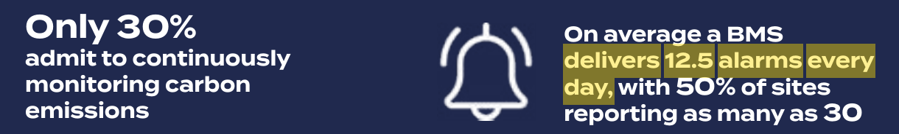

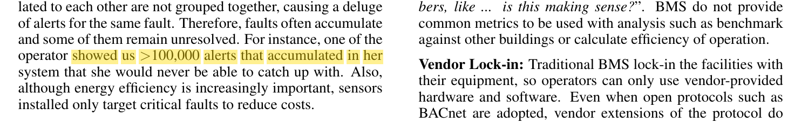

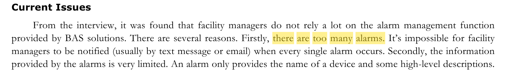

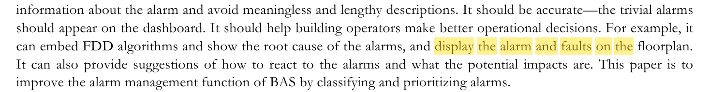

**5-3. 분석 결과가 제공돼도 운영 조치로 이어지지 않습니다.**

FDD 결과를 본 운영자 11명 중 제어 변경 의향을 밝힌 사람은 2명이었습니다(C5, 초록). 학교구 FM 10명은 기존 도구의 높은 비용, 나쁜 사용자 경험, 정보를 조치로 바꾸기 어려운 점을 지적했습니다(C11).

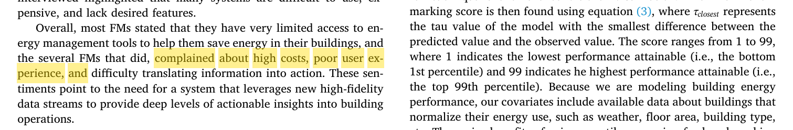

## 6. 빈 공간 운전: 운영자는 낭비가 있다는 것은 알지만 위치는 모름

**6-1. 운영자는 비효율 운전 건물이 있다고 인정하지만 어느 건물이 얼마나 비효율적인지 알지 못합니다.**

미국 5개 기관(건물 870동 이상) 운영자 10명 인터뷰 결과입니다(C1). 학교구 FM은 특정 설비와 운영 스케줄의 낭비를 놓쳤습니다(C11). 독일 사례 10곳은 고정 스케줄과 설정값으로 운영했고, 재실 기반 제어를 구현한 곳은 없었습니다(C2).

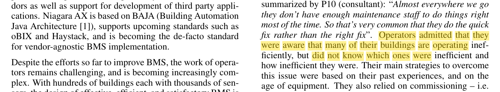

**6-2. 실측 결과 빈 공간 운전은 상시 발생합니다.**

| 측정 | 결과 | 비교 기준 |
|---|---|---|
| 국내 대학 강의실 292개(A21) | 빈 강의실 123개 중 40% 에어컨 가동 | 설정온도 평균 22.75℃, 권장 26℃ |
| 스웨덴 회의실 7개(D13) | 예약 시간의 31.2% 빈 방 | 실제 사용 68.8% |
| 미국 사무실 17동(D8) | 비점유 부하가 점유 부하의 평균 47.4% | 분석가 가정 10~20% |
| Butlr 2026(B25, 판매 기업) | 미사용 사무 공간의 24% 냉난방 지속 | 공간 계획에 데이터 사용 19% |

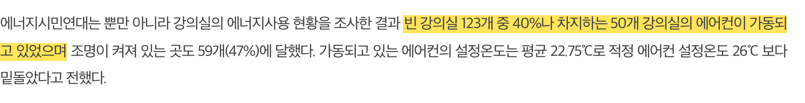

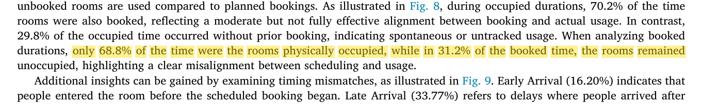

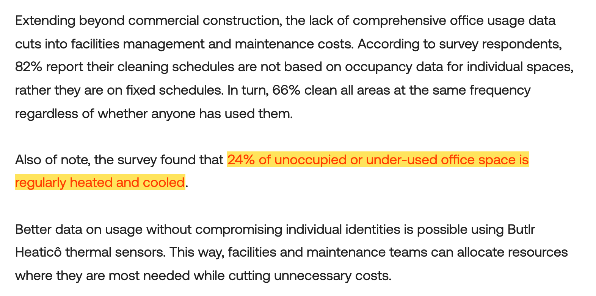

**6-3. 국내 공공청사는 반대로 일괄 정지 운전으로 더위 민원이 발생합니다.**

공공기관 냉방 기준은 28℃ 이상이며, 냉방은 오후 5시 30분 또는 6시에 일괄 정지합니다(A15). 주말 정지 후 월요일 오전 사무실 온도 민원도 보도됐습니다. 운영자는 낭비와 민원 사이에서 실별 판단 근거 없이 건물 단위로 운전합니다.

**6-4. 재실 정보로 운전을 바꾸면 현장 실증에서 HVAC 에너지가 17.8~55.47% 감소했습니다.**

WiFi 재실 추정 기반 제어는 1일 실험에서 17.8%를 절감했습니다(D14). 13개월 현장 실증은 평일 43.48%, 주말·휴일 55.47%를 절감했습니다(D16, 초록). 커미셔닝 643동의 중앙값 절감은 16%입니다(D10).

## 7. 인력·숙련: 국내 유지관리자 72%가 50대 이상

**7-1. 국내 운영 인력은 고령화됐고 인원이 줄었습니다.**

| 자료 | 결과 | 비교 기준 |
|---|---|---|
| 기계설비 경력수첩(A7, 2024-03) | 50대 이상 48,087명, 72% | 20~30대 약 6,500명 |
| 관리사무소장 설문(A9) | 인력 부족 56% | 업무 부담 1위 노후 시설 수선 89% |
| 충남교육청 시설관리직(A13) | 2013년 665명 | 1999년 1,785명 |
| 학교 BEMS 설문(A1) | 전문인력 없음 71% | 설비 담당자가 겸임 11% |

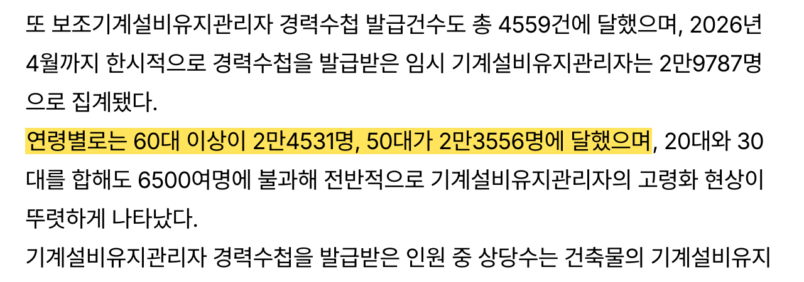

**7-2. 해외 조사도 인력 부족과 숙련 인력 의존을 공통으로 보고합니다.**

FM 팀 인력 부족 응답은 48.1%(B11), 인력 부족이 운영에 영향을 준다는 응답은 72%(B23)이고, FM의 약 40%가 10년 내 은퇴를 예상합니다(B26). 매사추세츠 조사에서 EMS 사용 직원이 1~2명인 기관은 44%였습니다(C8). 한 대학 담당자는 숙련 운영자 1명의 이탈이 대학에 치명적이라고 말했습니다.

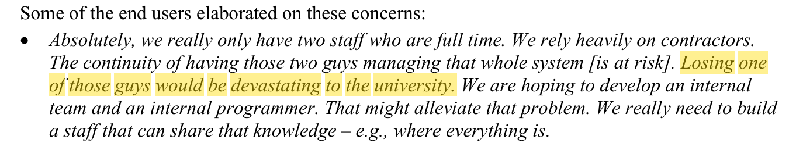

## 8. 도면·자산 정보: 설비 관계는 건축 도면에만 존재

**8-1. 설비 간 관계와 평면 그래픽은 도면과 수작업에 의존합니다.**

미국 운영자 인터뷰에서 설비 간 관계는 건축 도면에만 있었고, 평면도 그래픽은 수작업으로 그렸습니다(C1). IFMA·Autodesk 조사에서 자산 명명 표준이 없는 조직은 46%, BIM 형식이 운영에 맞지 않는다는 응답은 30%였습니다(B12). 국내는 발주도면이 준공도면으로 남아 실측과 다른 사례가 보고됐습니다(A26). 도면 부정확에 관한 국내 운영자 설문은 찾지 못했습니다.

## 9. 운영자 요구: 통합 화면, 상태 조회·일괄 제어, 재실 정보, 민원 기록

**9-1. 가장 많이 언급된 요구는 통합 단일 화면이고, 국내 학교 운영자는 고장 조회와 일괄 on/off를 가장 필요한 기능으로 선택했습니다.**

| 요구 | 근거 수 | 대표 수치 |
|---|---|---|
| 통합 단일 화면 | 14건 | 단일 플랫폼 희망 52%(B7), 파트너 역량 1위 단일 플랫폼 74%(B13) |
| 고장·상태 조회, 일괄·원격 제어 | 6건 | 고장 조회 95%, 일괄 on/off 93%(A1), 원격 관리 중요 94%와 보유 25%(B7) |
| 실별 재실·공간 이용 정보 | 8건 | 교실 재실 확인 88%(A1) |
| 민원의 위치·시간 기록 | 6건 | 재실자와 체계적 소통 수단 희망 90%(C10) |
| 빠르고 쉬운 시각화 | 7건 | 데이터 시각화가 큰 영향을 줄 기술이라는 응답 56%(B6) |
| 예지 정비·FDD | 8건 | 업계 설문 8건(B4, B7, B11, B15~B17, B20, B23) |
| 경보 우선순위, 평면도 위 표시 | 4건 | C1, C9, C13, D24 |
| 조작 시 에너지·비용 영향 표시 | 3건 | C1, C6, C11 |
| 인수인계·학습 지원 | 6건 | A2, A4, A5, C1, C6, C8 |

주: 근거 수는 수록 자료 중 해당 요구를 언급한 자료 수.

**9-2. 3D 화면이나 자연어 질의를 운영자가 직접 요구한 설문과 인터뷰는 찾지 못했습니다.**

가장 가까운 근거는 시각화 요구(B4), 단일 플랫폼 요구(B7), 평면도 위 경보 표시 요구(D24)입니다.

## 10. 도구 효과: 3D·AR은 설비 위치 찾기를 단축, 모니터링 효과는 미확인

**10-1. AR·BIM 도구는 설비 위치 찾기 과업에서 2D 도면·종이 대비 시간을 51~65% 단축했습니다.**

| 실험 | 조건 | 결과 |
|---|---|---|
| Lee·Akin 2011(D19) | AR, BAS 연동 | 위치 찾기 시간 51% 절감, BAS 데이터 확인 8% 절감(초록) |
| Gheisari 외 2014(D20) | 8명, AR과 종이 작업지시서 | 128초와 336초, 위치 오류 1.00건과 19.38건 |
| Chen 외 2019(D21) | 48명, AR과 2D 도면 | 점검 31.1초와 89.8초(65.4% 단축) |
| Lin 외 2014(D22) | 25명, 모바일 BIM과 종이 | 시설 정보 찾기 7~13초와 12~23초 |

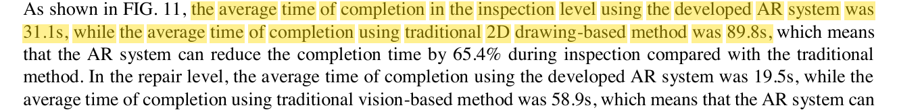

주: 참가자는 주로 학생이며 과업은 유지보수 위치 찾기임.

**10-2. 모니터링 과업에서 3D가 2D보다 낫다는 근거는 없습니다.**

시설 운영 GUI 6종 평가에서 모니터링 용도는 2D 배치가 3D보다 명확하고 빨랐습니다(C14, 초록). 소방관 64명 실험에서 2D와 3D 도면의 NASA-TLX 작업 부하는 차이가 없었습니다(D23, p=0.924).

**10-3. 자연어·LLM 질의는 운영자 대상 비교 실험이 없습니다.**

디지털트윈·AI 비서 시제품의 SUS는 82와 79.6이었지만 비교 조건이 없었습니다(D26). 건물 데이터 자연어 질의 벤치마크의 정확 일치율은 56~65%입니다(D27). HVAC 운영 LLM 논문 66편 중 즉시 도입 가능한 연구는 0편이었습니다(D28).

## 11. 서비스 시사점: 민원 확인, 빈 공간 탐지, 통합 화면을 검증 지표로 사용

**11-1. 서비스 기능 4개는 조사된 문제와 요구에 대응하며, 경보와 인력 문제는 현재 범위 밖입니다.**

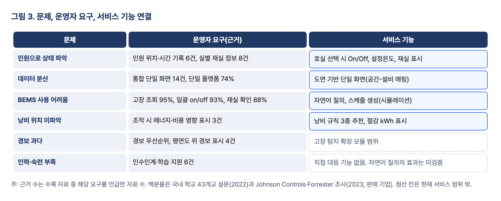

**11-2. 검증 지표는 3D 화면의 시각 효과보다 운영 과업의 시간과 탐지량으로 정하는 것이 근거에 맞습니다.**

| 지표 | 비교 기준 | 근거 |
|---|---|---|
| 민원 호실의 상태 확인 시간 | 2D 도면과 BMS 화면 조합 | D2, C3 |
| 빈 공간 운전 탐지 수와 낭비 kWh | 운영자 수동 탐색 | C1, A21, D13 |
| 상태 확인에 필요한 화면 수 | 현재 사용 시스템 수 | B13, B21 |
| 신규 운영자의 과업 완료 시간 | 숙련 운영자 | A1, C8 |

**11-3. 3D 단독 화면의 근거가 약하므로 같은 데이터를 2D 평면으로 보는 화면 전환을 검토할 필요가 있습니다.**

근거는 C14와 D23입니다. 판단은 다음 작업의 요구사항 검토에서 정하십시오.

## 12. 제한 사항: 판매 기업 자료 22건, 운영자 대상 3D·LLM 실험 없음

**12-1. 수치 일부는 판매 기업 조사와 2차 보도이며, 일부 공백은 확인하지 못했습니다.**

- 판매 기업 자료는 22건이고, 같은 자료 안에서 수치가 다른 경우가 있음(B8 80%와 87%, B15 52%와 53%, A9 56%와 56.7%).
- 국내 감사원·국정감사의 BEMS 미운영 지적, 국민신문고·교육청 냉난방 민원 건수, 오피스 시설팀의 직접 발언은 찾지 못함.
- 운영자 대상 3D 트윈과 2D 평면의 모니터링 과업 비교 실험, 자연어 질의의 비교 실험은 찾지 못함.
- DBpia, RISS, Verdantix, IWFM, IFMA 벤치마크 등 유료·회원 자료는 열람하지 않음.
- C14 원문 캡처는 출판사 접근 차단으로 생성하지 못함.

## 다음 작업

| 작업 | 기한 | 담당 |
|---|---|---|
| 서비스 기획 2절 문제 근거 표 갱신 여부 결정 | 미정 | 미정 |
| 2D 평면 보기 전환 요구사항 검토 | 미정 | 미정 |
| 검증 지표 4개 측정 방법 확정 | 미정 | 미정 |
| BECON 팀에 운영자 민원 처리 방식 확인 | 미정 | 미정 |

## 관련 자료

- [국내·업계 자료 목록](building-operator-problems-sources.md)
- [논문 자료 목록](building-operator-problems-papers.md)
- [서비스 기획](../service-plan.md)
- [공조 설비 정비 문제 배경과 시장 조사](maintenance-background-market.md)
- [재실 밀도·사물과 실내온도 근거 조사](occupancy-thermal-evidence.md)
