# AI 디지털트윈 공간 가시화·운영 최적화 조사

> **요약** (기준일 2026-11-18)
>
> - 현장 문제는 정적 3D 모델, 비표준 설비 데이터, 실행으로 연결되지 않는 가시화 3가지가 공통. 국토부 3D 지도 오차는 도심 1m, 비도심 5m
> - 2025~2026 논문은 LLM을 트윈의 질의·시나리오·규칙 생성 계층으로 사용. 경쟁 제품은 측정·대시보드 영역과 3D 트윈 영역으로 구분
> - 권장 주제는 후보 B "재실 기반 공간 운영 에이전트". 5개 기준 평가에서 25점 만점 중 21점으로 1위, 확정은 공고 확인 후 결정
>
> | 항목 | 값 | 비교 기준 |
> |---|---|---|
> | 세계 디지털트윈 시장 | 211억~362억 달러(2025) | 2030년 1,316억~1,803억 달러 |
> | 오피스 평균 활용률(JLL) | 54%(2025) | 2024년 49%, 기업 목표 79% |
> | 트윈 학습 강화학습 공조 절감률 | 10~35% | 시뮬레이션 기준. 현장 실증은 한 자릿수~10%대 초반 |
> | 권장 후보 평가 점수 | 21점 | 2위 후보 D 19점 |
>
> **다음 작업**: 2026-11-19 해커톤 공고의 제공 데이터·심사 기준 확인 후 주제 확정(팀 전체)
>
> **대체**: 5절 주제 후보 평가는 [한국 공간 문제와 공공데이터 기반 주제 6가지](korea-space-topics.md)로 대체(2026-11-18). 이 문서는 해외 기술 동향과 경쟁 제품 자료로 유지

해커톤 주제 "AI 디지털트윈 기반 공간 가시화 및 운영 최적화"의 사전 조사 결과입니다. 문제마다 원문 캡처를 첨부했고, 확인한 문장은 노란색으로 표시했습니다. 논문별 상세는 [논문·기업 사례 상세](digital-twin-survey-papers.md), 같은 내용의 PDF는 [2026-11-18 보고서](../../../reports/2026-11-18-digital-twin-survey/report.pdf)에 있습니다.

## 1. 조사 범위: 뉴스, 기업 자료, 논문, 시장 보고서

**1-1. 2026-11-18에 웹 검색 41회로 공간 가시화·운영 최적화의 문제, 기술, 시장을 조사했습니다.**

조사 기간은 2025-01부터 2026-11까지입니다. 배경 수치에 한해 이전 자료를 포함했습니다.

| 갈래 | 대상 | 확인 수준 |
|---|---|---|
| 뉴스·정책 | 과기정통부, 국토부, 행안부 사업과 국내 보도 | 기사 본문 캡처 |
| 기업 자료 | CBRE, JLL, IFMA, NVIDIA, 경쟁 제품 홈페이지 | 발표 자료 캡처. 판매 기업 자료 포함 |
| 논문 | arXiv, Frontiers, Sensors 등 | 초록과 그림 캡처. 본문 일부 미확인 |
| 시장 보고서 | MarketsandMarkets, Mordor Intelligence 등 | 공개 요약. 원 보고서 미확인 |

## 2. 현장 문제: 8가지가 데이터, 활용, 조직 3개 계층에 분포

**2-1. 아래 계층의 문제가 위 계층 결과의 신뢰도를 낮춥니다.**

조직 문제는 데이터 갱신을 막고, 데이터 문제는 가시화 결과의 신뢰도를 낮춥니다.

**그림 2.1 조직 문제는 데이터 갱신을, 데이터 문제는 가시화 신뢰도를 낮춤**

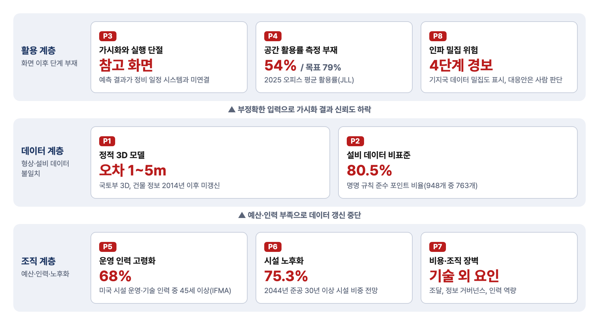

### 데이터 계층

**2-2. 공공 3D 지도는 오차가 1~5m이고 건물 정보가 2014년에서 멈췄습니다(P1).**

같은 지역의 민간 3D 지도 오차는 2~10cm입니다.

**그림 2.2 국토부 3D 지도의 다리 겹침과 둔치 입체감 누락**

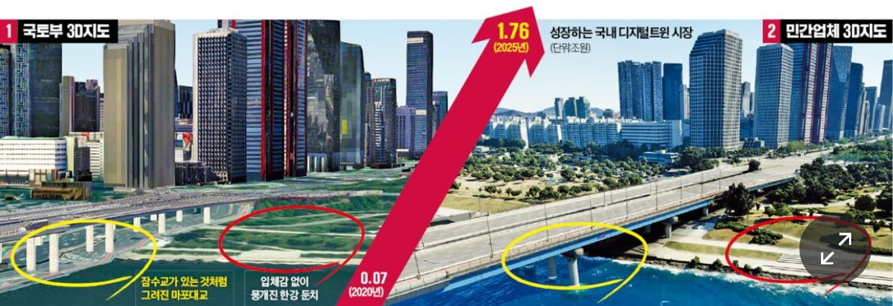

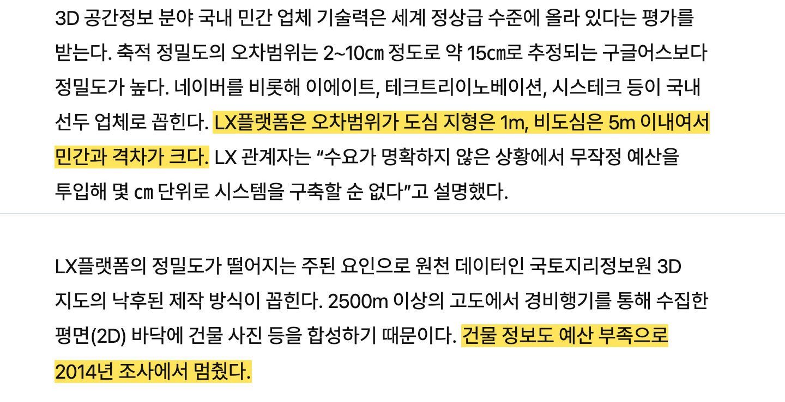

자료: [한국경제(2025-01-14)][hk-lx]

**2-3. 설비 데이터는 제조사마다 이름 형식이 달라 매핑에 수작업이 필요합니다(P2).**

테스트 건물의 설비 포인트 948개 중 763개(80.5%)만 명명 규칙을 따랐습니다([TU Delft][tudelft]).

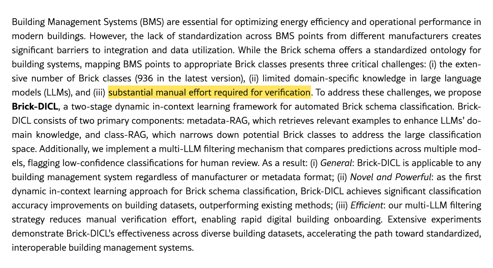

자료: [Brick-DICL(arXiv 2606.17637)][brick-dicl]

### 활용 계층

**2-4. 트윈의 예측 결과가 정비 시스템과 연결되지 않으면 참고 화면에 그칩니다(P3).**

가시화 다음 단계인 조치 연결이 빠진 상태입니다.

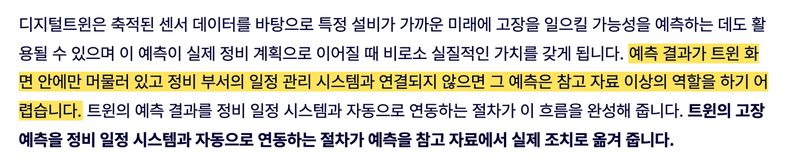

자료: [알체라 블로그][alchera]

**2-5. 오피스 공간의 절반가량은 평균적으로 사용되지 않습니다(P4).**

2025년 활용률 54%는 기업 목표 79%보다 25%p 낮습니다.

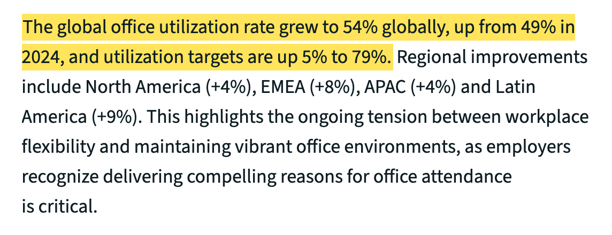

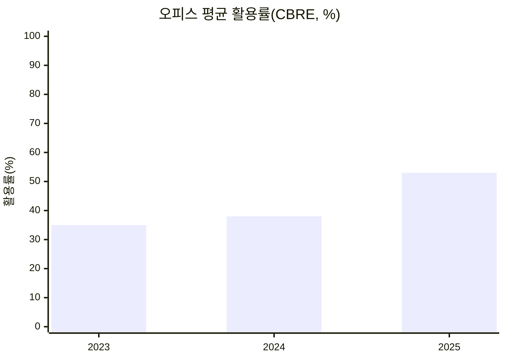

자료: [JLL][jll], [CBRE·Facilities Dive][office]

**2-6. 인파 관리 시스템은 밀집도를 지도에 표시하고, 대응은 사람이 판단합니다(P8).**

기지국 접속 데이터로 밀집도를 계산해 4단계 경보를 표시합니다.

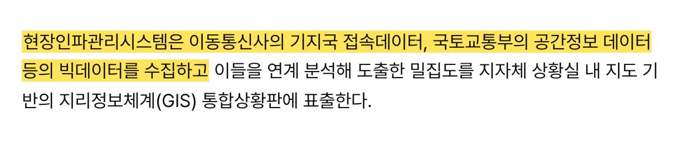

자료: [파이낸셜뉴스(2023-05-10)][fnnews]

### 조직 계층

**2-7. 미국 시설 운영·기술 인력의 68%가 45세 이상입니다(P5).**

숙련자의 지식이 시스템이 아닌 사람에게 남아 있어 인수인계가 어렵습니다. IFMA는 고소득 국가 시설관리자의 최대 40%가 2026년까지 은퇴한다고 추정했습니다([JLL][jll-fm]).

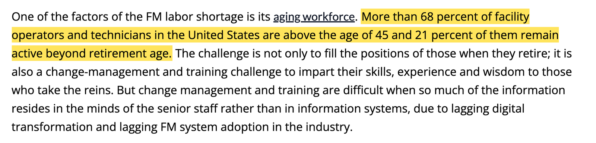

자료: [IFMA FMJ][ifma]

**2-8. 준공 30년 이상 시설 비중은 2044년 75.3%에 도달합니다(P6).**

중대 결함은 2020년 275건에서 2024년 935건으로 3.4배 증가했습니다.

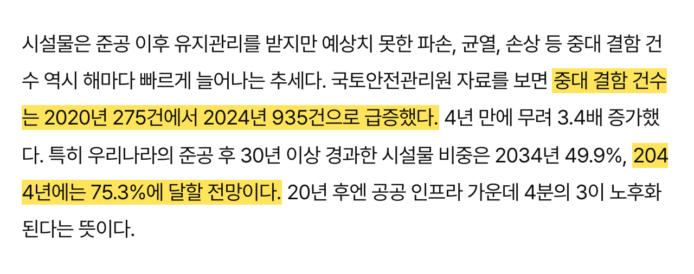

자료: [아시아경제(2026-07-13)][asiae]

**2-9. 도입 장벽은 기술보다 조직, 조달, 인력 역량에 있습니다(P7).**

공공 의료 시설의 트윈 사업 대부분은 시범 단계에 머물러 있습니다.

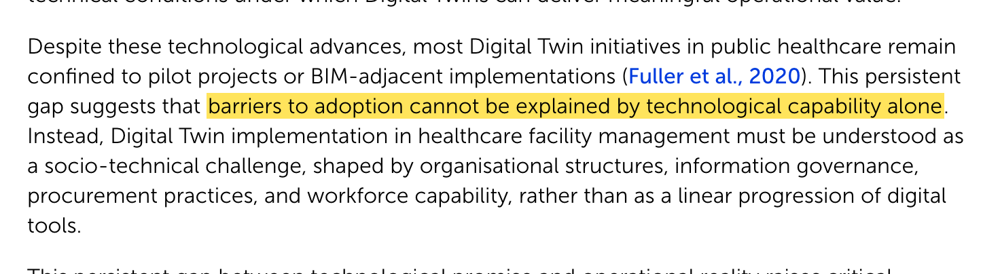

자료: [Frontiers in Built Environment(2026)][frontiers]

## 3. 기술 동향: LLM을 질의·시나리오·규칙 생성 계층으로 사용

**3-1. LLM은 공간 그래프 위에서 질의, 시나리오, 규칙을 생성합니다.**

계산과 제어는 기존 시뮬레이터와 제어기가 수행합니다. 연구별 상세는 [논문·기업 사례 상세](digital-twin-survey-papers.md)에 있습니다.

**그림 3.1 LLM 계층이 P3 실행 단절과 P5 인력 부족을 담당**

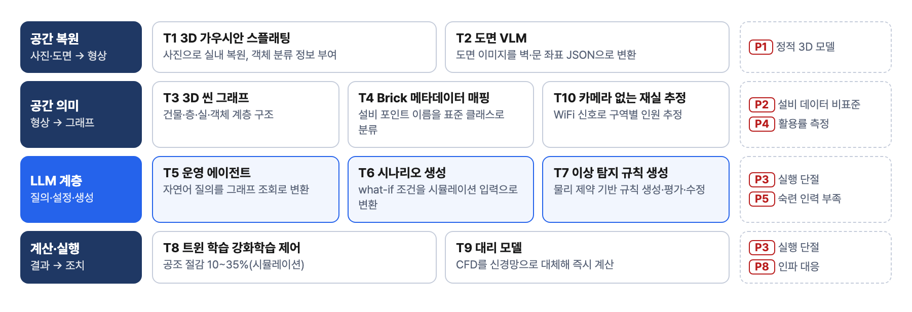

**3-2. 도면과 사진에서 공간 그래프를 만들고 자연어로 조회하는 연구가 증가했습니다.**

FloorplanVLM은 도면을 좌표 JSON으로, KeySG는 건물을 층·실·객체 그래프로 변환합니다.

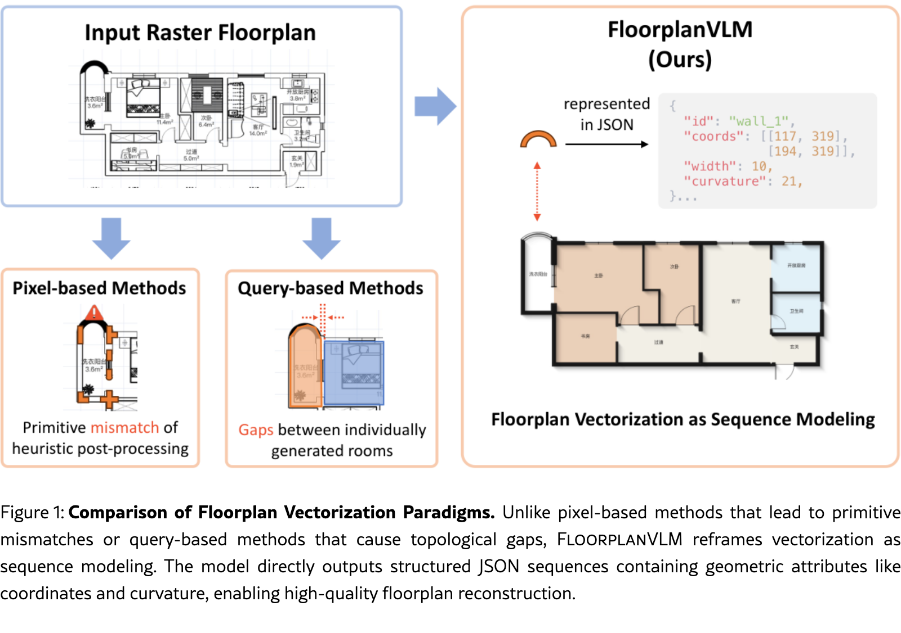

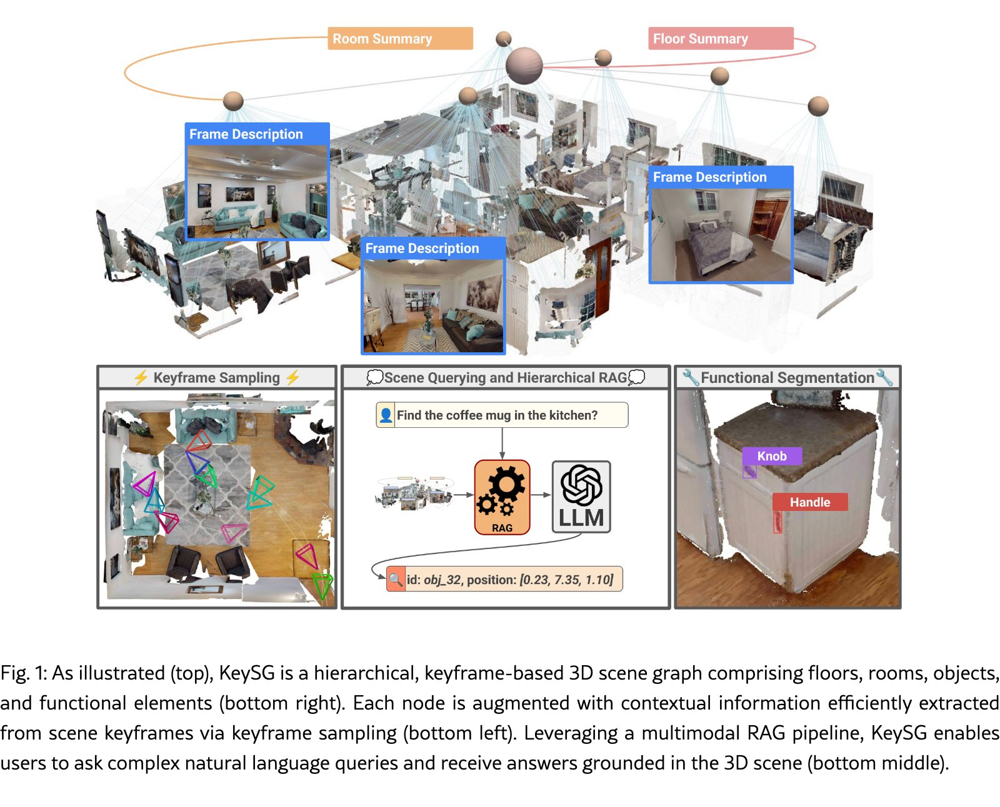

자료: [FloorplanVLM][floorplanvlm], [KeySG][keysg]

**3-3. 운영 자동화 연구는 규칙 생성과 시뮬레이션 학습 환경으로 나뉩니다.**

PILLM은 LLM이 이상 탐지 규칙을 생성·수정합니다. NVIDIA Mega는 공장 트윈에서 로봇 제어를 학습합니다.

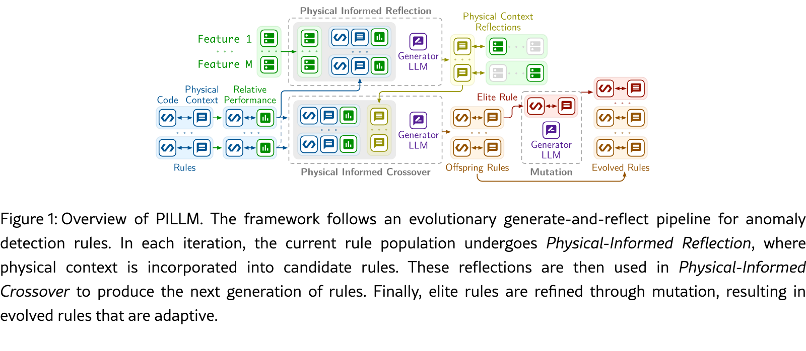

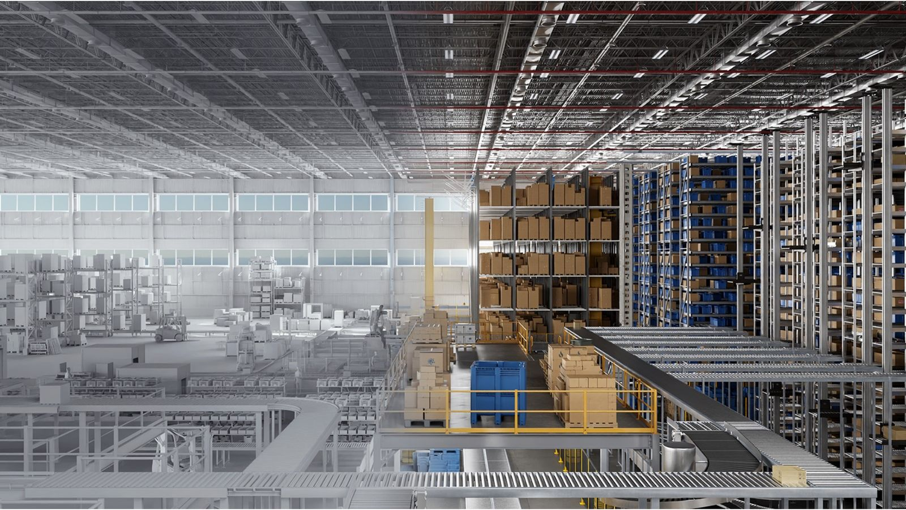

자료: [PILLM][pillm], [NVIDIA][mega]

**3-4. 에너지 절감 수치는 시뮬레이션과 현장 실증을 구분해 인용해야 합니다.**

공조 절감률은 시뮬레이션 10~35%, 현장 실증 한 자릿수~10%대 초반입니다. 장비 교체 12%, 교체와 강화학습 결합 32% 사례에서 강화학습 단독 효과는 분리되지 않았습니다.

## 4. 시장·경쟁: 디지털트윈 연 34~48% 성장, 경쟁 제품은 측정과 3D로 구분

**4-1. 디지털트윈 시장은 2030년까지 연 34~48% 성장이 전망됩니다.**

빌딩 관리 시스템 시장은 2025년 규모가 더 크지만 성장률은 낮습니다.

**표 4.1 시장 규모 추정 범위**

| 시장 | 2025 | 2030 | 연평균 성장률 | 자료 |
|---|---|---|---|---|
| 세계 디지털트윈 | 211억~362억 달러 | 1,316억~1,803억 달러 | 34~48% | [MarketsandMarkets][mnm], Mordor, 360iResearch |
| 빌딩 관리 시스템(BMS) | 419억 달러 | 1,167억 달러 | 22.8% | Mordor Intelligence |
| 빌딩 에너지 관리(BEMS) | 296억 달러 | 584억 달러 | 14.5% | [Knowledge Sourcing][bems] |
| 재실 분석 소프트웨어 | 28억~42억 달러 | 미정 | 14.8~18.5% | Market Intelo(신뢰도 낮음) |
| 국내 디지털트윈 | 1.76조 원 | 미정 | 2020년 0.07조 원 | 한국경제 그래픽(그림 2.2) |

주: 재실 분석 수치는 같은 기관의 다른 보고서와 값이 중복되어 참고용.

**4-2. 공간 활용 측정과 자동 운영 제안을 함께 제공하는 제품은 적습니다.**

측정 제품은 대시보드까지, 3D 트윈 제품은 운영 AI 결합 단계입니다.

**그림 4.1 후보 B는 가시화와 자동 제안을 함께 제공하는 영역**

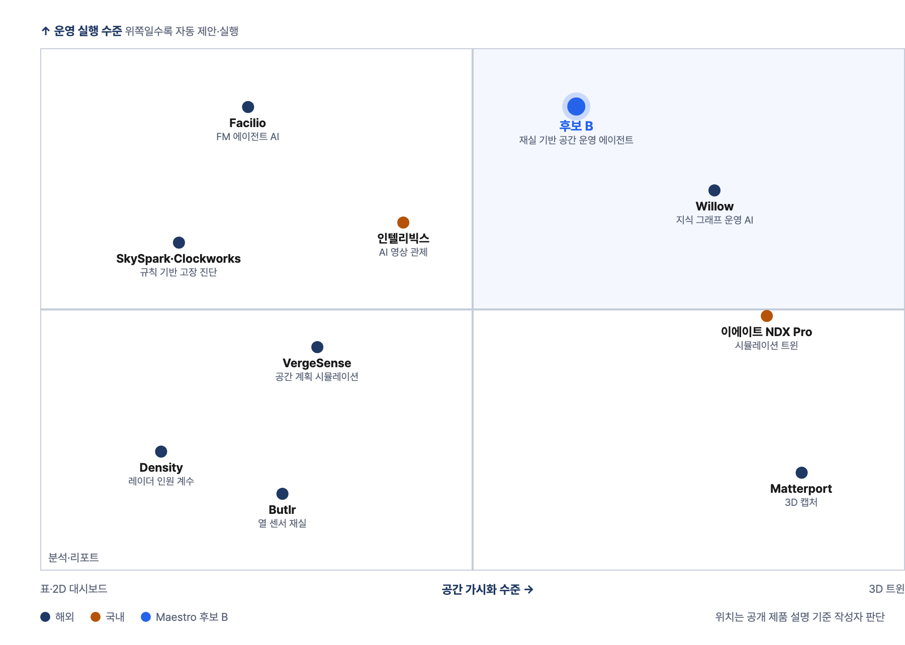

**표 4.2 후보별 경쟁 제품**

| 후보 | 경쟁 제품 | 특징 | 후보의 차이 |
|---|---|---|---|
| A 대화형 공간 트윈 | Matterport, Willow, 이에이트 NDX Pro | 3D 캡처, 지식 그래프, 시뮬레이션 트윈 | 도면 이미지만으로 생성, 자연어 조회 |
| B 재실 기반 공간 운영 | VergeSense, Density, Butlr | 재실 센서, 활용률 대시보드, 공간 계획 | 센서 없이 예약·계량 데이터로 시작, 통합안과 kWh 계산 |
| C what-if 시뮬레이터 | NVIDIA Omniverse, 이에이트 NFLOW, AnyLogic | 물리·이산 사건 시뮬레이션 | 자연어 시나리오 입력, 대리 모델 즉시 계산 |
| D 이상 징후 작업 지시 | Facilio, SkySpark, Clockworks | 규칙 기반 고장 진단, FM 에이전트 | LLM 규칙 생성, 3D 위치와 작업 지시 연결 |
| E 인파 안전 트윈 | 인텔리빅스, 플럭시티 Safers, 뷰런 | CCTV·라이다 밀집 분석, 통합관제 | 공간 그래프 기반 대피 경로 계산 |

주: Butlr는 2024-08 Series B 3,800만 달러 투자 유치. 인텔리빅스 AI 관제 시스템은 지자체 68.5% 도입(2025-12 보도).

**4-3. 후보 B의 경쟁 제품은 재실 센서 판매를 전제로 합니다.**

VergeSense와 Density는 센서 설치 후 활용률을 표시하고, 공간 계획 판단은 사용자가 수행합니다.

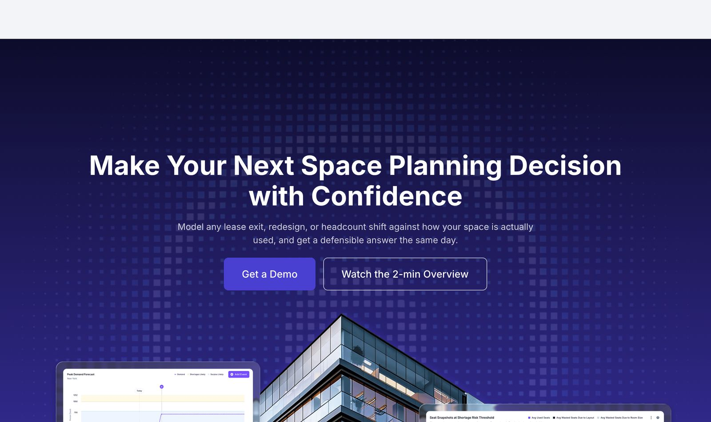

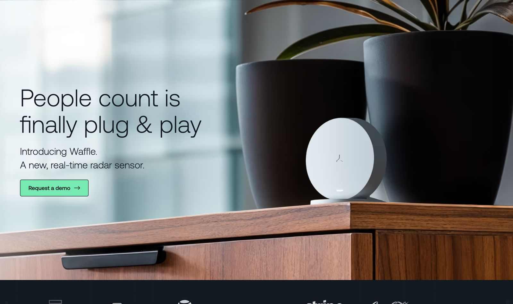

**4-4. 3D 트윈·고장 진단·관제 제품은 운영 AI를 결합하는 방향입니다.**

Willow는 지식 그래프, 이에이트는 온톨로지, Facilio는 FM 에이전트, 인텔리빅스는 AI 영상 관제를 내세웁니다.

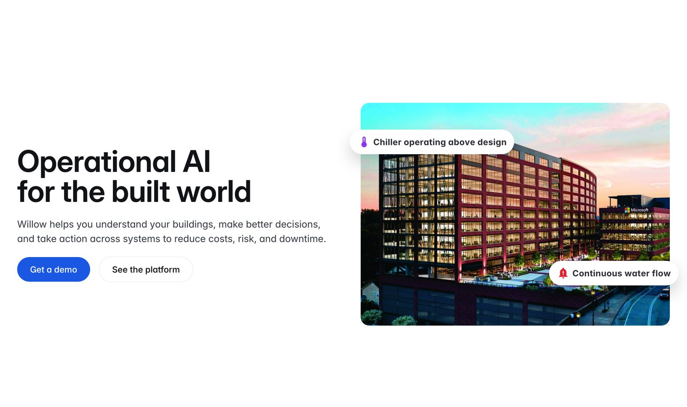

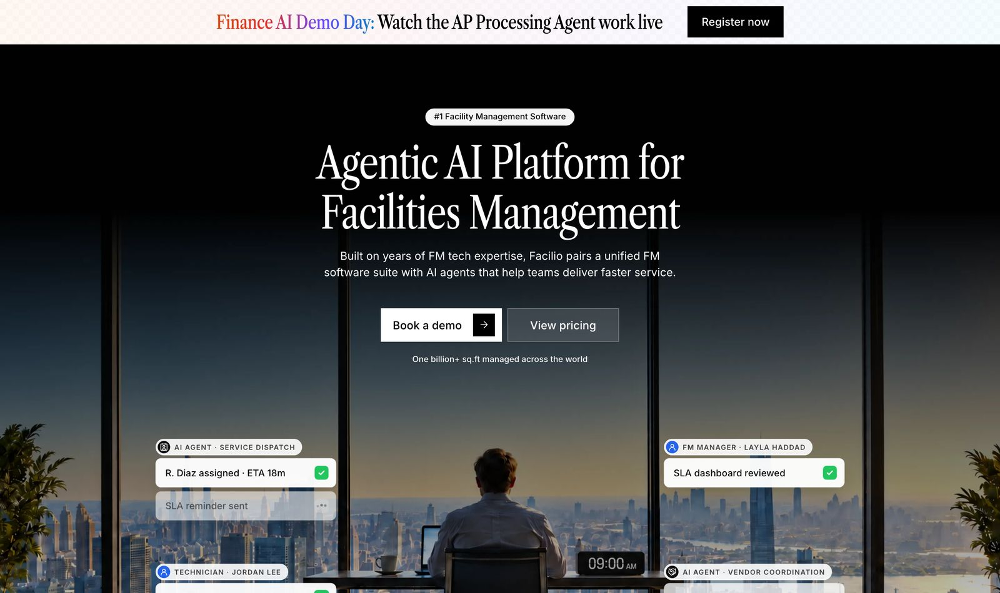

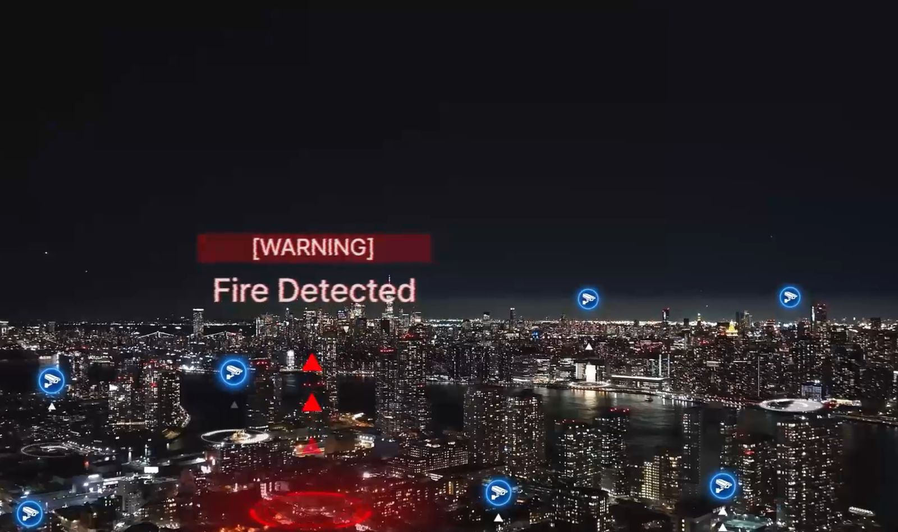

## 5. 해커톤 주제 후보: 5개 기준 평가, 후보 B 21점으로 1위

**5-1. 후보는 2절의 문제 1개 이상과 3절의 기술 1개 이상을 결합한 5개입니다.**

| 후보 | 이름 | 내용 | 문제 | 기술 |
|---|---|---|---|---|
| A | 대화형 공간 트윈 | 도면에서 층·실 그래프와 3D 화면 생성. 자연어로 공간 상태 조회 | P1, P2, P5 | T2, T3, T4 |
| B | 재실 기반 공간 운영 에이전트 | 재실 히트맵, 저활용 구역 통합안과 공조 일정 제안, 절감량 계산 | P4, 에너지 | T3, T5, T10 |
| C | what-if 운영 시뮬레이터 | 자연어 시나리오를 시뮬레이션 파라미터로 변환해 운영안 비교 | P3, P8 | T6, T9 |
| D | 이상 징후 작업 지시 | 센서 이상 탐지, 3D 위치 표시, 작업 지시서 자동 작성 | P3, P5, P6 | T3, T7 |
| E | 인파 안전 트윈 | 공간 그래프와 밀집도로 위험 구역·대피 경로 표시 | P8 | T6, T10 |

**5-2. 시장성, 기술적 독창성, 구현력, 난이도, 주제 관계성 평가에서 후보 B가 21점으로 1위입니다.**

각 1~5점이며 난이도는 쉬울수록 높은 점수입니다(2026-11-18 사용자 결정).

**표 5.2 후보별 점수와 근거**

| 후보 | 시장성 | 독창성 | 구현력 | 난이도 | 관계성 | 합계 | 근거 |
|---|---:|---:|---:|---:|---:|---:|---|
| A | 3 | 4 | 3 | 2 | 4 | 16 | 3D 생성 품질 확보 부담, 최적화 결과 수치화 약함 |
| B | 5 | 3 | 4 | 4 | 5 | 21 | 활용률 54% 대 목표 79%, 공개 계량 데이터, 가시화와 최적화 모두 해당 |
| C | 3 | 5 | 2 | 2 | 4 | 16 | 대리 모델 학습 데이터와 시간 부족 |
| D | 4 | 4 | 4 | 3 | 4 | 19 | 인력 고령화 문제 근거 명확, 3D 표현 비중 낮음 |
| E | 3 | 3 | 3 | 3 | 4 | 16 | 공공 수요 중심, 기존 관제 제품 다수 |

주: 점수는 이 문서의 근거를 기준으로 한 작성자 판단이며, 공고의 심사 기준 확인 후 재평가 대상.

**5-3. 후보 B는 히트맵으로 가시화하고, 에이전트가 통합안과 절감량을 제안합니다.**

1~3단계가 공간 가시화, 4~5단계가 운영 최적화입니다. 후보 D의 작업 지시 기능은 확장 기능으로 추가할 수 있습니다.

**그림 5.1 데이터 수집에서 일정 변경 요청까지 6단계**

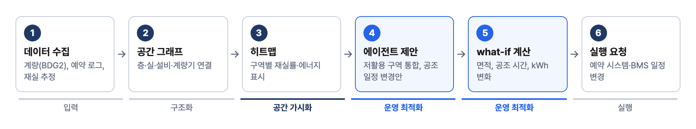

**그림 5.2 재실 히트맵과 에이전트 제안을 한 화면에 표시**

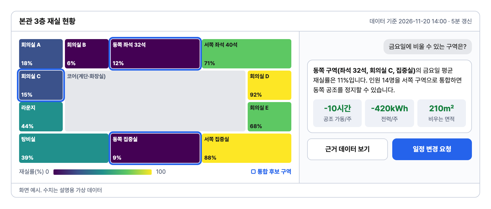

주: 수치는 설명용 가상 데이터. 도식 원본은 `docs/reports/2026-11-18-digital-twin-survey/diagrams/`.

## 6. 공개 데이터: 에너지, 도시 인구, 3D 공간정보

**6-1. 실내 재실 공개 데이터는 확인하지 못했으며, 없으면 합성 데이터를 사용하고 화면에 표시합니다.**

3D 구축 시간이 부족하면 평면 히트맵을 먼저 구현합니다.

| 데이터 | 내용 | 제약 |
|---|---|---|
| Building Data Genome Project 2 | 비주거 건물 1,636개, 계량기 3,053개, 2016~2017 시간 단위 | 저장소 라이선스 파일 확인 필요 |
| 서울시 실시간 도시데이터 | 주요 121개 장소 인구 5분 갱신, 12시간 예측 인구 | 1회 1개 장소 호출. 인증키 필요. 기지국 추정값 |
| 브이월드 3D 분석 API | 2025-01 3단계 서비스. glb·gltf 등 파일 형식 지원 | 3D 건물 원본 API는 2019-07 중단. 재개 여부 미확인 |
| 공공데이터포털 GIS건물통합정보 | 건물 2D 형상과 속성 | 활용 신청과 인증키 필요 |

자료: [BDG2][bdg2], [서울 열린데이터광장][seoul], [브이월드 3단계][vworld]

## 7. 제한 사항: 원문 미확인 수치와 판매 기업 자료

**7-1. 논문 수치는 초록 기준이며, 시장 규모는 공개 요약 기준입니다.**

- 시장 보고서 원문은 유료이며 확인하지 않았습니다. 기관마다 시장 정의가 달라 범위로 표시했습니다.
- 오피스 활용률과 재실 분석 시장 수치는 조사·판매 기업 자료입니다.
- 해커톤 공고(주최, 기간, 제공 데이터, 심사 기준)는 확인하지 못했습니다.
- 경쟁 제품 위치(그림 4.1)는 공개 홈페이지 설명 기준 작성자 판단입니다.
- 2026-11-18 이전 판의 "미국 시설관리자 39% 55세 이상"은 원문에서 확인하지 못해 IFMA 원문 수치로 교체했습니다.

## 다음 작업

| 작업 | 기한 | 담당 |
|---|---|---|
| 해커톤 공고의 기간, 제공 데이터, 심사 기준 확인과 표 5.2 재평가 | 2026-11-19 | 미정 |
| 주제 확정과 [기술 선택 기록](../decisions/README.md) 작성 | 2026-11-19 | 팀 전체 |
| 발표 자료에 인용할 수치의 원문 확인 | 발표 자료 작성 전 | 미정 |
| 저장소 git 초기화와 원격 저장소 연결 | 미정 | 미정 |

## 관련 자료

- [논문·기업 사례 상세](digital-twin-survey-papers.md)
- [PDF 보고서](../../../reports/2026-11-18-digital-twin-survey/report.pdf)

[hk-lx]: https://www.hankyung.com/article/2025011459191
[tudelft]: https://repository.tudelft.nl/file/File_a83d1cc6-3e2b-4bba-b56b-bc52c5f963d2
[brick-dicl]: https://arxiv.org/html/2606.17637
[alchera]: https://www.alchera.ai/resource/blog/ac-industrial-digital-twin-ai-data-operating-system-advancement
[jll]: https://www.jll.com/en-de/newsroom/the-evolving-workplace-prioritizes-experience-while-optimizing-space
[office]: https://www.facilitiesdive.com/news/office-occupancy-data-workplace-trends-cbre-vergesense-RTO/741159
[fnnews]: https://www.fnnews.com/news/202305101834193923
[jll-fm]: https://www.jll.com/en-de/insights/firms-are-on-the-hunt-for-tech-savvy-facilities-managers
[ifma]: https://fmj.ifma.org/addressing-the-fm-labor-shortage
[asiae]: https://view.asiae.co.kr/article/2026070817544082956
[frontiers]: https://www.frontiersin.org/journals/built-environment/articles/10.3389/fbuil.2026.1828585/full
[floorplanvlm]: https://arxiv.org/abs/2602.06507
[keysg]: https://arxiv.org/abs/2510.01049
[pillm]: https://arxiv.org/abs/2510.17146
[mega]: https://blogs.nvidia.com/blog/mega-omniverse-blueprint
[mnm]: https://www.marketsandmarkets.com/ResearchInsight/digital-twin-market-size.asp
[bems]: https://www.knowledge-sourcing.com/report/building-energy-management-system-market
[bdg2]: https://arxiv.org/abs/2006.02273
[seoul]: https://data.seoul.go.kr/dataList/OA-21285/A/1/datasetView.do
[vworld]: https://smartcity.go.kr/2025/01/15/16일부터-브이월드v-world-3단계-서비스-시작/
