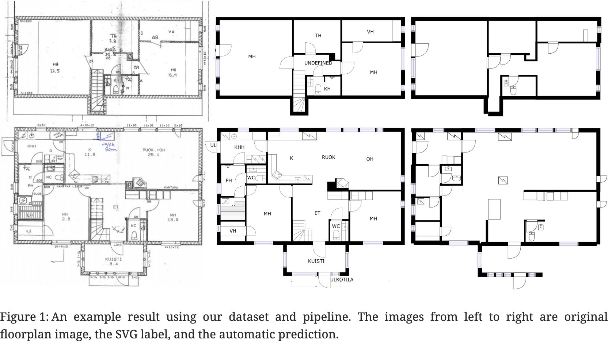
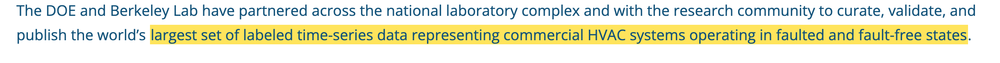
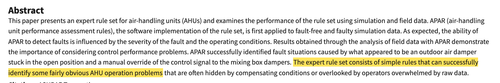

# 도면 인식·공조 고장 진단 기술 조사

> **요약** (기준일 2026-11-19)
>
> - 도면 인식은 공개 데이터셋(CubiCasa5K 5,000장, 80개 이상 분류)과 코드가 있으나 주거 평면 중심. 기계실 설비 기호 공개 데이터셋은 확인하지 못함
> - 공조 고장 진단은 LBNL 공개 데이터(설비 7종, 고장 라벨, Brick TTL, CC BY)와 NIST APAR 규칙(28개)으로 시연 가능
> - 운전 추천 검증은 BOPTEST 시뮬레이터(REST API, Docker), AR은 iPhone Safari WebXR 미지원이라 이미지 추적 방식 필요
>
> | 항목 | 값 | 비고 |
> |---|---|---|
> | CubiCasa5K | 5,000장, 학습 4,200·검증 400·테스트 400 | 주거 평면, 저장소 라이선스 확인 필요 |
> | LBNL 단일 덕트 공조기 | 고장 5종, 1년(365일) | EnergyPlus·Modelica 시뮬레이션 |
> | APAR | 규칙 28개 | 계측 부족 시 탐지 수 감소(비교 연구 52개 중 10개) |
>
> **다음 작업**: 없음

[서비스 기획](../service-plan.md)의 이상 요건 구현에 필요한 데이터셋, 모델, 도구를 조사한 기록입니다. 2026-11-19 웹 검색 10회로 확인했으며, 수치는 각 자료의 공개 페이지 기준입니다.

## 1. 도면 인식: 주거 평면 데이터셋 존재, 기계실 기호는 직접 라벨링

**1-1. CubiCasa5K는 도면 5,000장에 벽, 실, 아이콘 등 80개 이상 분류를 다각형으로 표시한 공개 데이터셋입니다.**

기준 모델은 실과 아이콘 분할을 함께 수행하며, 코드와 데이터가 공개되어 있습니다. 핀란드 주거 매물 도면 중심이라 기계실 도면에는 추가 학습이나 교정이 필요합니다.

**1-2. 설비 기호 검출은 배관·계장도(P&ID)와 건설 도면에서 연구가 있고, 기계실 공개 데이터셋은 확인하지 못했습니다.**

공개 데이터셋과 기계실 도면의 차이, 학습 영향은 [기계실 도면과 공개 도면 데이터셋 비교](mechanical-room-drawing-datasets.md)에 있습니다.

| 연구·데이터 | 내용 | 비고 |
|---|---|---|
| Jamieson 외(IJDAR 2024) | 배관·공조 건설 도면에서 1단계·2단계 검출기 비교 | 데이터 공개 여부 미확인 |
| P&ID 기호 데이터 | 기호 48종, 7,728개 | 석유·가스 분야 |
| Elyan 외(2020) | YOLO 기반 P&ID 기호 인식 94% 이상 보고 | 비공식 사본으로 확인 |
| FloorplanVLM(arXiv 2602.06507) | 비전 언어 모델로 도면을 좌표 JSON으로 변환 | 대안 경로 |
| AI Hub 도면 데이터 | 평면도 벽·문·창 데이터셋 | 검색으로 확인하지 못함 |

## 2. 3D 생성과 화면: three.js와 That Open Components

**2-1. 웹 3D는 three.js로 벽 높이 생성과 설비 배치를 구현하고, IFC 연동이 필요하면 That Open Components를 사용합니다.**

That Open의 이전 web-ifc-viewer는 지원이 중단되었고, 현재 도구는 MIT 라이선스 v3의 `@thatopen/components`입니다. 패키지마다 라이선스가 다르므로 사용 전에 확인하십시오.

## 3. 고장 데이터: LBNL 공개 데이터 7종

**3-1. LBNL 데이터는 상업용 공조 설비 7종의 고장·정상 시계열과 고장 라벨을 제공합니다.**

| 설비 | 고장 | 생성 방법 | 기간 |
|---|---|---|---|
| 단일 덕트 공조기(VAV) | 5종, 심각도별 | EnergyPlus, Modelica 시뮬레이션 | 1년 |
| 냉동기 플랜트 | 7종 | EnergyPlus, Modelica 시뮬레이션 | 1년 |
| 보일러 플랜트 | 5종 | 시뮬레이션 | 데이터 문서 확인 필요 |
| 옥상형 공조기, 이중 덕트 공조기, VAV 박스, 팬코일 | 자료마다 고장 수 상이 | 시뮬레이션·실험·현장 | 데이터 문서 확인 필요 |

주: 각 데이터셋은 PDF 설명, CSV 시계열(고장 없음 1개 포함), Brick 스키마 TTL 파일로 구성. 라이선스 CC BY, DOI 10.25984/1881324.

## 4. 고장 진단 방법: 규칙, 분류, 잔차

**4-1. NIST의 APAR는 질량·에너지 보존에서 유도한 전문가 규칙 28개로 공조기 고장을 탐지합니다.**

운전 모드를 제어 신호로 판정하고 해당 모드의 규칙만 검사합니다. 시뮬레이션, 에뮬레이터, 현장 데이터로 테스트했고 상용 제어기에 탑재되었습니다. 계측 포인트가 부족하면 적용 규칙이 줄어, 한 비교 연구에서는 52개 문제 중 10개만 탐지했습니다.

**4-2. LLM을 쓰는 진단 연구는 규칙 생성과 근거 설명 쪽으로 발전하고 있습니다.**

PILLM(arXiv 2510.17146)은 물리 제약을 포함한 진화 탐색으로 이상 탐지 규칙을 생성합니다. 이 서비스는 LLM을 근거 설명에만 선택적으로 쓰고, 판정은 규칙과 분류 모델이 수행합니다.

## 5. 운전 추천 검증: BOPTEST 시뮬레이터

**5-1. BOPTEST는 건물 공조 제어 알고리즘을 테스트하는 시뮬레이터로, REST API와 Docker 실행을 지원합니다.**

공개 서버(api.boptest.net)와 로컬 Docker 실행이 가능하며, 2024-11 기준 공개 테스트 건물 8개가 있습니다. 확장 단계에서 추천안의 에너지·쾌적 지표 비교에 사용합니다.

## 6. AR: iPhone은 WebXR AR 미지원

**6-1. 2026년 자료 기준 iPhone Safari는 WebXR AR을 지원하지 않고, Android Chrome은 WebXR을 지원합니다.**

iPhone에서는 카메라 영상에서 이미지를 추적하는 라이브러리(MindAR 등)를 써야 합니다. MindAR의 현재 기능은 공식 문서로 확인하지 않았습니다.

## 7. 국내 제도: 기계설비법 유지관리·성능점검

**7-1. 연면적 1만㎡ 이상 건축물 등은 기계설비 유지관리자를 선임하고, 성능점검을 연 1회 이상 받아야 합니다.**

| 항목 | 기준 | 자료 |
|---|---|---|
| 선임 대상 | 연면적 1만㎡ 이상(창고 제외), 500세대 이상 공동주택 등 | 서울시 |
| 성능점검 | 사용승인 1년 후부터 매년 1회 이상 | 금천구 |
| 유지관리점검 | 반기 1회 이상 | 서울시 |
| 임시등급 인정 | 2027-04-17까지 연장(2026-06-01 시행규칙 개정) | 한국건설기계설비신문 |

## 다음 작업

없음. 구현 중 새로 확인한 데이터·도구는 이 문서에 추가하십시오.

## 관련 자료

- [CubiCasa5K](https://arxiv.org/abs/1904.01920), [LBNL FDD 데이터](https://faultdetection.lbl.gov/data), [OSTI 데이터 기록](https://www.osti.gov/biblio/1881324-lbnl-fault-detection-diagnostics-datasets)
- [NIST APAR](https://www.nist.gov/publications/expert-rule-set-fault-detection-air-handling-units), [APAR 비교 연구](https://link.springer.com/content/pdf/10.1007%2Fs12053-014-9289-z.pdf)
- [BOPTEST](https://github.com/ibpsa/project1-boptest/blob/master/README.md), [That Open Components](https://github.com/ThatOpen/engine_web-ifc)
- [Jamieson 외 도면 기호 검출](https://rgu-repository.worktribe.com/output/2457618), [WebXR 지원 현황](https://abratabia.com/webxr-games/webxr-device-support.php)
- [서울시 유지관리자 선임](https://news.seoul.go.kr/citybuild/archives/507833), [한국건설기계설비신문](https://www.kharn.kr/news/article.html?no=29840)
