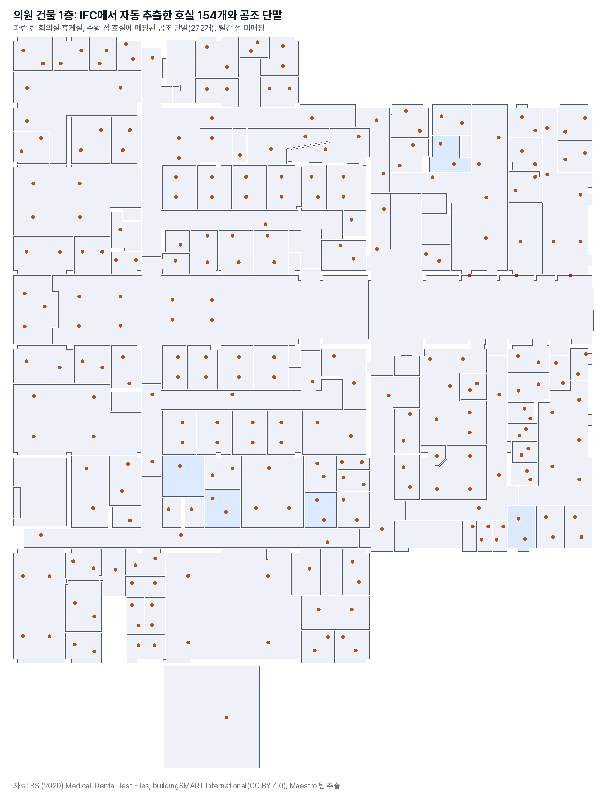
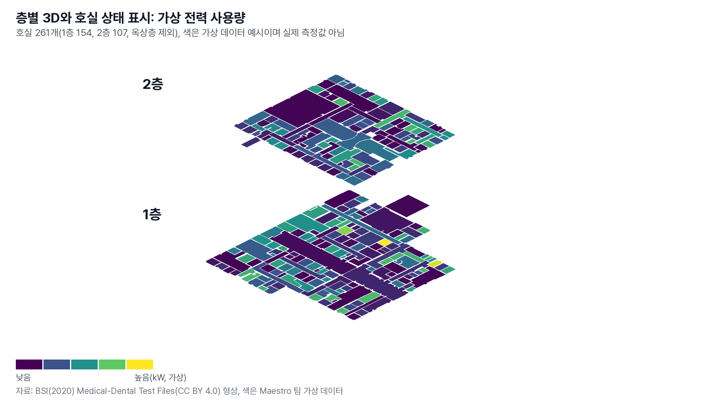

# 공개 IFC 샘플 검토와 추출 실험

> **요약** (기준일 2026-11-19)
>
> - 과제가 대안으로 제시한 buildingSMART 인증 샘플(Certification-datasets)은 건물 모델이 1개 층, 공간 2개, 급기구 2개라 시연용 건물로 작음
> - 같은 기관의 커뮤니티 저장소 의원 건물(Medical-Dental Clinic) IFC에서 호실 269개를 약 10초에 추출했고, 공조 단말 451개 중 448개(99.3%)를 좌표로 호실에 매핑함
> - 매핑 비율은 정답 대조가 아닌 포함 판정 성공률. 부산대 건물 도면이 확보되면 같은 스크립트로 교체 검증 필요
>
> | 항목 | 인증 샘플(Building) | 커뮤니티 의원 건물 |
> |---|---|---|
> | 층 | 1개 | 4개(1층, 2층, 지붕, 기초) |
> | 공간(IfcSpace) | 2개 | 269개 |
> | 공조 요소 | 급기구 2, 덕트 1 | 단말 440, 송풍기 8, 열교환 3 |
>
> **다음 작업**: 부산대 건물 도면 확보 시 같은 추출 실험 반복(미정)

과제 4의 데이터 대안을 확인한 기록입니다. 2026-11-19에 GitHub 저장소 2곳을 조회하고, IFC 5개를 내려받아 ifcopenshell 0.9.0으로 분석했습니다. 설계 반영 내용은 [시스템 설계](../architecture.md)에 있습니다.

## 1. 인증 샘플: 건물 1개 층, 공간 2개

**1-1. buildingSMART Certification-datasets는 IFC 버전 3종별 Simple-Scene 모델 10개이며, 건물 모델은 시연용으로 작습니다.**

라이선스는 CC BY 4.0입니다. 저장소 설명은 교육, 구현, 인증 목적의 단순 모델입니다.

| 파일(IFC4) | 내용 | 시연 적합성 |
|---|---|---|
| Building-Architecture | 층 1개(groundfloor), 공간 2개(living room, entry hall), 벽 4, 슬래브 3 | 호실 질의·비교 불가 |
| Building-Hvac | 급기구 2, 덕트 1, 분배 시스템 1 | 공간-설비 매핑 예시로만 사용 |
| Building-Structural 외 7개 | 구조, 조경, 교량, 도로, 철도, 전기, 배관 | 해당 없음 |

## 2. 커뮤니티 샘플: 의원 건물과 복층 주택

**2-1. 커뮤니티 저장소(buildingsmart-community)에는 실제 건물 기반의 의원 건물과 복층 주택 IFC가 있습니다.**

두 데이터셋 모두 CC BY 4.0이며, 출처 표기 문구를 README에 지정합니다. 파일은 Git LFS로 저장되어 있어 일반 내려받기 주소로는 포인터 파일만 받습니다.

| 데이터셋 | 내용 | 출처 표기 |
|---|---|---|
| Medical-Dental Clinic(IFC2x3) | 2개 층 의원, 건축·구조·공조·배관·전기 모델 | BSI(2020) "Medical-Dental Test Files," buildingSMART International |
| Duplex Apartment(IFC2x3) | 2개 층 복층 주택, 공간 21개 | BSI(2020) "Duplex Apartment Test Files," buildingSMART International |

## 3. 추출 실험: 호실 269개, 공조 단말 448개 매핑

**3-1. 의원 건물 건축 모델에서 층·호실 바닥 다각형을, 공조 모델에서 단말 위치를 추출해 점-다각형 포함 판정으로 매핑했습니다.**

호실 바닥은 공간 형상의 최저 높이 삼각형을 합쳐 만들었습니다. 단말은 형상 중심점과 같은 층 높이 범위(바닥 -0.5~+4.5m)로 판정했습니다.

| 항목 | 값 | 비고 |
|---|---|---|
| 호실 | 269개(1층 154, 2층 109, 지붕 6) | 총면적 6,645.8㎡ |
| 공조 요소 | 451개(단말 440, 송풍기 8, 열교환 3) | IfcFlowTerminal 등 |
| 호실 매핑 | 448개(99.3%) | 정답 대조 아님 |
| 단말이 있는 호실 | 221개(82.2%) | 나머지는 복도·창고 등 |
| 회의실·휴게실 유형 | 9개 | CONF. ROOM, LOUNGE 등 |
| 처리 시간 | 약 10초 | 작성자 PC, 건축 13MB + 공조 27MB |





```bash
python docs/reports/tools/ifc_extract.py Clinic_Architectural.ifc Clinic_HVAC.ifc clinic_extract.json
python docs/reports/tools/ifc_render.py clinic_extract.json docs/human/explanation/research/img
```

주: 두 스크립트는 ifcopenshell, shapely, Pillow가 필요합니다.

## 4. 고객 제품과 운영 기준 확인

**4-1. BECON은 해외 자료 기준으로 층 평면도 화면, 3D 에너지 관리 화면, 고에너지 공간 색 표시를 제공합니다.**

| 항목 | 내용 | 확인 수준 |
|---|---|---|
| BECON 구성 | BECON HVAC, BECON building, BECON cloud | LG 해외 자료, 검색 발췌 |
| 중앙제어기 | BACnet IP, Modbus TCP 직접 연동, 웹 접근 | LG 해외 자료, 검색 발췌 |
| 냉방 설정 기준 | 정부 권고 26℃, 공공기관 냉방 28℃ 이상·난방 18℃ 이하 | 언론 보도, 규정 원문 미확인 |
| 빈 시간 운전 | 비재실 시간에도 24시간 운전하는 사례가 상당한 에너지 낭비 원인 | PNNL 2008 원문 |

## 5. 제한 사항

- 매핑 정답이 없어 정확도는 측정하지 않았습니다. 육안으로 1층을 확인했고, 미매핑 3개는 호실 경계선 위에 위치합니다.
- 의원 건물은 미국 건물이고 공조 방식이 HVAC(IDU)가 아닙니다. 시연에서는 공조 단말을 HVAC 위치 후보로만 사용합니다.
- 과제 예시의 "6층"은 의원 건물에 없으므로, 부산대 건물 미확보 시 층 번호를 바꿔 시연합니다.

## 관련 자료

- [buildingSMART Certification-datasets](https://github.com/buildingSMART/Certification-datasets)
- [buildingsmart-community Community-Sample-Test-Files](https://github.com/buildingsmart-community/Community-Sample-Test-Files)
- [LG BECON 소개(해외)](https://www.lg.com/global/business/insights/hvac/blog/how-does-lg-becon-solve-building-energy-management-challenges/)
- [Katipamula, Brambley, ACEEE 2008](https://www.aceee.org/files/proceedings/2008/data/papers/4_42.pdf)
- [공공기관 실내 온도 기준 보도(서울신문 2024)](https://m.go.seoul.co.kr/news/2024/08/08/20240808018004)
