# 한국 공간 문제와 공공데이터 기반 디지털트윈 주제 6가지

> **요약** (기준일 2026-11-18)
>
> - 한국의 공간 문제는 과밀, 수급 불균형, 노후 세 가지 유형. 유형마다 주제 2개, 모두 국내 공개 공공데이터로 시작 가능
> - 국내 경쟁은 실시간 감시·정보 표시·예약 중개 중심, 해외 경쟁은 전문가용 도구나 다른 시장 대상. 주제마다 차별점 존재
> - 평가 동점 3개(인파 리허설, 따릉이 재배치, 빈 공간 매칭 각 19점). 시연 재미, 데이터 안정성, 공간 가시화 중 팀 기준으로 선택
>
> | 주제 | 문제 수치 | 관련 시장(2025) | 주요 경쟁 | 점수 |
> |---|---|---|---|---:|
> | 인파 리허설 | 핼러윈 28개 지역 | 16.7억 달러 | 현장인파관리시스템, MassMotion | 19 |
> | 응급실 길찾기 | 60분 초과 2.5배 | 39억~49억 달러 | E-Gen, 광역응급의료상황실 | 18 |
> | 따릉이 재배치 | 연 100억 원대 적자 | 40억~98억 달러 | 서울시 전담 인력, Lyft Urban Solutions | 19 |
> | 빈 공간 매칭 | 폐교 4,037곳 | 미확인 | 공유누리, 스페이스클라우드 | 19 |
> | 땅꺼짐 위험 지도 | 싱크홀 1,118건 | 3.1억~4.8억 달러 | 서울시 GPR 탐사, Fracta | 16 |
> | 폭염 쉼터 사각지대 | 온열질환 4,460명 | 18억~32억 달러 | 광주 폭염지도, 기상청 영향예보 | 18 |
>
> **다음 작업**: 2026-11-19 공고 확인, 인증키 신청, 주제 1~2개 선택(팀 전체)

한국에서 보도된 공간 문제와 국내 공공데이터로 해커톤 주제 6개를 정리한 문서입니다. 주제마다 한눈에 보기 카드, 문제, 아이디어와 진행, 공공데이터, 경쟁과 시장 순서로 설명합니다. 기사·논문 원문과 포털·제품 화면을 캡처했고 확인한 문장은 노란색으로 표시했습니다. 같은 내용의 PDF는 [2026-11-18 보고서](../../../reports/2026-11-18-korea-space-topics/report.pdf)입니다.

## 1. 문제 유형: 과밀, 수급 불균형, 노후

**1-1. 한국의 공간 문제는 과밀, 수급 불균형, 노후 세 가지 유형으로 묶입니다.**

유형마다 주제 2개를 선정했고, 모두 공공데이터, 트윈 가시화, AI 판단, 운영 변경 4단계로 풉니다. 시장 규모는 조사 기관의 공개 요약 기준이며, 기관마다 정의가 달라 범위로 표시했습니다.

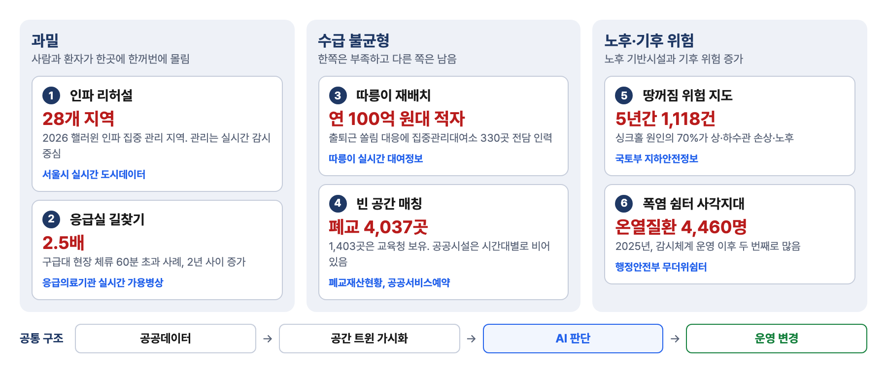

## 2. 과밀 공간: 인파 리허설, 응급실 길찾기

### 인파 리허설

**2-1. 인파 리허설은 행사 전에 군중을 가상으로 걷게 해 병목을 찾고, AI 대안을 비교합니다.**

정부는 2026년 핼러윈에 전국 28개 지역을 집중 관리했고, 현장인파관리시스템은 기지국 데이터로 지금의 밀집도를 표시합니다. 동선을 바꾼 결과는 행사 당일 현장에서 판단합니다.

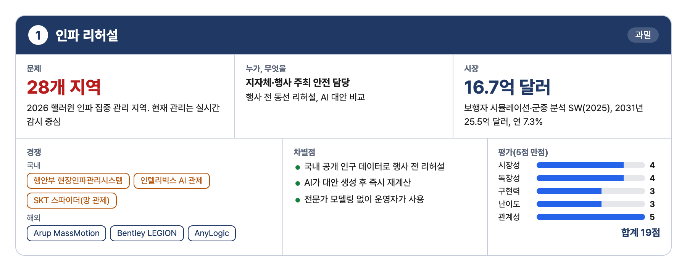

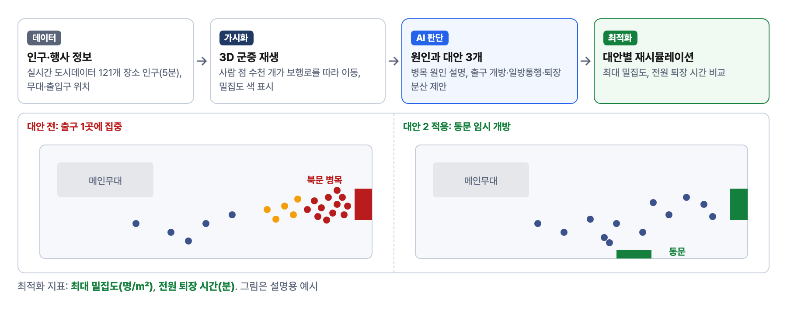

| 데이터 | 내용 | 제약 |
|---|---|---|
| [서울시 실시간 도시데이터(OA-21285)][seoul-city] | 주요 121개 장소 인구 5분 갱신, 12시간 예측 인구 | 1회 1개 장소 호출, 기지국 추정값 |
| 브이월드 | 지형, 건물, 3D 분석 API | 3D 건물 원본 API 재개 여부 미확인 |

**2-2. 국내 경쟁은 실시간 감시 도구이고, 해외 경쟁은 전문가용 보행자 시뮬레이터입니다.**

보행자 시뮬레이션·군중 분석 소프트웨어 시장은 2025년 16.7억 달러, 2031년 25.5억 달러(연 7.3%)로 전망됩니다. Bentley LEGION은 1만 6,330달러부터 판매됩니다.

| 구분 | 제품·기관 | 방식 | 이 주제와의 차이 |
|---|---|---|---|
| 국내 | 행안부 현장인파관리시스템 | 기지국 데이터 실시간 밀집도, 4단계 경보 | 행사 전 동선 변경 결과 계산 없음 |
| 국내 | 인텔리빅스 | CCTV AI 영상 관제, 지자체 68.5% 도입(2025-12 보도) | 영상 감시 중심 |
| 국내 | SKT 스파이더 | 통신 장비 통합 관제, 축제 트래픽 분석 | 통신망 운영 목적 |
| 해외 | Arup MassMotion, Bentley LEGION, AnyLogic | 보행자·범용 시뮬레이션 소프트웨어 | 전문가 모델링 필요, 국내 인구 데이터 미연동 |

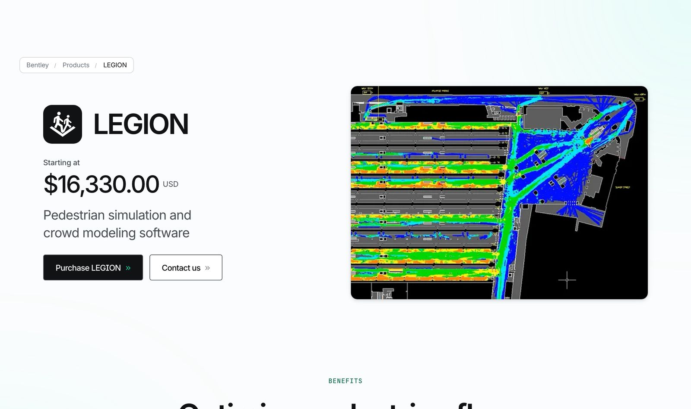

자료: [정책브리핑][crowd-news], [파이낸셜뉴스][fnnews], [LP Information][mkt-crowd], [보안뉴스][intellivix], [바이라인네트워크][skt]

### 응급실 길찾기

**2-3. 응급실 길찾기는 실시간 병상, 도착 시간, 수용 가능성을 한 지도에 놓고 병원 순위를 계산합니다.**

구급대 현장 체류 60분 초과 사례는 2년 사이 2.5배 증가했고, 30분 초과 이송 비중은 1.9%에서 5.2%로 늘었습니다. 실제 병원 선정은 의료진과 상황실의 판단 영역이며, 시연은 정보 제공과 시뮬레이션으로 한정합니다.

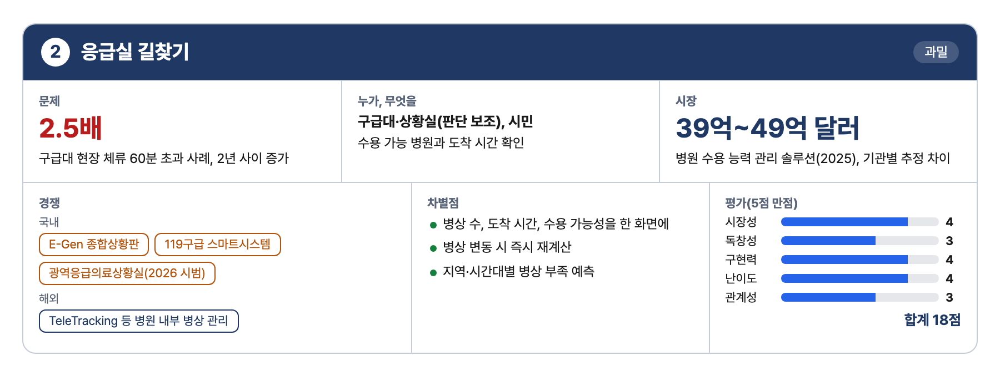

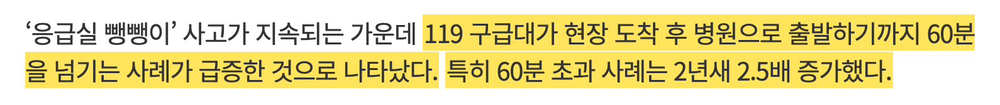

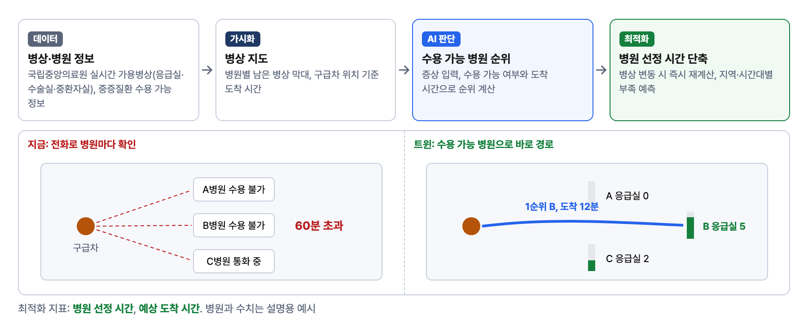

| 데이터 | 내용 | 제약 |
|---|---|---|
| 국립중앙의료원 전국 응급의료기관 정보 조회 서비스 | 실시간 가용병상, 중증질환 수용 가능 정보, 병원 위치 | XML, 활용신청 필요 |
| 응급의료기관 시간대별 가용병상(가공 데이터) | 지역·시간대별 병상 패턴 | 2023-12~2024-11 한정 |

**2-4. 병상 정보는 이미 공개되어 있고, 2026년부터 광역상황실이 중증 환자 병원을 선정합니다.**

이 주제의 차이는 병상 수에 도착 시간과 수용 가능성을 더해 계산하고, 지역·시간대별 부족을 예측하는 점입니다. 병원 수용 능력 관리 솔루션 시장은 2025년 39억~49억 달러로 추정됩니다.

| 구분 | 제품·기관 | 방식 | 이 주제와의 차이 |
|---|---|---|---|
| 국내 | E-Gen 응급의료포털 | 종합상황판에서 병원별 응급실 병상 공개 | 도착 시간·수용 가능성 계산 없음 |
| 국내 | 119구급 스마트시스템 | 전남 구급대 135개대 자동 병원 선정(2024~) | 지역 단위 운영 |
| 국내 | 광역응급의료상황실 | 2026 시범사업, 중증 환자 이송 병원 선정 | 상황실 업무 체계. 이 주제는 판단 보조 화면 |
| 해외 | TeleTracking 등 | 병원 내부 병상·환자 흐름 관리 | 병원 내부 운영 대상 |

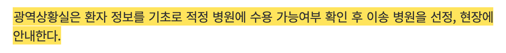

자료: [데일리메디(2026-04-17)][er-news], [아이뉴스24][er-news3], [데일리메디(2026-02-25)][er119], [HTF][mkt-er]

## 3. 수급 불균형 공간: 따릉이 재배치, 빈 공간 매칭

### 따릉이 재배치

**3-1. 따릉이 재배치 트윈은 1시간 뒤 비거나 거치율을 초과할 대여소를 예측하고 트럭 경로를 계산합니다.**

따릉이는 3년 연속 연 100억 원대 운영 적자를 기록했고, 출퇴근 쏠림은 집중관리대여소 330곳의 전담 직원과 시민 마일리지로 맞춥니다.

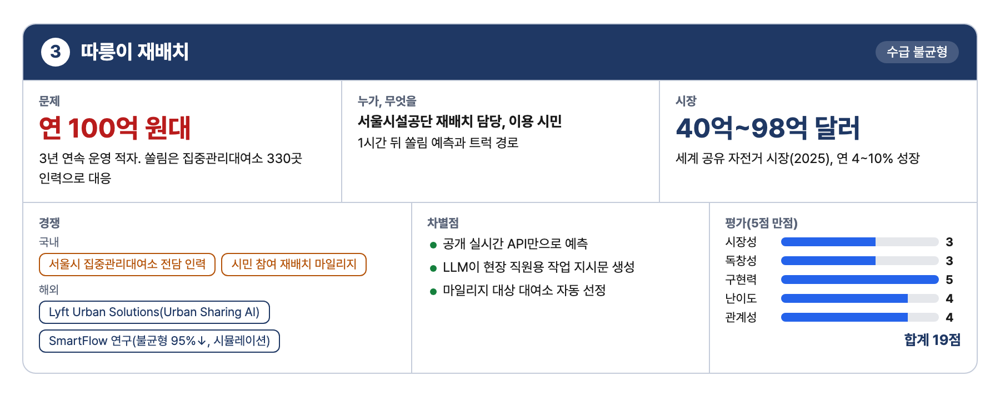

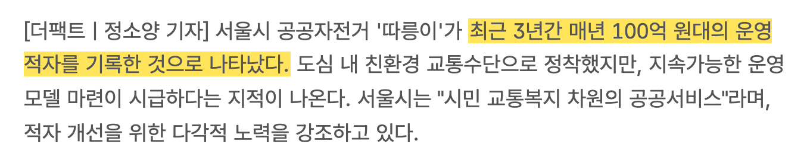

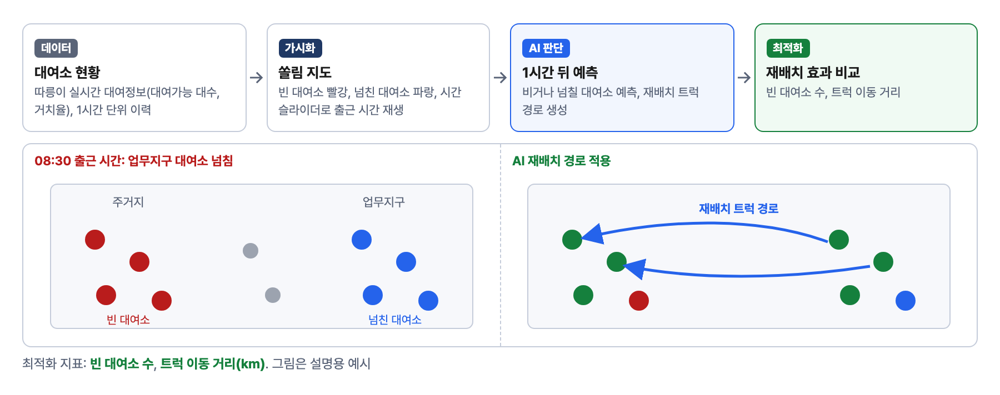

| 데이터 | 내용 | 제약 |
|---|---|---|
| [따릉이 실시간 대여정보(OA-15493)][seoul-bike] | 대여소별 대여가능 대수, 거치율, 위치 | 1회 1,000건, JSON, 인증키 필요 |
| 대여소별 대여가능 수량(1시간 단위) | 2023~2025 분기 파일 | 잔여 대수 기준 |

**3-2. 해외에는 AI 재배치 도구와 연구가 있고, 국내 공개 데이터 기반 사례는 확인하지 못했습니다.**

SmartFlow 연구는 Citi Bike 시뮬레이션에서 불균형을 95% 이상 감소시켰고, LLM이 현장 직원용 작업 지시문을 만듭니다. 세계 공유 자전거 시장은 2025년 40억~98억 달러, 연 4~10% 성장이 전망됩니다.

| 구분 | 제품·기관 | 방식 | 이 주제와의 차이 |
|---|---|---|---|
| 국내 | 서울시설공단 | 집중관리대여소 330곳 전담 인력, 마일리지 | 사람 판단 중심 |
| 해외 | Lyft Urban Solutions(Urban Sharing) | AI로 재배치·배터리·정비 작업 지원(빌바오) | 운영사 내부 도구 |
| 연구 | SmartFlow(arXiv 2601.00868) | DQN 재배치와 LLM 작업 지시 | 시뮬레이션 결과, 서울 데이터 미적용 |

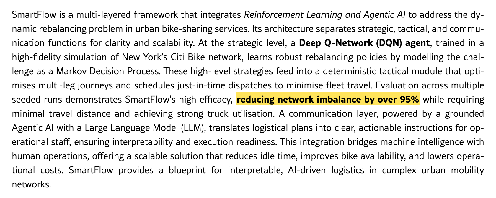

자료: [더팩트][bike-news], [내 손안에 서울][bike-news2], [SmartFlow][smartflow], [ZAG Daily(후원 기사)][urban], [Fortune Business Insights][mkt-bike]

### 빈 공간 매칭

**3-3. 빈 공간 매칭은 폐교와 공공시설의 빈 시간을 주변 수요와 맞춰 용도와 개방 시간을 제안합니다.**

전국 폐교는 4,037곳이며 1,403곳은 시·도교육청 보유입니다. 6~21세 학령인구는 한 해 사이 19만 3천 명 줄었습니다.

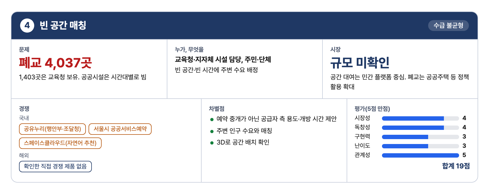

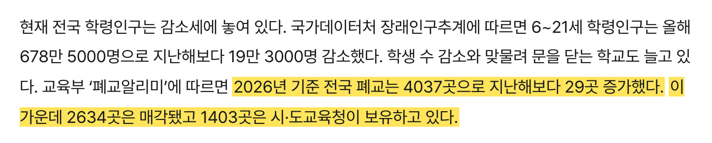

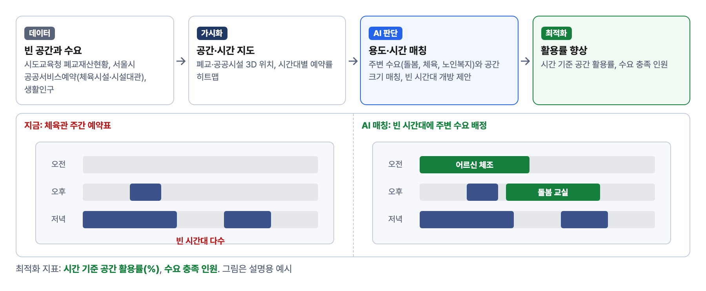

| 데이터 | 내용 | 제약 |
|---|---|---|
| 시도교육청 폐교재산현황 | 폐교명, 면적, 활용 현황 | 교육청별 파일, 형식 상이 |
| [서울시 공공서비스예약 정보(OA-2271)][seoul-rsv] | 체육시설, 시설대관 예약 | 매일 갱신, 공공누리 1유형 |
| 서울 생활인구 | 주변 수요 | 집계구 데이터 서비스 개편 중 |

**3-4. 공공과 민간 모두 예약 중개 서비스가 있고, 공급자 쪽 용도·개방 시간 제안 도구는 확인하지 못했습니다.**

공간 대여 시장 규모 수치는 확인하지 못했습니다.

| 구분 | 제품·기관 | 방식 | 이 주제와의 차이 |
|---|---|---|---|
| 국내 | 공유누리(행안부·조달청) | 공공 개방 시설 예약 포털(2020-03) | 예약 중개, 용도·개방 시간 제안 없음 |
| 국내 | 서울시 공공서비스예약 | 체육시설·시설대관 예약 | 예약 창구 |
| 국내 | 스페이스클라우드 | 민간 공간 대여, 자연어 공간 추천(2026-09) | 민간 공간과 이용자 검색 중심 |
| 국내 | 시·도교육청 | 폐교 자체 활용, 지자체 대부, 공공주택 전환 | 수요 데이터 비교 도구 미확인 |

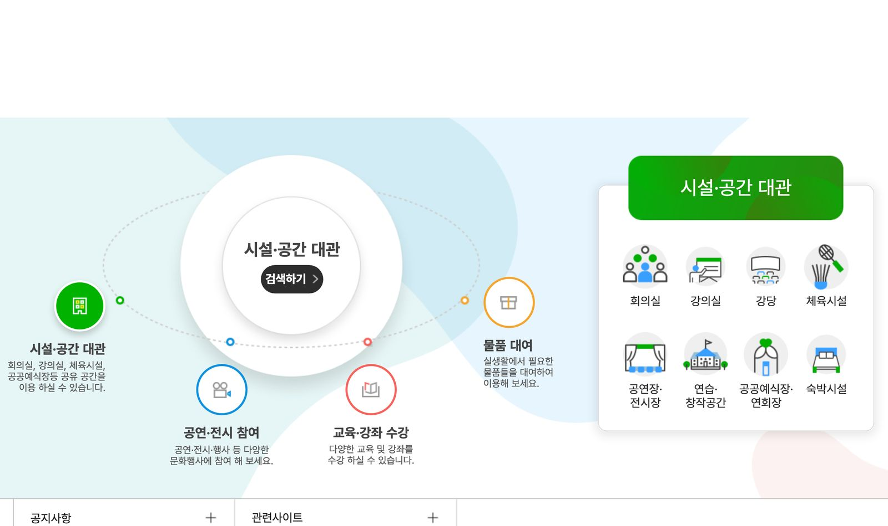

자료: [비즈한국][school-news], [벤처스퀘어][spacecloud]

## 4. 노후·기후 위험 공간: 땅꺼짐 위험 지도, 폭염 쉼터 사각지대

### 땅꺼짐 위험 지도

**4-1. 땅꺼짐 위험 지도는 사고·공사 이력으로 격자별 위험 점수를 매기고 GPR 탐사 순서를 정합니다.**

2021년부터 2026년 3월까지 전국 싱크홀 1,118건 중 70%(877건)의 원인이 관로 손상·노후입니다.

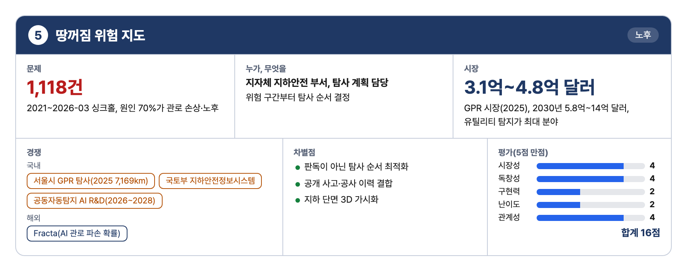

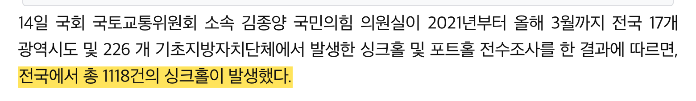

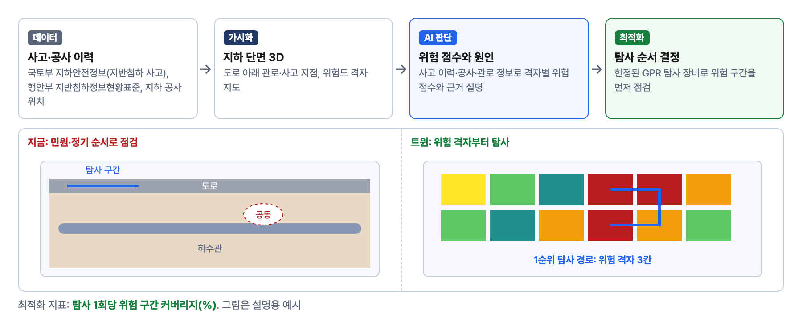

| 데이터 | 내용 | 제약 |
|---|---|---|
| 국토교통부 지하안전정보 | 지하안전평가, 지반침하 사고 정보 | XML·JSON, 활용신청 필요 |
| 서울안전누리 GPR 탐사 지도 | 탐사 결과, 공동 위치 | 서울 한정, 내려받기 형식 미확인 |
| 하수관로 연식·재질 | 관로 노후도 | 공개 범위 미확인. 구현의 가장 큰 제약 |

**4-2. 서울시는 2025년 GPR로 7,169km를 탐사해 공동 578개를 조치했고, 탐사 장비를 확대하는 중입니다.**

장비가 한정된 만큼 탐사 순서가 결과를 좌우합니다. GPR 시장은 2025년 3.1억~4.8억 달러이며, 유틸리티 탐지가 가장 큰 응용 분야입니다.

| 구분 | 제품·기관 | 방식 | 이 주제와의 차이 |
|---|---|---|---|
| 국내 | 서울시 GPR 탐사 | 2025 7,169km 탐사, 공동 578개, 차량형 장비 10대로 확대 | 탐사 우선순위 산정 방식은 공개 자료 미확인 |
| 국내 | 국토부 지하안전정보시스템 | 사고 정보, GPR 결과 공개 확대 방침 | 정보 제공 중심 |
| 국내 | 공동자동탐지 AI R&D | 2026~2028, 씨스텍·시선아이티·건설기술연구원·국토안전관리원 | GPR 영상 판독 중심 |
| 해외 | Fracta | AI 관로 파손 확률, 조사 우선 구역(Leak Zones) | 상수도 대상, 미국 중심 |

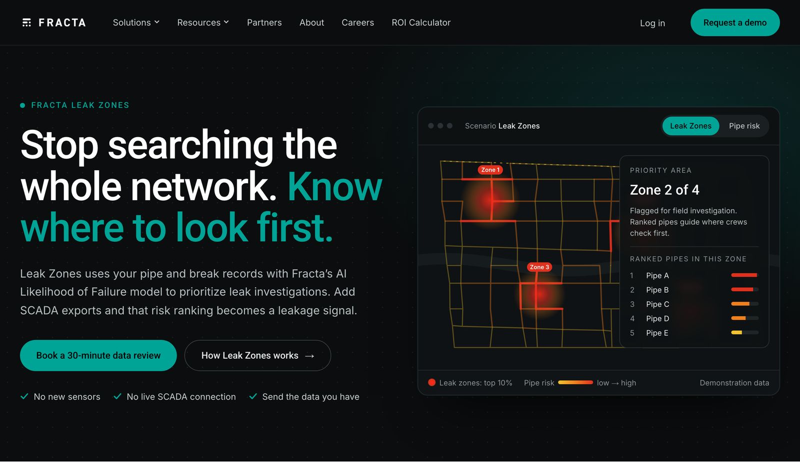

자료: [헤럴드경제][sink-news], [서울신문][gpr], [비즈워치][sink-news2], [MarketsandMarkets][mkt-gpr]

### 폭염 쉼터 사각지대

**4-3. 폭염 쉼터 사각지대 지도는 고령 인구와 쉼터 도보 거리를 겹쳐 사각지대를 찾고 신규 쉼터를 제안합니다.**

2025년 온열질환자는 4,460명이고, 기온이 38도 이상이면 자택 환자 비중이 6.2%에서 12.8%로 증가합니다.

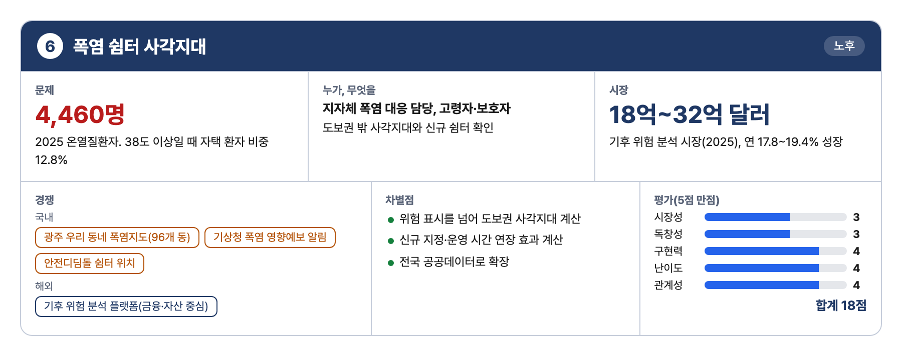

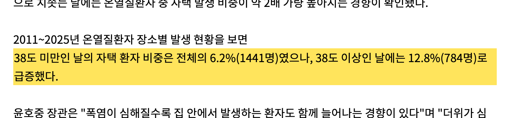

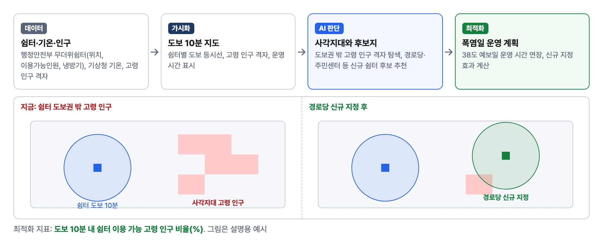

| 데이터 | 내용 | 제약 |
|---|---|---|
| 행정안전부 무더위쉼터 | 위치, 면적, 이용가능인원, 냉방기 보유 | XML·JSON, 2024-09 수정 |
| 서울특별시 무더위쉼터 | 위치, 운영시간 | 서울 한정 |
| 통계청 SGIS 격자 인구 | 고령 인구 분포 | 활용 신청 필요, 제공 단위 미확인 |

**4-4. 광주는 2026-07부터 30m 단위 열분포와 행정동 취약등급을 보여 주는 폭염지도를 운영합니다.**

광주 지도는 5개 구 96개 동에 한정되고, 쉼터 사각지대와 신규 지정 효과는 계산하지 않습니다. 기후 위험 분석 시장은 2025년 18억~32억 달러로 추정됩니다.

| 구분 | 제품·기관 | 방식 | 이 주제와의 차이 |
|---|---|---|---|
| 국내 | 광주 우리 동네 폭염지도 | 30m 열분포, 행정동 취약등급, 쉼터 위치 | 96개 동 한정, 사각지대·신규 지정 계산 없음 |
| 국내 | 기상청 폭염 영향예보 알림 | 주의 이상 시 문자·카카오톡 알림 | 경보 전달 |
| 국내 | 안전디딤돌 | 쉼터 위치 안내 | 위치 목록 |
| 해외 | 기후 위험 분석 플랫폼 | 자산·금융 기후 리스크 분석 | 공공 쉼터 운영 대상 아님 |

자료: [뉴시스][heat-news], [뉴시스][heat-news2], [MTN][heatmap], [Fortune Business Insights][mkt-heat]

## 5. 공통 엔진과 선택: 동점 3개, 팀 기준으로 선택

**5-1. 여섯 주제는 공공데이터 수집, 공간 그래프, 계산 모듈, AI 에이전트, 화면 5개 계층을 공유합니다.**

해커톤에서는 엔진 1개와 시나리오 1~2개를 시연하는 구성이 가능합니다.

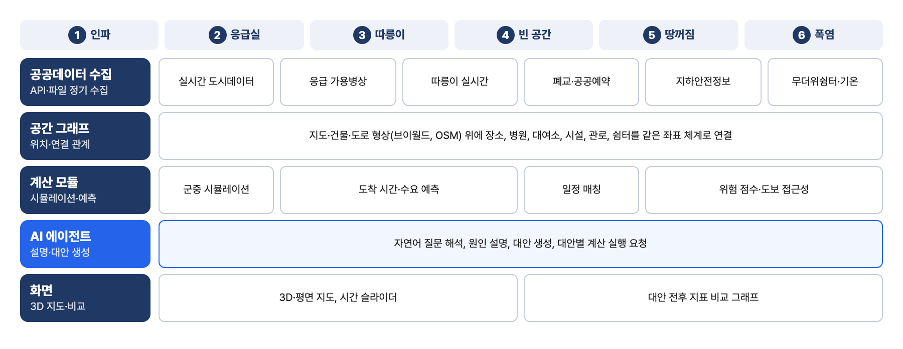

**5-2. 5개 기준 평가에서 인파 리허설, 따릉이 재배치, 빈 공간 매칭이 각 19점으로 같습니다.**

각 1~5점이며 난이도는 쉬울수록 높은 점수입니다(2026-11-18 사용자 결정).

| 주제 | 시장성 | 독창성 | 구현력 | 난이도 | 관계성 | 합계 | 근거 |
|---|---:|---:|---:|---:|---:|---:|---|
| 인파 리허설 | 4 | 4 | 3 | 3 | 5 | 19 | 정부 집중 관리 수요, 군중 시뮬레이션 구현 부담 |
| 응급실 길찾기 | 4 | 3 | 4 | 4 | 3 | 18 | 실시간 API 공개, 기존 상황실 업무와 겹침, 3D 비중 낮음 |
| 따릉이 재배치 | 3 | 3 | 5 | 4 | 4 | 19 | 실시간·이력 데이터 공개, 해외 재배치 연구 다수 |
| 빈 공간 매칭 | 4 | 4 | 3 | 3 | 5 | 19 | 폐교 1,403곳 활용 수요, 교육청별 데이터 형식 상이 |
| 땅꺼짐 위험 지도 | 4 | 4 | 2 | 2 | 4 | 16 | 관로 상세 데이터 공개 범위 미확인 |
| 폭염 쉼터 사각지대 | 3 | 3 | 4 | 4 | 4 | 18 | 데이터 확보 쉬움, 광주 폭염지도와 일부 겹침 |

주: 점수는 조사 근거 기준 작성자 판단이며, 공고의 심사 기준 확인 후 재평가 대상.

**5-3. 동점인 세 주제는 강점이 달라, 팀이 중시하는 기준에 따라 선택하는 구성입니다.**

| 중시하는 기준 | 주제 | 이유 |
|---|---|---|
| 시연 장면의 재미 | 인파 리허설 | 병목 발생과 해소 과정을 화면으로 바로 확인 |
| 데이터 안정성 | 따릉이 재배치 | 실시간 API와 시간 단위 이력이 모두 공개 |
| 공간 가시화 비중 | 빈 공간 매칭 | 건물 3D와 시간표를 함께 표시 |
| 사회적 관심 | 응급실 길찾기 | 응급실 이송 지연 보도가 2025~2026년 지속 |
| 경쟁 공백 | 땅꺼짐 위험 지도 | 탐사 순서 최적화 제품을 국내에서 확인하지 못함 |
| 짧은 구현 기간 | 폭염 쉼터 사각지대 | 정적 데이터와 도보 거리 계산 중심 |

## 6. 제한 사항: API 미호출, 시장 수치는 공개 요약 기준

**6-1. 데이터 항목은 포털 페이지로 확인했고, 인증키 발급과 실제 호출은 하지 않았습니다.**

- 하수관로 연식·재질, 공유누리 API, 통계청 SGIS 격자 인구의 제공 범위는 확인하지 못했습니다.
- 시장 규모는 유료 보고서의 공개 요약이며, 공간 대여 시장 규모는 확인하지 못했습니다.
- 경쟁 제품의 "이 주제와의 차이"는 공개 자료 기준 작성자 판단입니다.
- 시연 장면 그림의 수치는 설명용 예시입니다. 도식 원본은 `docs/reports/2026-11-18-korea-space-topics/diagrams/`입니다.

## 다음 작업

| 작업 | 기한 | 담당 |
|---|---|---|
| 해커톤 공고의 기간, 제공 데이터, 심사 기준 확인과 재평가 | 2026-11-19 | 미정 |
| 공공데이터포털·서울 열린데이터광장 인증키 신청 | 2026-11-19 | 미정 |
| 주제 1~2개 선택과 [기술 선택 기록](../decisions/README.md) 작성 | 2026-11-19 | 팀 전체 |

## 관련 자료

- [PDF 보고서](../../../reports/2026-11-18-korea-space-topics/report.pdf)
- [디지털트윈 조사(해외 기술 동향, 경쟁 제품)](digital-twin-survey.md)

[crowd-news]: https://m.korea.kr/news/policyNewsView.do?newsId=148973954
[fnnews]: https://www.fnnews.com/news/202305101834193923
[seoul-city]: https://data.seoul.go.kr/dataList/OA-21285/A/1/datasetView.do
[mkt-crowd]: https://www.marketresearch.com/LP-Information-Inc-v4134/Global-Pedestrian-Simulation-Crowd-Software-42003584
[intellivix]: https://m.boannews.com/html/detail.html?idx=141072
[skt]: https://byline.network/2026/04/8-444/
[er-news]: https://www.dailymedi.com/news/news_view.php?wr_id=935723
[er-news3]: https://www.inews24.com/view/2017361
[er119]: https://www.dailymedi.com/news/news_view.php?wr_id=934145
[mkt-er]: https://www.htfmarketintelligence.com/report/global-hospital-capacity-management-solutions-market
[bike-news]: https://news.tf.co.kr/read/life/2241109.htm
[bike-news2]: https://mediahub.seoul.go.kr/archives/2016177
[seoul-bike]: https://data.seoul.go.kr/dataList/OA-15493/A/1/datasetView.do
[smartflow]: https://arxiv.org/abs/2601.00868
[urban]: https://zagdaily.com/featured/using-ai-to-keep-the-wheels-turning-in-bilbaos-bike-share/
[mkt-bike]: https://www.fortunebusinessinsights.com/index.php/bike-sharing-market-105908
[school-news]: https://bizhankook.com/articles/public-housing-on-closed-schools.html
[seoul-rsv]: https://data.seoul.go.kr/dataList/OA-2271/A/1/datasetView.do
[spacecloud]: https://www.venturesquare.net/1112767/
[sink-news]: https://www.heraldk.com/article/2026051320503362226
[gpr]: https://m.go.seoul.co.kr/news/2025/10/19/20251019500046
[sink-news2]: https://news.bizwatch.co.kr/article/real_estate/2025/05/27/0016
[mkt-gpr]: https://www.marketsandmarkets.com/ResearchInsight/ground-penetrating-radar-market-trends.asp
[heat-news]: https://www.newsis.com/view/NISX20260514_0003629135
[heat-news2]: https://www.newsis.com/view/NISX20260801_0003732421
[heatmap]: https://news.mtn.co.kr/news-detail/2026072914532497603
[mkt-heat]: https://www.fortunebusinessinsights.com/climate-risk-analytics-market-116031
