# 공조 설비 정비 문제 배경과 시장 조사

> **요약** (기준일 2026-11-19)
>
> - 문제 배경 자료 56건을 검토해 43건을 수록함. 현장 문제는 고장 상시 발생, 경험 의존 원인 탐색, 공간·데이터 정보 부재, 제도·인력 공백 4가지
> - 경쟁 제품은 도면 3D 변환, BIM·스캔 트윈, 고장 진단 소프트웨어, 제조사 원격 관리, 현장 AR 5개 유형이며, 각 유형은 정비 흐름의 일부만 담당
> - 차별점은 2D 도면 1장 시작, 3D 위치와 원인 후보 연결, 제조사 무관 연결, 현장 겹쳐보기 4가지. 모두 구현 전이며 측정 지표를 정함
>
> | 항목 | 값 | 비교 기준 |
> |---|---|---|
> | 매일 고장 경보가 있는 공조기 | 40% | 터미널 유닛 30%(LBNL 2023, 설비 6만 대 이상) |
> | 고장 진단 소프트웨어 에너지 절감 | 중앙값 9% | 에너지 정보 시스템 4%(LBNL, 도입 2년 기준) |
> | 데이터 포인트 연동 비용 | 1개당 230~1,880달러 | 초기 비용~5년 보유 비용(ASHB 2020) |
>
> **다음 작업**: 검증 지표 측정 방법 확정(미정)

[서비스 기획](../service-plan.md)의 문제 근거와 경쟁 분석입니다. 2026-11-19에 웹 검색 32회를 수행했고, 논문·보고서 PDF 15건을 내려받아 문장을 확인했습니다. 수치마다 확인 수준을 [자료 목록](#7-자료-목록-수록-43건과-제외-13건)에 표시했습니다.

## 1. 조사 방법: 웹 검색 32회, 자료 56건 검토

**1-1. 국내 기사·기관, 국내 논문, 해외 논문·보고서, 기업·시장 자료 4종을 검토했고, 22건은 원문 강조 캡처로 확인했습니다.**

학술 DB(KCI, Scopus)를 직접 검색하지 않았으므로 웹 검색에 노출되지 않은 논문은 빠졌을 수 있습니다.

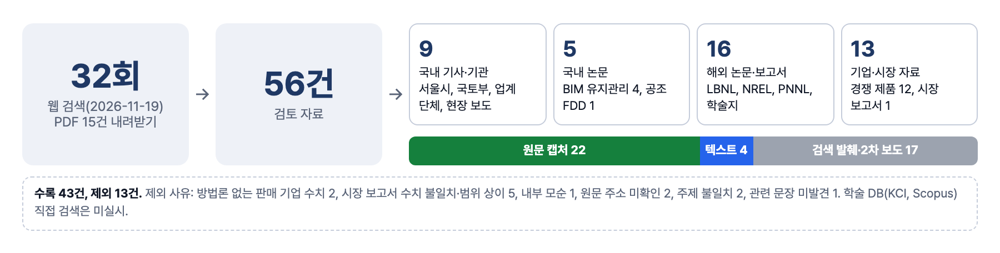

## 2. 현장 문제: 고장, 원인 탐색, 정보 부재, 제도 공백 4가지

**2-1. 공조 설비 고장은 매일 발생하지만, 정비 기술자는 2D 도면과 경보 목록만으로 원인을 찾습니다.**

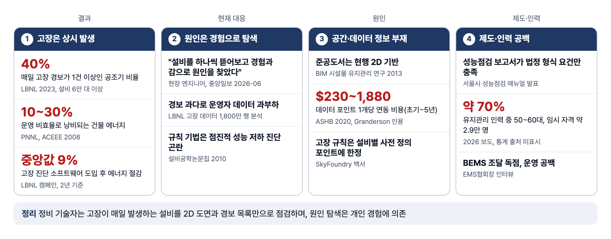

**2-2. 고장 상시 발생: 공조기 40%에서 매일 고장 경보가 1건 이상 발생합니다.**

LBNL은 설비 6만 대 이상의 고장 진단 기록을 분석했습니다. 운영 비효율로 낭비되는 에너지는 10~30%로 추정됩니다.

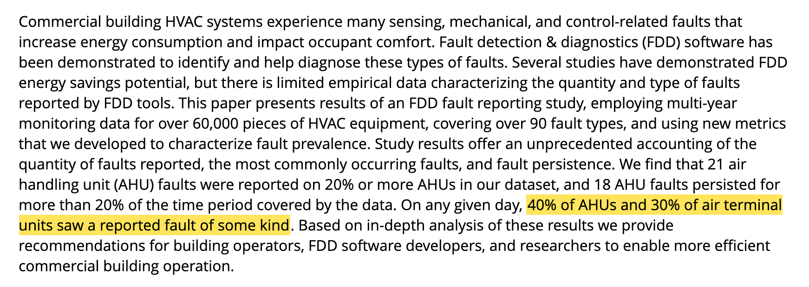

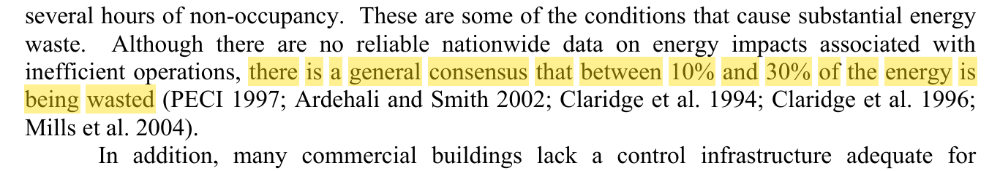

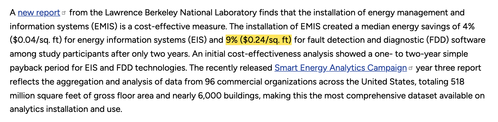

**2-3. 경험 의존 원인 탐색: 현장 엔지니어는 설비를 하나씩 열어 원인을 찾았다고 말합니다.**

LBNL은 경보가 많아 운영자에게 데이터 과부하가 생길 위험을 지적했습니다. 국내 연구는 전문가 규칙 기법이 점진적 성능 저하를 진단하기 어렵다고 보고했습니다.

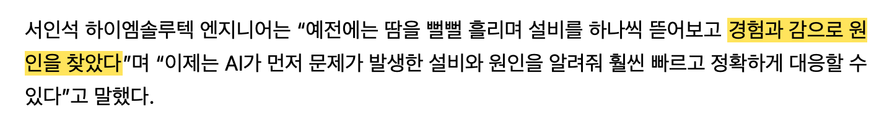

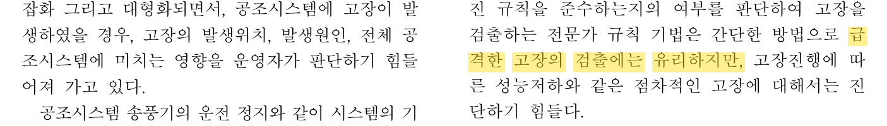

**2-4. 공간·데이터 정보 부재: 준공도서는 2D 기반이고, 데이터 포인트 연동은 수작업입니다.**

포인트 태깅은 사람이 수행하는 작업이며, 1개당 비용은 초기 230달러, 5년 보유 시 1,880달러로 인용됩니다. 국내 연구는 BIM 데이터가 유지관리에 필요한 항목을 포함하는지 검토되지 않았다고 지적했습니다.

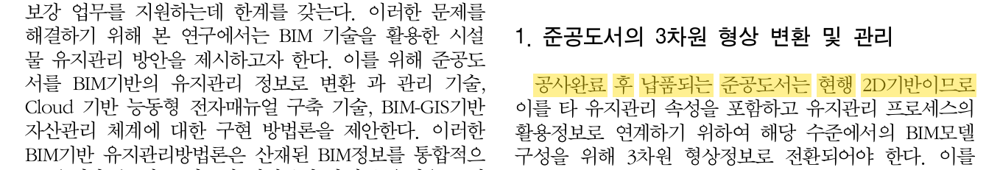

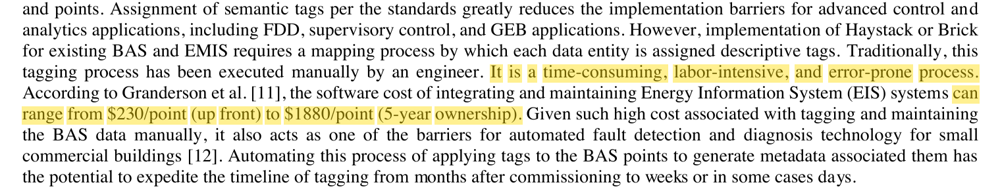

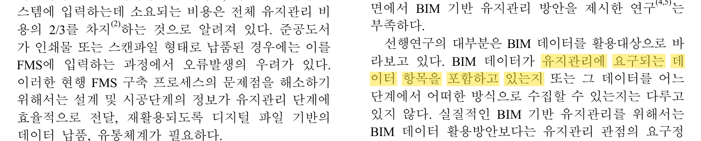

**2-5. 제도·인력 공백: 성능점검 보고서가 형식 요건만 갖춘 사례가 있고, 유지관리 인력은 고령화되었습니다.**

서울시는 저가 수주 현장의 보고서가 실질 유지관리에 도움이 되지 않는다고 밝혔습니다. 유지관리 인력의 약 70%가 50~60대라는 보도는 통계 출처를 표시하지 않았습니다.

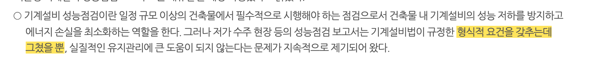

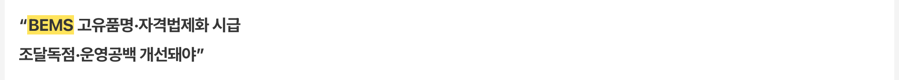

| 문제 | 근거 | 확인 수준 |
|---|---|---|
| 소규모 건물 미지원 | 1,000㎡ 미만 상업 건물에는 고장 진단 도구가 부족함(NREL 2018) | 원문 캡처 |
| 도입 장벽 | 전문가 29명 인터뷰, 기술·경제·사용자·제도 장벽(Energy and Buildings 2024) | 원문 캡처 |
| 트윈 기반 이상 탐지 | IFC 기반 트윈에서 공조 원심 펌프 이상 탐지(Automation in Construction 2020) | 초록 캡처 |
| 도면 3D 학습 데이터 부족 | 2D 도면→BIM 학습 데이터 부족으로 합성 데이터 생성(Automation in Construction 2025) | 검색 발췌 |
| 반자동 재구성 | 기존 건물 스캔 도면에서 BIM 재구성 시 사람 보정 병행(HAL Paris 8) | 검색 발췌 |

## 3. 시장 유형: 5개 유형이 정비 흐름의 일부만 담당

**3-1. 도면에서 현장 조치까지 5단계 중 한 업체 유형이 담당하는 범위는 1~3단계입니다.**

도면 3D 변환은 앞 2단계, 고장 진단 소프트웨어는 진단 단계, AR 업체는 현장 단계를 담당합니다.

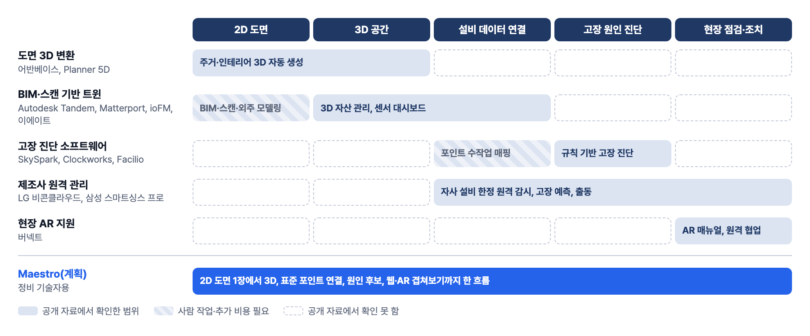

| 유형 | 업체 | 시장 근거 |
|---|---|---|
| 도면 3D 변환 | 어반베이스, Planner 5D | 어반베이스는 국내 아파트 도면 약 80% 보유(2019 보도) |
| BIM·스캔 기반 트윈 | Autodesk Tandem, Matterport, ioFM, 이에이트, Willow | Tandem은 BIM Collaborate Pro 구독에 포함 |
| 고장 진단 소프트웨어 | SkySpark, Clockworks, Facilio | 공조 최적화 소프트웨어 46억 달러(2026)→67억 달러(2031, Memoori) |
| 제조사 원격 관리 | LG 비콘클라우드, 삼성 스마트싱스 프로 | 하이엠솔루텍 원격 유지보수 1만 773곳(2026-06 보도) |
| 현장 AR 지원 | 버넥트 | AR 매뉴얼 제작비 95% 절감 주장(회사 자료) |

주: Memoori는 유료 보고서 요약, 하이엠솔루텍과 버넥트 수치는 회사 측 주장.

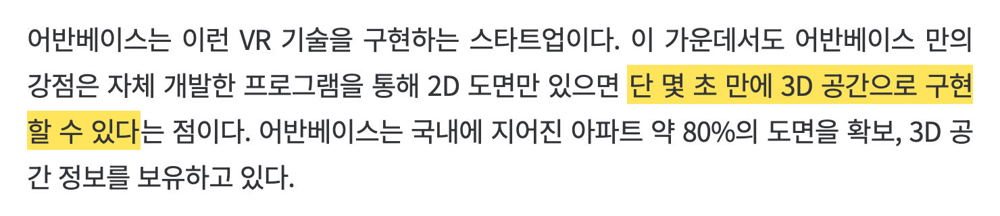

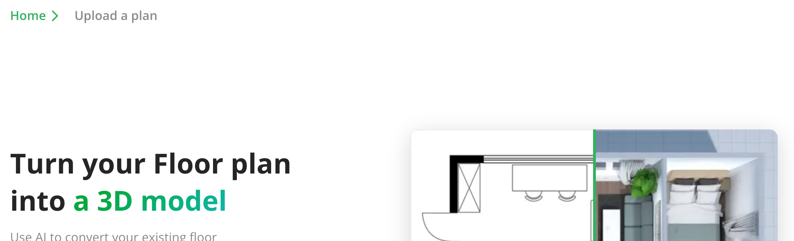

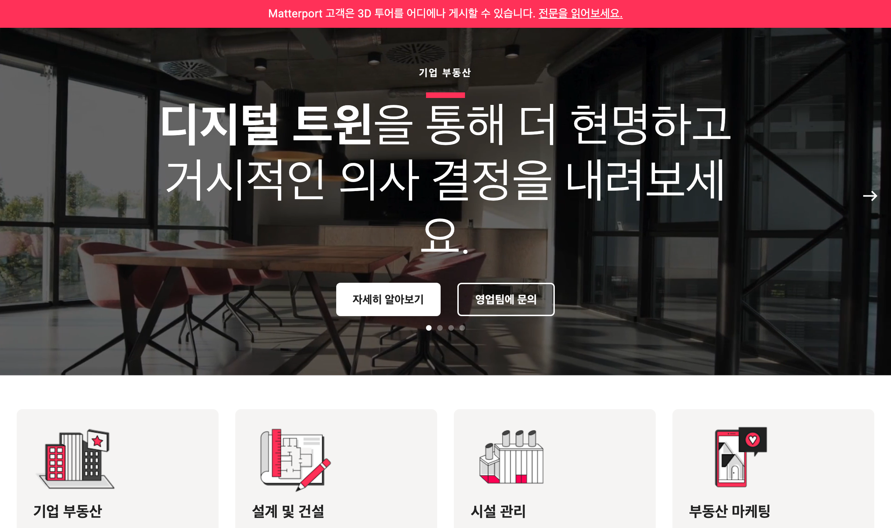

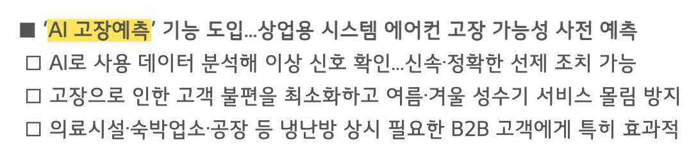

## 4. 업체별 부족한 점: 시작 조건, 공간 맥락, 설비 범위

**4-1. 3D 트윈 업체는 BIM·스캔·모델링을 시작 조건으로 요구하고, 고장 진단 업체는 공간 맥락이 없습니다.**

제조사 원격 관리는 자사 모델에 한정됩니다. 표의 회색 칸은 공개 자료에서 확인하지 못한 기능이며, 기능이 없다는 뜻은 아닙니다.

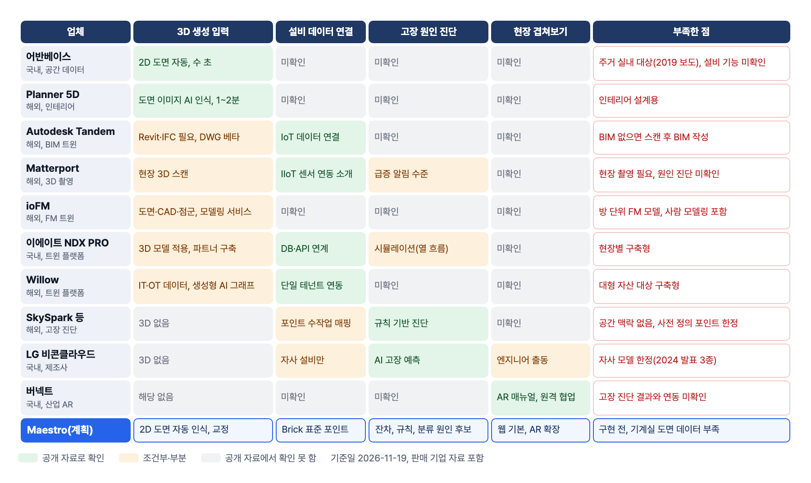

**4-2. 근거 문장은 업체 공식 자료와 보도에서 확인했습니다.**

| 업체 | 부족한 점 | 근거 | 확인 수준 |
|---|---|---|---|
| Autodesk Tandem | Revit·IFC 입력, DWG는 베타. BIM이 없으면 스캔 후 BIM 작성 | Autodesk 포럼 Q&A(2024) | 검색 발췌 |
| Matterport | 현장 3D 스캔 필요. 진단은 급증 알림 수준 | Matterport 시설 관리 글 | 검색 발췌, 판매 기업 |
| ioFM | 문서를 3D로 바꾸는 모델링 서비스, 방 단위 과금 | Siemens 제품 페이지 | 검색 발췌, 판매 기업 |
| 이에이트 NDX PRO | 현장별 구축과 운영은 파트너사 담당 | 2026-07 SaaS 전환 보도 | 검색 발췌 |
| Willow | IT·OT 데이터 수집 후 단일 테넌트 Azure 구축 | Willow 배포 안내 | 원문 캡처 |
| SkySpark 등 | 규칙은 설비별 사전 정의 포인트에 한정, 외부 데이터 미포함 | SkyFoundry 백서 | 원문 캡처 |
| LG 비콘클라우드 | 2024 발표 지원 모델 Multi V Super 4·5, MULTI V i | LG전자 보도자료 | 원문 캡처 |
| 버넥트 | AR 매뉴얼·원격 협업 중심. 진단 연동 미확인 | 에너지경제 보도 | 검색 발췌 |

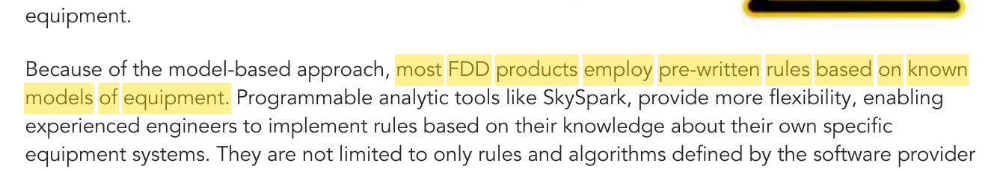

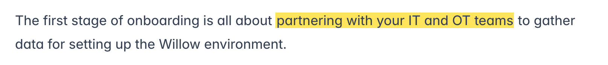

## 5. 차별점: 시작 조건, 진단 결과, 설비 범위, 현장 연결

**5-1. Maestro는 2D 도면 1장에서 시작해 원인 후보를 3D 위치와 현장 화면에 연결합니다.**

차별점 4가지는 구현 전 계획입니다. 해커톤 시연에서 아래 지표로 측정합니다.

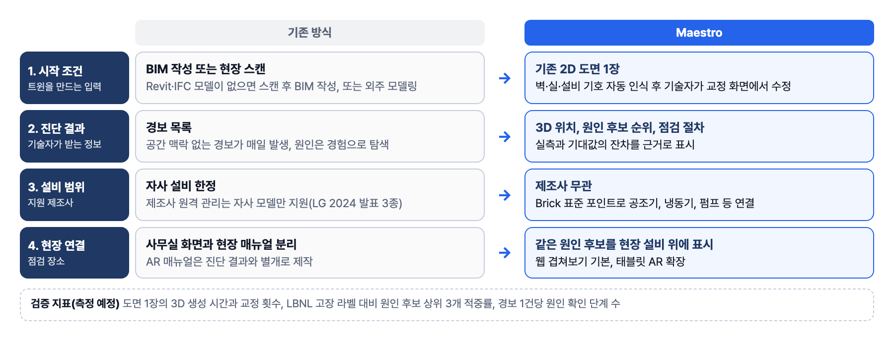

| 차별점 | 측정 지표 | 비교 기준 |
|---|---|---|
| 2D 도면 1장 시작 | 도면 1장의 3D 생성 시간, 교정 횟수 | 수작업 3D화 약 1개월(어반베이스 대표 발언, 2019) |
| 3D 위치와 원인 후보 | LBNL 고장 라벨 대비 원인 후보 상위 3개 적중률 | 목표 미정 |
| 제조사 무관 연결 | 연결한 설비 종류 수 | MVP 목표 5종 |
| 현장 겹쳐보기 | 경보 1건당 원인 확인 단계 수 | 목표 미정 |

## 6. 제한 사항: 학술 DB 미검색, 판매 기업 자료 포함

**6-1. 웹 검색 기반 조사라 KCI·Scopus 전수 검색과는 다르며, 경쟁 제품 기능은 공개 자료 기준입니다.**

- 업체 기능은 데모나 계약 문서로 확인하지 않았습니다. 회색 칸은 확인하지 못한 항목입니다.
- 유지관리 인력 70%와 임시 자격 2.9만 명은 통계 원출처를 확인하지 못했습니다.
- LBNL 18 million rows 보고서와 Crowe 2023 PDF는 텍스트 좌표 추출이 실패해, 초록 페이지 캡처로 대체했습니다.
- Autodesk Tandem 제품 페이지와 ioFM 페이지는 접근 차단·쿠키 창으로 캡처하지 못했습니다.

## 7. 자료 목록: 수록 43건과 제외 13건

**7-1. 확인 수준은 원문 캡처, 원문 텍스트(PDF 문장 확인), 검색 발췌·2차 보도 3단계입니다.**

| 번호 | 자료 | 사용 위치 | 확인 수준 |
|---|---|---|---|
| D1 | [서울시 성능점검 표준 매뉴얼](https://news.seoul.go.kr/citybuild/archives/526952) | 2-5 | 원문 캡처 |
| D2 | [서울시 유지관리자 선임 안내](https://news.seoul.go.kr/citybuild/archives/507833) | 서비스 기획 1절 | 원문 캡처 |
| D3 | [스마트투데이, 서울시 성능점검 전문가 자문단](https://www.smarttoday.co.kr/ko-kr/articles/100282) | 2-5 | 검색 발췌 |
| D4 | [한국건설기계설비신문, 국토부 과장 인터뷰](https://www.kharn.kr/mobile/article.html?no=29749) | 서비스 기획 1절 | 원문 캡처 |
| D5 | [한국건설기계설비신문, 성능점검협회장 인터뷰](https://www.kharn.kr/mobile/article.html?no=29133) | 2-5 | 검색 발췌, 업계 단체 |
| D6 | [한국건설기계설비신문, EMS협회장 인터뷰](https://www.kharn.kr/mobile/article.html?no=27943) | 2-5 | 원문 캡처(제목), 업계 단체 |
| D7 | [중앙일보(다음 전재), AI 에러 알림](https://v.daum.net/v/20260625172118989) | 2-3, 3절 | 원문 캡처 |
| D8 | [다음 콘텐츠, 기계설비법 유예와 인력](https://v.daum.net/v/8t1Nh7LxYW) | 2-5 | 원문 캡처, 통계 출처 미표시 |
| D9 | [한국건설기계설비신문, 임시등급 연장](https://www.kharn.kr/news/article.html?no=29840) | 기술 조사 7절 | 원문 텍스트 |
| K1 | [BIM을 이용한 시설물 유지관리 방안(2013)](https://koreascience.kr/article/CFKO201328660927323.pdf) | 2-4 | 원문 캡처 |
| K2 | [시설물 유지관리를 위한 BIM 데이터 입력기준(설비공학논문집 2013)](https://koreascience.kr/article/JAKO201321963619680.pdf) | 2-4 | 원문 캡처 |
| K3 | [COBie: 시설물 유지관리 정보교환체계](https://koreascience.kr/article/JAKO201206737753937.pdf) | 2-4 | 원문 텍스트 |
| K4 | [BIM 기반 시설물 유지관리 데이터 정의(KIBIM 2020)](https://koreascience.kr/article/JAKO202011836959789.pdf) | 2-4 | 원문 텍스트 |
| K5 | [정풍량 공조시스템 고장검출 및 진단(설비공학논문집 2010)](https://koreascience.kr/article/JAKO201008758934126.pdf) | 2-3 | 원문 캡처 |
| P1 | [Katipamula, Brambley, ACEEE 2008](https://www.aceee.org/files/proceedings/2008/data/papers/4_42.pdf) | 2-2 | 원문 캡처 |
| P2 | [Crowe 외, HVAC 고장 빈도(STBE 2023)](https://eta-publications.lbl.gov/publications/empirical-analysis-prevalence-hvac) | 2-2 | 초록 캡처 |
| P3 | [LBNL, 고장 데이터 1,800만 행 분석](https://eta-publications.lbl.gov/sites/default/files/what_we_learned_from_analyzing_18_0.pdf) | 2-3 | 원문 텍스트 |
| P4 | [DOE, Smart Energy Analytics Campaign](https://www.energy.gov/cmei/buildings/articles/smart-energy-analytics-campaign-reveals-continued-energy-and-cost-savings) | 2-2 | 원문 캡처 |
| P5 | [NREL, 소규모 건물 AFDD 장벽(2018)](https://www.osti.gov/pages/biblio/1477586) | 2-5 표 | 원문 캡처 |
| P6 | [Energy and Buildings 2024, FDD 도입 장벽](https://vbn.aau.dk/ws/files/693826470/1-s2.0-S0378778823010319-main.pdf) | 2-5 표 | 원문 캡처 |
| P7 | [ASHB 2020, BAS 포인트 자동 태깅](https://www.ashb.com/wp-content/uploads/2020/08/IS-2020-108.pdf) | 2-4 | 원문 캡처 |
| P8 | [Lu 외, 트윈 기반 이상 탐지(2020)](https://www.repository.cam.ac.uk/handle/1810/305624) | 2-5 표 | 초록 캡처 |
| P9 | [Liang 외, 합성 BIM 데이터셋(2025)](https://ir.library.osaka-u.ac.jp/repo/ouka/all/103515/AutomConstr_181_106584.pdf) | 2-5 표 | 검색 발췌 |
| P10 | [Cambeiro Barreiro 외, 2D 도면 의미 3D(2023)](https://arxiv.org/abs/2306.01642) | 기술 조사 | 검색 발췌 |
| P11 | [HAL Paris 8, 스캔 도면 BIM 재구성](https://hal-univ-paris8.archives-ouvertes.fr/hal-02109541v1) | 2-5 표 | 검색 발췌 |
| P12 | [준공 BIM 속성 체계 리뷰(ITcon 2024)](https://ouci.dntb.gov.ua/works/40NpqEm9) | 6절 | 검색 발췌 |
| P13 | [기존 건물 BIM 적용 과제(SBTIC)](https://eventos.antac.org.br/index.php/sbtic/article/download/7567/5886/34259) | 6절 | 검색 발췌 |
| P14 | [시설 관리 AR·MR 체계적 리뷰(SASBE 2023)](https://emerald.com/insight/content/doi/10.1108/SASBE-11-2022-0254/full/html) | 4절 AR | 검색 발췌 |
| P15 | [LBNL, 차세대 FDD 시장 장벽](https://eta-publications.lbl.gov/bibcite/reference/35456) | 4절 | 검색 발췌 |
| P16 | [CleanTechnica, PNNL 제어 개선 29% 절감](https://cleantechnica.com/2017/06/26/us-commercial-buildings-cut-energy-use-29-widespread-controls/) | 참고 | 2차 보도 |
| C1 | [비즈워치, 어반베이스(2019)](https://news.bizwatch.co.kr/article/real_estate/2019/03/22/0009) | 3절 | 원문 캡처 |
| C2 | [Planner 5D 도면 3D 변환](https://planner5d.com/ai/floor-plan-to-3d-model) | 3절 | 화면 캡처 |
| C3 | [Autodesk Tandem 포럼 Q&A](https://forums.autodesk.com/t5/tandem-forum/see-what-attendees-asked-during-our-may-2024-webinar-q-amp-a-is/m-p/12763156) | 4-2 | 검색 발췌 |
| C4 | [Matterport 시설 관리](https://matterport.com/learn/digital-twin/facility-management) | 3절, 4-2 | 화면 캡처, 판매 기업 |
| C5 | [Siemens, ioLabs ioFM](https://www.siemens.com/en-us/products/iolabs-ag-iofm-fast-and-cost-effective-way-to-digital-twin/) | 4-2 | 검색 발췌, 판매 기업 |
| C6 | [보안뉴스, 이에이트 데이터센터 시뮬레이션](https://m.boannews.com/html/detail.html?idx=134837) | 4-2 | 검색 발췌 |
| C7 | [Willow 배포 안내](https://willowinc.com/the-willow-deployment-journey/2717/) | 4-2 | 원문 캡처 |
| C8 | [SkyFoundry 백서](https://skyfoundry.com/file/82/Understanding-the-Data-Oriented-Tools-Available-to-Facility-Managers.pdf) | 4-2 | 원문 캡처, 판매 기업 |
| C9 | [LG전자 AI 고장예측 보도자료](https://www.lg.co.kr/media/release/27349) | 4-2 | 원문 캡처 |
| C10 | 삼성 스마트싱스 프로(D7 기사 언급) | 3절 | 검색 발췌 |
| C11 | [헬로티, 모넷코리아 공조 예지보전](https://hellot.net/news/article.html?no=113033) | 3절 | 검색 발췌 |
| C12 | [에너지경제, 버넥트 AR](https://m.ekn.kr/view.php?key=420328) | 3절, 4-2 | 검색 발췌, 회사 수치 |
| C13 | [Memoori, HVAC 최적화 보고서 2026](https://memoori.com/?p=21222) | 3절 | 검색 발췌, 유료 보고서 |

**7-2. 제외한 자료 13건과 제외 사유입니다.**

| 자료 | 제외 사유 |
|---|---|
| Oxmaint 블로그 2건(수리 시간 40% 감소, 교육 50% 단축) | 판매 기업 수치, 방법론 미표시 |
| Marketintelo FDD 시장 보고서 | 연평균 성장률 14.8%와 양 끝값(약 10%) 불일치 |
| HVAC 소프트웨어 시장 보고서 4종(FMI, Arizton, MRFR, DIResearch) | 범위 상이, 2025년 규모 7억~32억 달러 편차 |
| Coohom 도면 변환 비교 글 | 같은 항목 안에서 기능 유무 서술 모순 |
| AROMA-FF AR 현장 실험(탐색 시간 49% 감소) | 원문 주소 미확인 |
| 신영기, 설비저널 2015 AHU FDD 리뷰 | 원문 주소 미확정 |
| 서울신문 2001 노후 건축물 관리 | 주제 불일치(구조 안전) |
| Kode Labs FDD 문서 | 검색 결과가 다른 제품 문서 |
| 안효경 외 2013 BIM 유지관리 논문 | PDF에서 관련 문장 미발견 |

## 관련 자료

- [서비스 기획](../service-plan.md)
- [도면 인식·공조 고장 진단 기술 조사](floorplan-hvac-twin-tech.md)
- [디지털트윈 조사](digital-twin-survey.md) 4절 시장·경쟁
