# 기계실 도면과 공개 도면 데이터셋 비교

> **요약** (기준일 2026-11-19)
>
> - 공개 도면 데이터셋은 주거·상업 평면의 벽, 방, 문, 가구 중심이며, 기계실 장비·배관 기호 라벨이 있는 공개 데이터셋은 찾지 못함
> - 기계실 도면은 작은 기호(밸브 약 3mm), 배관·지시선 겹침, 태그 텍스트 의존, 계통별 색, 여러 시트 구성이 공개 데이터셋과 다름. 이 중 클래스, 크기, 겹침, 텍스트, 기호 표준, 확보 경로 6가지가 학습에 큰 영향을 줌
> - 대응은 벡터·레이어 직접 읽기, 타일 분할 검출, 텍스트 분리, 합성 도면 학습과 실제 도면 평가 분리, 교정 화면 라벨 누적
>
> | 항목 | 공개 데이터셋 | 기계실 도면 샘플 |
> |---|---|---|
> | 이미지 크기 | CubiCasa5K 평균 약 1,400×1,600px(2차 자료) | A1 시트 300dpi 9,933×7,016px |
> | 장비·배관 클래스 | 0종(CubiCasa5K, FloorPlanCAD 기준) | 장비 5종 이상, 밸브·배관·덕트·계기 |
> | 텍스트 | FloorPlanCAD는 텍스트 제거 | 장비 태그·배관명이 설비 식별 정보 |
>
> **다음 작업**: 국내 기계실 도면 확보 경로 결정, 설비 라벨 클래스 정의, 합성 도면 생성 규칙 설계(미정)

[서비스 기획](../service-plan.md) 이상 요건 1번(도면 자동 인식)의 학습 데이터 조사입니다. 2026-11-19에 웹 검색 15회를 수행했습니다. 해외 공개 기계실 도면 PDF 3건과 데이터셋 논문 7건을 내려받아 확인했습니다. [기술 조사](floorplan-hvac-twin-tech.md) 1절의 미확인 항목을 이어서 조사했습니다.

## 1. 기계실 도면 샘플: 평면도, 장비 일정표, 계통도 3종

**1-1. 국내 공개 기계실 도면은 웹 검색으로 찾지 못했고, 해외 공공 입찰 도면 3건을 샘플로 사용했습니다.**

샘플은 캐나다 위니펙시 입찰 도면 2건과 미국 BNL 발표 자료 1건입니다. 모두 CAD에서 내보낸 벡터 PDF입니다.

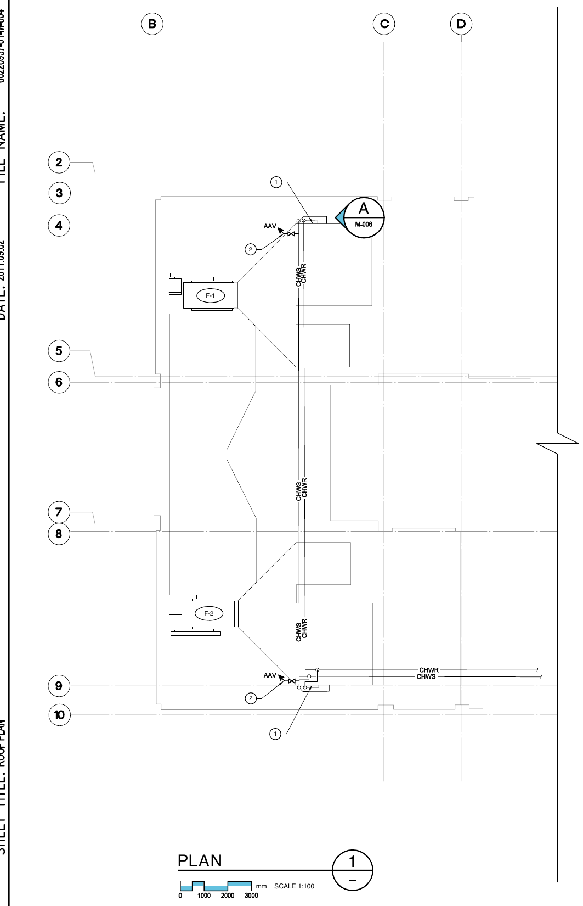

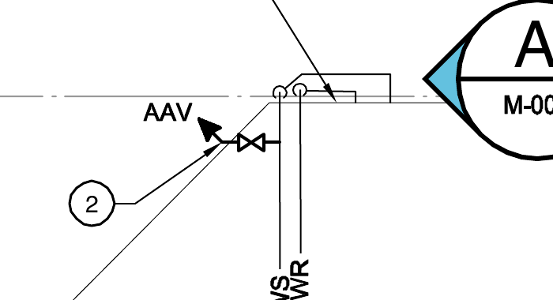

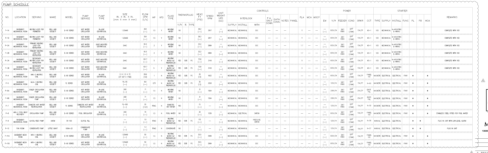

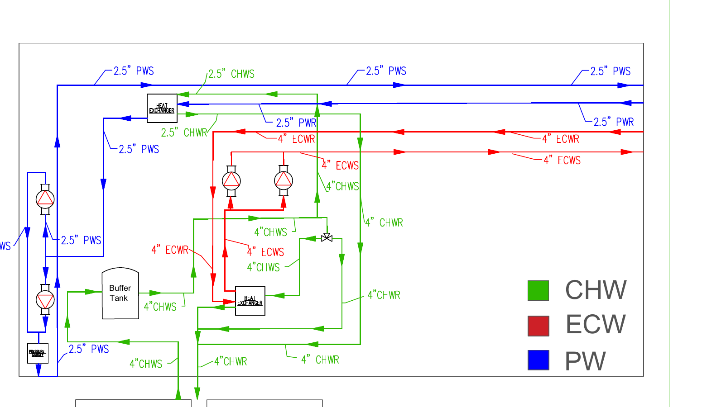

| 샘플 | 확인한 특징 | 측정값 |
|---|---|---|
| 평면도(M-006) | 기계실 2곳 1:100, 장비 태그 F-1~F-5, 배관명 CHWS·CHWR, 격자 기호, 사진, 표제란 | 시트 A1(841×594mm), 추출 단어 51개 |
| 평면도 확대 | 밸브 기호 폭 약 3mm(시트 폭의 0.4%), 지시선·격자선·배관이 한 지점에서 겹침 | 640px로 축소하면 밸브 약 2~3px |
| 장비 일정표(ME1.2) | 보일러·펌프·공기분리기·판형열교환기·팽창탱크 사양 표, 태그별 유량·동력 | 추출 단어 195개 |
| 계통도(BNL) | 냉수(CHW) 초록, 냉각수(ECW) 빨강, 공정수(PW) 파랑, 배관 지름 2.5·4인치 | 추출 단어 9개 |

주: 평면도의 주석 문단과 배관명은 텍스트 추출에 나오지 않았습니다. CAD 폰트가 PDF에서 선으로 저장된 것으로 판단하며, 확인은 화면 대조로만 했습니다.

## 2. 공개 데이터셋: 평면 4종, 배관 계장도 2종, 전기 기호 1종

**2-1. 공개 데이터셋 7종 중 기계실 장비·배관 기호를 라벨로 가진 데이터셋은 없었습니다.**

배관 계장도(P&ID) 데이터셋은 밸브·펌프 기호가 있지만 공정 플랜트 도면이며, 건물 기계실 평면과 형식이 다릅니다.

| 데이터셋 | 규모 | 형식 | 대상 | 클래스 | 기계실과의 관계 |
|---|---|---|---|---|---|
| CubiCasa5K(2019) | 5,000장 | 래스터 + 다각형 | 핀란드 주거 | 80종 이상, 기준 방 12·아이콘 11 | 벽·문 분할 사전학습 |
| FloorPlanCAD(2021) | 1만 5천 장 이상(v2) | 벡터 SVG, 선 단위 | 주거·상업 | 35종(v2), 30종(v1) | 텍스트 제거, 장비 클래스 없음 |
| ArchCAD-400K(2025) | 5,538장, 41만 3,062조각 | 벡터 | 공공·상업 86%, 주거 14% | 27종 | 레이어·블록 자동 라벨 방식 참고 |
| LS-CAD(CADSpotting) | 45~50장(논문 버전별 상이) | 벡터 | 대형 건축 도면 | 확인 못 함 | 대형 도면 슬라이딩 창 병합 참고 |
| Dataset-P&ID(2021) | 합성 500장 | 래스터 | 공정 P&ID | 기호 32 | 밸브·펌프 기호, 연결 주석 없음 |
| PID2Graph(2024) | 실제 소량 + 합성 | 래스터 + 그래프 | 공정 P&ID | 기호와 연결 | 연결 주석 형식 참고 |
| DELP(SkeySpot, 2025) | 45장, 2,450개 | 스캔 래스터 | 전기 배치도 | 34 | 소량 데이터 규모 참고 |

주: Jamieson 외(2024)는 공조·배관 도면 검출을 실험했지만 데이터 공개 여부를 확인하지 못했습니다. AI Hub에서 설비 도면 기호 데이터셋은 검색으로 찾지 못했습니다.

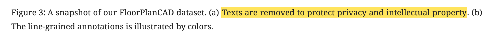

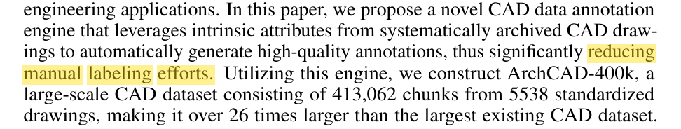

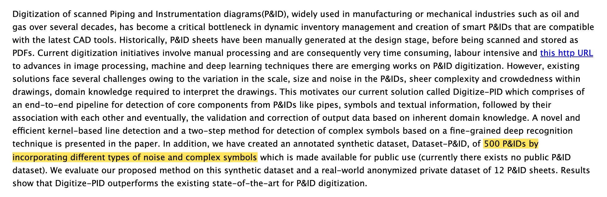

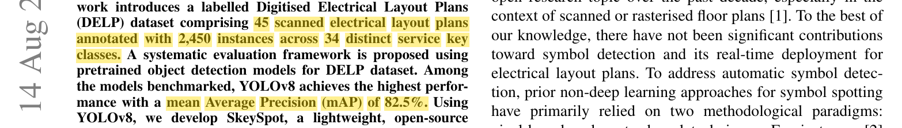

## 3. 차이와 학습 영향: 10개 항목 중 6개가 큰 영향

**3-1. 클래스, 크기·축척, 선 겹침, 텍스트, 기호 표준, 확보 경로 6개 항목이 학습에 큰 영향을 줍니다.**

공개 데이터셋에는 설비 클래스 라벨이 없습니다. 따라서 사전학습 효과는 벽 분할에 한정되고, 설비 기호는 새 라벨이 필요합니다.

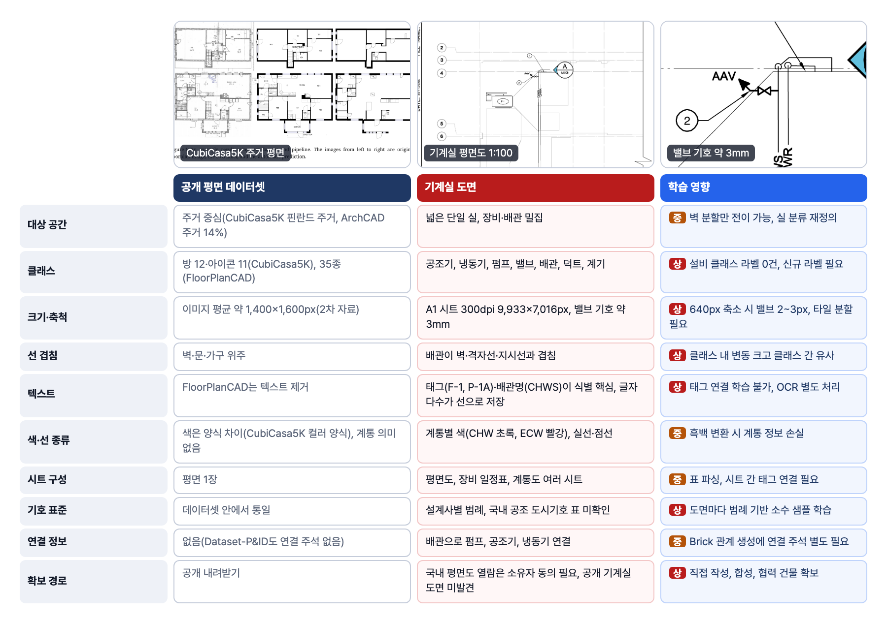

**3-2. 작은 기호와 겹침은 기존 연구에서도 검출 성능을 떨어뜨리는 원인으로 보고되었습니다.**

Jamieson 외는 공조 도면 기호가 클래스 안에서는 모양 차이가 크고 클래스 사이에서는 비슷하다고 보고했습니다. Rezvanifar 외는 평면 전체 대비 기호가 작은 문제를 타일 단위 학습으로 다뤘습니다.

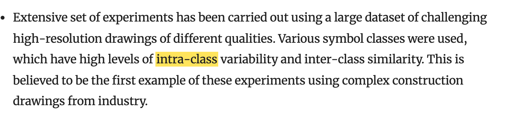

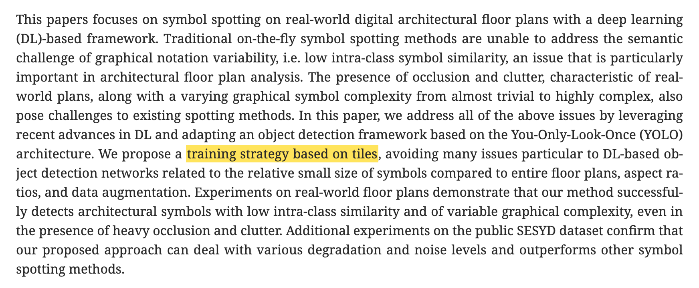

**3-3. 텍스트와 연결 정보가 없는 데이터셋으로는 태그와 장비의 연결, 배관 연결을 학습할 수 없습니다.**

기계실 도면에서 장비를 구분하는 정보는 기호 모양보다 태그(F-1, P-1A)입니다. 일정표의 사양도 태그로 조회합니다. FloorPlanCAD는 텍스트를 제거했고, Dataset-P&ID에는 연결 주석이 없습니다.

| 항목 | 공개 데이터셋 | 기계실 도면 | 학습 영향 |
|---|---|---|---|
| 클래스 | 방·문·가구·위생기구 | 공조기·냉동기·펌프·밸브·배관 | 설비 라벨 0건에서 시작 |
| 크기·축척 | 평균 약 1,400×1,600px | A1 300dpi 9,933×7,016px | 그대로 축소하면 작은 기호 소실 |
| 선 겹침 | 벽·가구 위주 | 배관·지시선·격자선 겹침 | 오검출, 분할 경계 오류 |
| 텍스트 | 제거 또는 부차 정보 | 태그·배관명이 식별 정보 | OCR 분리, 태그-장비 연결 별도 학습 |
| 색·선 종류 | 양식 차이 | 계통 의미(냉수, 냉각수) | 흑백 변환 시 계통 손실 |
| 시트 구성 | 평면 1장 | 평면·일정표·계통도 | 표 파싱, 시트 간 연결 |
| 기호 표준 | 데이터셋 안에서 통일 | 설계사별 범례 | 도면마다 소수 샘플 적응 |
| 연결 정보 | 없음 | 배관 연결 | Brick 관계용 연결 주석 별도 |
| 확보 경로 | 공개 | 국내 평면도 열람 제한 | 합성·협력 건물로 확보 |

## 4. 대응 방안: 벡터 우선, 타일 검출, 합성 학습과 실제 평가 분리

**4-1. DXF·벡터 PDF는 선과 레이어를 직접 읽어 라벨 부담을 줄이고, 스캔 도면만 래스터 검출로 처리합니다.**

미국 AIA 레이어 규칙을 따르는 도면은 레이어 이름(M-HVAC-EQPM 장비, M-DUCT-SUPP 급기 덕트, M-HOTW-PIPE 온수 배관)으로 설비를 구분할 수 있습니다. 국내 건설 CALS 전자도면 표준의 기계 레이어 규칙은 원문을 확인하지 못했습니다.

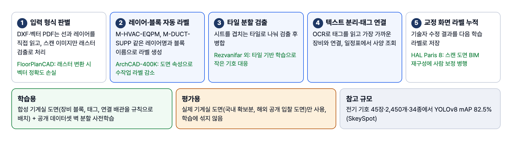

**4-2. 학습은 합성 도면으로, 평가는 실제 도면으로 분리합니다.**

합성 도면은 장비 블록, 태그, 연결 배관을 규칙으로 배치해 만듭니다. 무작위 배치 합성은 연결 구조가 비현실적이라는 비판(SynthPID)이 있으므로, 배관 연결 규칙을 넣으십시오. 실제 도면은 학습에 섞지 않아야 성능 수치를 믿을 수 있습니다.

| 대응 | 해결하는 차이 | 근거 |
|---|---|---|
| 벡터·레이어 직접 읽기 | 클래스, 겹침, 텍스트 | FloorPlanCAD(래스터 변환 시 정확도 손실), ArchCAD-400K(속성 기반 자동 라벨) |
| 타일 분할 검출 | 크기·축척 | Rezvanifar 외, CADSpotting 슬라이딩 창 병합 |
| OCR 분리와 태그 연결 | 텍스트, 시트 구성 | 샘플 평면도·일정표의 태그 구조 |
| 범례 기반 소수 샘플 | 기호 표준 | Jamieson 박사논문(소수 샘플 학습 제안) |
| 합성 학습, 실제 평가 | 확보 경로 | Liang 외 2025(합성 BIM 데이터), SynthPID |
| 교정 화면 라벨 누적 | 확보 경로 | HAL Paris 8(사람 보정 병행) |

## 5. 제한 사항: 국내 도면 미확보, 표준 원문 미확인

**5-1. 국내 기계실 도면 샘플과 국내 도시기호·레이어 표준 원문은 이번 조사에서 확인하지 못했습니다.**

- 국내 도면은 나라장터 공고 첨부 설계도서에서 찾을 수 있을 것으로 예상하지만, 확인하지 않았습니다.
- 건축물 평면도 열람·발급은 원칙적으로 소유자 동의가 필요합니다. 다중이용 건축물은 공익 목적이면 동의 없이 가능하다는 국토교통부 보도가 있으나, 현행 조문은 대조하지 않았습니다.
- 샘플 3건은 해외 도면이라 한글 표기, 국내 설계사 범례와 다릅니다.
- CubiCasa5K 이미지 크기와 FloorPlanCAD 규모는 출처마다 값이 달라 판 번호를 함께 기록했습니다.

## 6. 자료 목록

| 자료 | 내용 | 확인 수준 |
|---|---|---|
| [위니펙시 M-006 도면](https://legacy.winnipeg.ca/finance/findata/matmgt/documents/2011/673-2011/673-2011_Drawing_M-006-R0.pdf) | 기계실 평면도 1:100 | 원문 PDF |
| [위니펙시 ME1.2 도면](https://www.winnipeg.ca/finance/findata/matmgt/documents/2022/340-2022_B/340-2022B_ADDENDUM_6/340-2022B_Addendum_6_Drawing%20ME1.2-R1.pdf) | 기계·전기 일정표 | 원문 PDF |
| [BNL 펌프실 계통도](https://indico.bnl.gov/event/16415/contributions/65730/attachments/42481/72165/1008C%20Pump%20Room%20rev1.pdf) | 냉수·냉각수 계통 | 원문 PDF |
| [CubiCasa5K](https://arxiv.org/abs/1904.01920) | 5,000장, 80종 이상 | 원문, 클래스 목록은 2차 자료 |
| [FloorPlanCAD](https://arxiv.org/abs/2105.07147) | 텍스트 제거, 35종 | 원문 캡처 |
| [ArchCAD-400K](https://arxiv.org/abs/2503.22346) | 5,538장, 자동 라벨, 주거 14% | 원문 캡처 |
| [CADSpotting](https://arxiv.org/abs/2412.07377) | 대형 도면 슬라이딩 창 | 검색 발췌 |
| [Digitize-PID](https://arxiv.org/abs/2109.03794) | Dataset-P&ID 합성 500장 | 원문 캡처 |
| [PID2Graph](https://arxiv.org/abs/2411.13929) | 실제 P&ID 연결 주석 | 검색 발췌 |
| [SynthPID](https://arxiv.org/abs/2604.16513) | 연결 보존 합성 P&ID | 검색 발췌 |
| [SkeySpot](https://arxiv.org/abs/2508.10449) | 45장, 34종, mAP 82.5% | 원문 캡처 |
| [Rezvanifar 외](https://arxiv.org/abs/2006.00684) | 타일 기반 학습 | 원문 캡처 |
| [Jamieson 외 2024](https://link.springer.com/article/10.1007/s10032-024-00492-9) | 공조·배관 도면 검출 | 원문 캡처 |
| [Purdue 석사논문 2019](https://docs.lib.purdue.edu/dissertations/AAI30503187) | 배관 기호, 합성 데이터 | 검색 발췌 |
| [USF AutoCAD 레이어 안내](https://www.usf.edu/administrative-services/documents/design-construction/guide-autocad-layers.pdf) | AIA 형식 기계 레이어명 | 검색 발췌 |
| [정책브리핑, 다중이용 건축물 도면 열람](https://www.korea.kr/news/policyNewsView.do?newsId=148890076) | 소유자 동의 예외 | 검색 발췌 |
| [소방 설계 YOLO 연구(2022)](https://koreascience.kr/article/JAKO202211038370514.pdf) | 도면 문·기둥 인식 | 검색 발췌 |

## 관련 자료

- [도면 인식·공조 고장 진단 기술 조사](floorplan-hvac-twin-tech.md)
- [요구사항](../../reference/requirements.md) FR-02~FR-05
- [시스템 설계](../architecture.md) 2절 도면 인식 권장안
