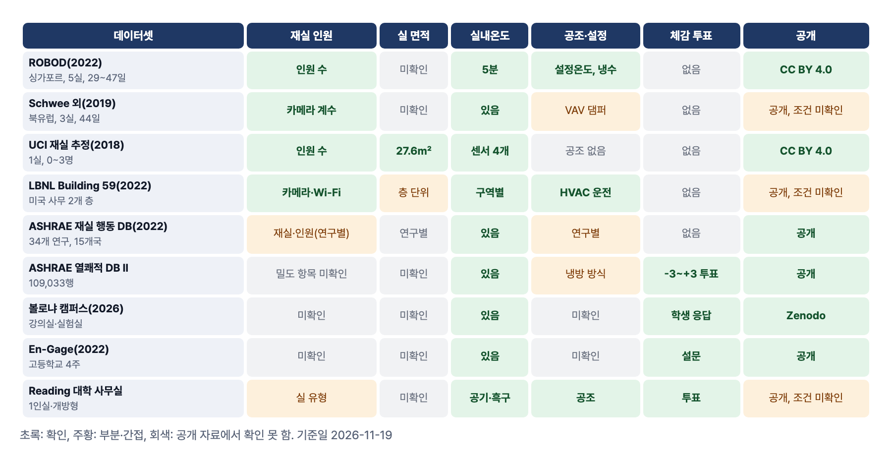
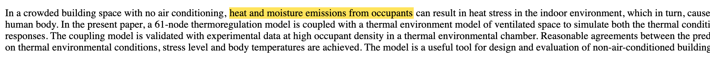
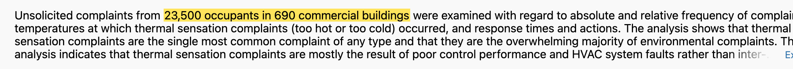
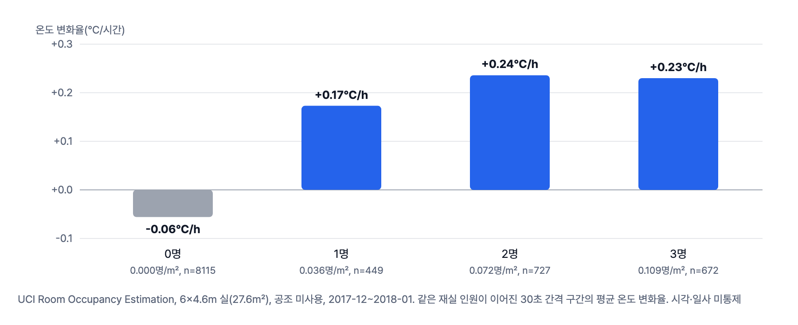
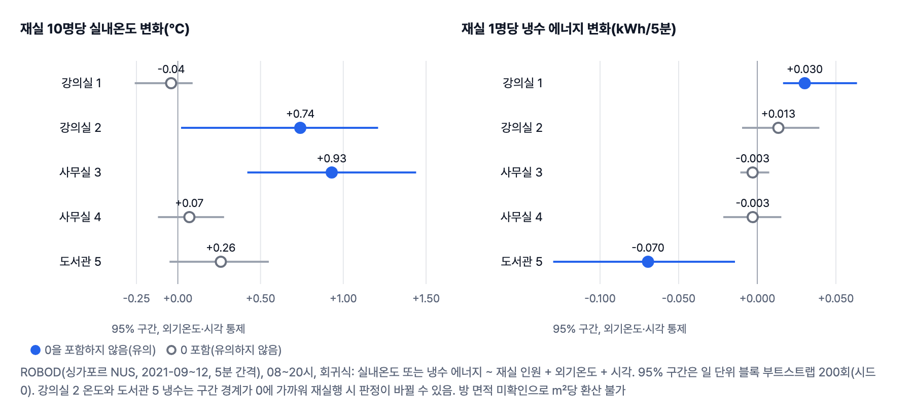

# 재실 밀도·사물과 실내온도·체감온도 근거 조사

> **요약** (기준일 2026-11-19)
>
> - 면적당 인원 수, 실내온도, 체감 투표를 한 번에 담은 공개 데이터셋은 찾지 못함. 인원 수와 온도를 함께 가진 데이터셋은 ROBOD, Schwee 외, UCI, LBNL Building 59 등 4종
> - 공개 데이터 직접 분석: 공조 없는 27.6㎡ 실은 재실 1~3명일 때 시간당 +0.17~0.24℃, 비재실 -0.06℃. 공조 실 5곳은 외기온도·시각 통제 후 10명당 -0.04~+0.93℃로 방마다 다르고, 유의한 곳은 2곳(경계 포함 시 2곳)
> - 사물(가구 등 실내 내용물)은 정상 상태 온도에 거의 영향이 없고, 온도 변화 속도와 시간 지연에 영향을 준다는 시뮬레이션 결과만 확인함. 실측 비교 연구는 찾지 못함
>
> | 항목 | 값 | 비교 기준 |
> |---|---|---|
> | 공조 없는 실 온도 변화율 | 재실 +0.17~0.24℃/h | 비재실 -0.06℃/h(UCI, 27.6㎡) |
> | 공조 실 재실 10명당 온도 | -0.04~+0.93℃ | 외기온도·시각 통제(ROBOD 5실) |
> | 가구 유무 정상 상태 온도 | 차이 미미 | 동적 가열 4시간 후 빈 실이 1.2K 높음(시뮬레이션) |
>
> **다음 작업**: ROBOD 방 면적 확인 후 ㎡당 환산, 가상 데이터 생성 규칙에 반영(미정)

재실 인원과 사물이 실내온도·체감온도에 주는 영향의 근거를 조사한 기록입니다. 2026-11-19에 웹 검색 27회를 수행했고, 공개 데이터셋 2개(UCI, ROBOD)를 내려받아 직접 분석했습니다. 학술 DB(KCI, Scopus) 직접 검색은 하지 않았습니다.

## 1. 데이터셋: 인원·온도는 있고 면적·체감 투표는 따로 있음

**1-1. 인원 수와 실내온도를 함께 가진 데이터셋은 4종이고, 체감 투표를 가진 데이터셋은 인원 수나 면적이 없습니다.**

UCI 데이터셋만 실 면적(27.6㎡)을 알 수 있어 ㎡당 인원으로 환산할 수 있습니다. 나머지는 면적을 공개 자료에서 확인하지 못했습니다.



| 데이터셋 | 규모 | 확인 수준 |
|---|---|---|
| [ROBOD](https://doi.org/10.6084/m9.figshare.19234530.v7) | 싱가포르 NUS 5실(강의실 2, 사무실 2, 도서관 1), 5분 간격 | 원문 데이터 분석 |
| [Schwee 외 2019](https://www.ncbi.nlm.nih.gov/pmc/articles/PMC6879639/) | 북유럽 공공건물 3실, 44일, 카메라 계수 | 원문 캡처 |
| [UCI Room Occupancy Estimation](https://archive.ics.uci.edu/dataset/864/room+occupancy+estimation) | 1실 6×4.6m, 0~3명, 공조 미사용 | 원문 데이터 분석 |
| [LBNL Building 59](https://www.nature.com/articles/s41597-022-01257-x) | 미국 사무 2개 층, 카메라·Wi-Fi 계수, HVAC | 검색 발췌 |
| [ASHRAE 재실 행동 DB](https://doi.org/10.1038/s41597-022-01475-3) | 34개 연구, 15개국, 재실·인원·실내온도 | 검색 발췌 |
| [ASHRAE 열쾌적 DB II](https://datadryad.org/dataset/doi:10.6078/D1F671) | 109,033행, 온열감 투표 | 검색 발췌, 밀도 항목 미확인 |
| 볼로냐 캠퍼스(Data 2026) | 강의실·실험실 환경 + 학생 응답 | 검색 발췌 |
| En-Gage(Scientific Data 2022) | 고등학교 4주, 온도·CO2 + 설문 | 검색 발췌 |
| [Reading 대학 사무실](https://researchdata.reading.ac.uk/78) | 1인실·개방형 사무실 온도 + 투표 | 검색 발췌 |


## 2. 논문 실험 결과: 강의 중 +4.2℃ 보고, 밀집 공간 열 스트레스

**2-1. 재실 밀도를 직접 변수로 다룬 실측은 강의실 연구 위주이며, ㎡당 인원과 온도의 용량-반응 관계를 제시한 연구는 찾지 못했습니다.**

| 연구 | 결과 | 확인 수준 |
|---|---|---|
| 중국 선양 대학 강의실(Buildings 2022) | 강의 중 온도 +4.2℃, 상대습도 +11.4%(비어 있을 때 대비), 인원 밀도가 주요 인자 | 검색 발췌(원문 접근 403) |
| Kang 외(Building and Environment 2000) | 공조 없는 밀집 공간에서 재실자 열·수분이 열 스트레스 유발, 예측과 실측 일치 | 초록 캡처 |
| 강의실 현장 연구(CLIMA 2022) | 44명 참여, 뒷줄이 앞줄보다 쾌적도 낮음 | 검색 발췌 |
| 대만 강의실 CFD 학위논문(2017) | 밀도 47·67·100% 비교, 100%에서 기존 냉방기 3대로 열 제거 부족 | 검색 발췌 |
| 지하철 객실 CFD(2024) | 0~6명/㎡ 모의, 0.5명/㎡에서는 풍속이 온도보다 큰 영향 | 검색 발췌 |
| Federspiel(1998) | 690개 건물 23,500명의 자발적 덥다·춥다 민원, 주원인은 제어 불량과 HVAC 고장 | 초록 캡처 |
| Griffitt, Veitch(1971) | 고온·고밀도 동시 조건의 정서 반응 연구, 체감온도 결과는 미확인 | 미확인 |





**2-2. 1인당 발열량은 사무 작업 기준 현열 약 75W, 잠열 약 65W로 인용되지만, 판과 출처에 따라 값이 다릅니다.**

ASHRAE Fundamentals 원문은 확인하지 못했고, 2차 자료에서 현열 72~75W, 잠열 45~65W 범위를 확인했습니다. ASHRAE 62.1과 EN 16798-1의 용도별 기본 재실 밀도도 원문을 확인하지 못했습니다.

## 3. 직접 분석: 공조 없는 실은 뚜렷, 공조 실은 방마다 다름

**3-1. 공조 없는 27.6㎡ 실에서 재실 1~3명(0.04~0.11명/㎡)이면 온도가 시간당 0.17~0.24℃ 올랐고, 비재실이면 0.06℃ 내려갔습니다.**

이 비교는 시각과 일사를 통제하지 않았습니다. 날짜별로 재실·비재실 변화율 차이를 비교하면 +0.37℃/h이지만, 비교 가능한 날이 3일뿐이라 통계적으로 유의하지 않습니다(p=0.08).



**3-2. 공조 실 5곳에서 외기온도와 시각을 통제하면, 재실 인원에 따른 온도 변화는 방마다 다르고 일부 방은 냉방 에너지로 나타났습니다.**

| 방 | 최대 인원 | 10명당 온도(95% 구간) | 1명당 냉수 에너지(kWh/5분) | 해석 |
|---|---:|---|---|---|
| 강의실 1 | 38 | -0.04℃(-0.26~+0.09) | +0.030(+0.016~+0.063) | 온도 유지, 냉방 에너지 증가 |
| 강의실 2 | 22 | +0.74℃(+0.02~+1.21) | +0.013(-0.010~+0.040) | 온도 상승, 하한 경계 |
| 사무실 3 | 13 | +0.93℃(+0.42~+1.44) | -0.003(유의하지 않음) | 온도 상승 |
| 사무실 4 | 18 | +0.07℃(-0.12~+0.28) | -0.003(유의하지 않음) | 차이 없음 |
| 도서관 5 | 16 | +0.26℃(-0.05~+0.55) | -0.070(-0.130~-0.014) | 온도 차이 없음, 냉수 음의 관계는 해석 보류 |



주: 통제 전 날짜별 비교에서는 강의실 1·2, 도서관 5가 재실 시 +0.5~0.9℃로 유의했습니다. 외기온도와 시각을 통제하자 대부분 줄었으므로, 단순 비교 차이의 상당 부분은 재실 시간대가 더운 시간대와 겹친 결과입니다.

## 4. 사물: 정상 상태 온도 영향 미미, 변화 속도에 영향

**4-1. 가구 등 실내 내용물은 열용량으로 온도 변화를 늦추며, 정상 상태 온도에는 거의 영향이 없다는 시뮬레이션 결과가 있습니다.**

빈 실과 가구가 있는 실의 실내온도를 실측으로 비교한 연구는 찾지 못했습니다. 컴퓨터·모니터 같은 발열 장비는 사람과 같은 열원이며, 실제 발열은 명판 전력보다 작다는 ASHRAE 설명이 있습니다(Standard 203-2014 테스트 방법).

| 연구 | 결과 | 방법 |
|---|---|---|
| Energy Procedia(2015) | 정상 상태 영향 미미, 설정온도 상승 4시간 후 빈 중량 실이 가구 실보다 1.2K 높음 | 시뮬레이션 |
| Energy and Buildings(2014) | 내부 열용량 추가 시 최대 냉방부하 중앙값 -2.28%(5,400회) | EnergyPlus |
| Johra 외(2019) | 경량 주택에서 가구 포함 시 시간상수 +42%, 에너지 유연성 +21% | 시뮬레이션 |
| Johra, Heiselberg(2017 리뷰) | 동적 계산에서 빈 실 가정은 부적절 | 문헌 리뷰 |

## 5. 서비스 반영: 가상 데이터와 추천 규칙

**5-1. 가상 데이터 생성기는 공조 실에서 재실의 영향을 온도보다 냉방 에너지에 더 크게 반영하고, 방마다 계수를 다르게 설정합니다.**

- 회의실·강의실처럼 인원 변동이 큰 방에는 인원 비례 냉방 에너지 항을 넣고, 온도 상승은 10명당 0~1℃ 범위에서 방별로 정하십시오.
- 공조가 꺼진 상태(빈 공간 운전 OFF 이후)에는 UCI 결과처럼 인원에 비례한 온도 상승률을 사용하십시오.
- 가구는 3D 표시 대상이지만 온도 모델에서는 생략합니다. 열용량 효과는 정상 상태 비교에 영향이 작습니다.
- 체감온도는 측정 데이터가 없으므로 PMV(ISO 7730) 계산값으로 표시하고, 계산값임을 표시하십시오.

## 6. 제한 사항

- ROBOD 방 면적을 확인하지 못해 ㎡당 인원으로 환산하지 못했습니다.
- 부트스트랩 200회 결과라 경계 구간(강의실 2 온도, 도서관 5 냉수)은 재실행 시 판정이 바뀔 수 있습니다.
- 선양 강의실 연구의 +4.2℃는 원문 접근이 차단되어(HTTP 403) 검색 발췌로만 확인했습니다.
- UCI는 7개 날짜, 0~3명으로 규모가 작고 시각·일사를 통제하지 않았습니다.

```bash
python docs/reports/tools/occupancy_analysis.py Occupancy_Estimation.csv robod
```

주: UCI CSV와 ROBOD 압축 파일(figshare)을 내려받은 뒤 실행하십시오. numpy가 필요합니다.

## 관련 자료

- [ROBOD figshare](https://doi.org/10.6084/m9.figshare.19234530.v7), [UCI 864](https://archive.ics.uci.edu/dataset/864/room+occupancy+estimation), [Schwee 외 2019](https://www.ncbi.nlm.nih.gov/pmc/articles/PMC6879639/)
- [선양 강의실 연구(MDPI Buildings 12(7) 912)](https://www.mdpi.com/2075-5309/12/7/912), [Kang 외 2000 초록](https://sel.me.wisc.edu/trnsys/validation/abstracts/buildingenvironment/12.htm), [Federspiel 1998](https://www.osti.gov/biblio/649422)
- [Johra, Heiselberg 2017 리뷰](https://vbn.aau.dk/en/publications/influence-of-internal-thermal-mass-on-the-indoor-thermal-dynamics), [가구와 최대 냉방부하(NREL)](https://research-hub.nrel.gov/en/publications/effects-of-furniture-and-contents-on-peak-cooling-load-2/)
- [ASHRAE 열쾌적 DB II](https://datadryad.org/dataset/doi:10.6078/D1F671), [LBNL Building 59](https://www.nature.com/articles/s41597-022-01257-x)
