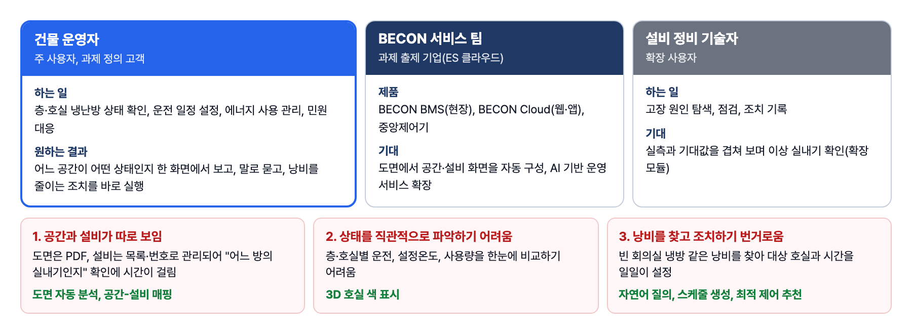
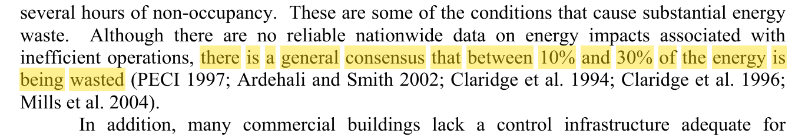
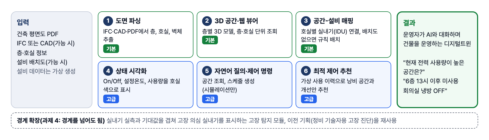
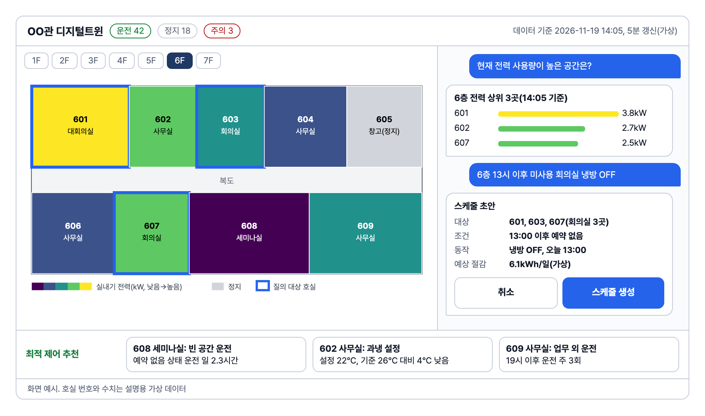
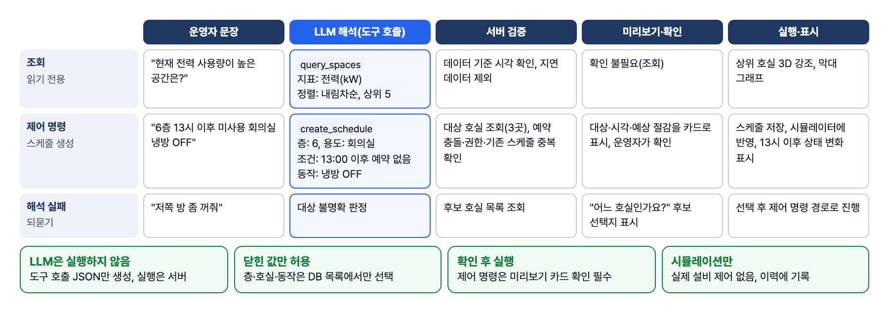
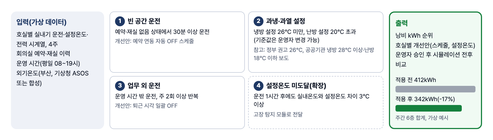
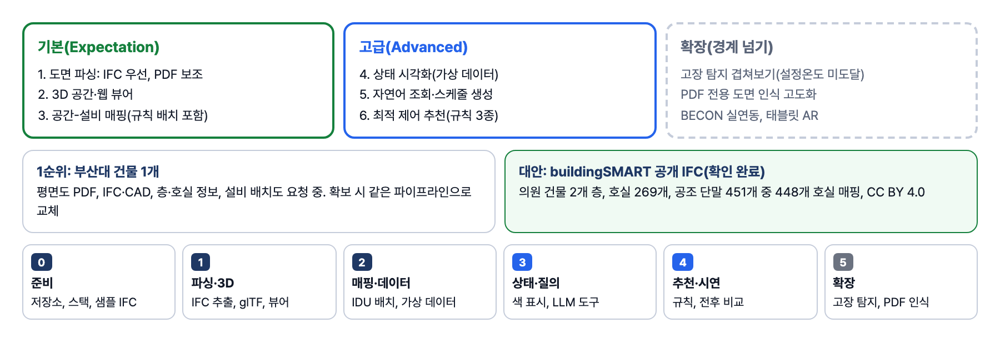
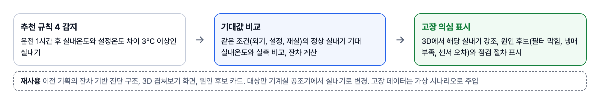

# 서비스 기획: 도면 기반 건물 운영 디지털트윈

> **요약** (기준일 2026-11-19)
>
> - 과제 4(ES 클라우드): 건물 운영자가 공간 현황과 설비 상태를 직관적으로 파악하기 어려운 문제를 도면 자동 분석과 대화형 디지털트윈으로 해결
> - 서비스는 도면 파싱, 3D 공간, 공간-설비 매핑, 상태 시각화, 자연어 질의·스케줄, 최적 제어 추천 6단계. 실제 설비 제어 없이 시뮬레이션으로 동작
> - 데이터는 부산대 건물 1개가 1순위이고, 대안 공개 IFC(의원 건물)에서 호실 269개 추출과 공조 단말 448개 매핑을 확인함
>
> | 항목 | 값 | 기준 |
> |---|---|---|
> | 주 사용자 | 건물 운영자 | 과제 정의, 정비 기술자는 확장 사용자 |
> | 대상 설비 | HVAC(IDU) | 상태(On/Off, 설정온도)와 전력은 가상 데이터 |
> | 기능 | 6단계 | 기본 3, 고급 3, 경계 확장 1(고장 탐지) |
>
> **다음 작업**: 부산대 건물 도면 제공 여부 확인, 기술 스택 확정, LLM 비용 점검(미정)

서비스의 고객, 문제, 해결 방법, 범위를 정한 문서입니다. 결정 경위는 [과제 4 범위 반영](decisions/2026-11-19%28%EA%B3%BC%EC%A0%9C%204%20%EB%B2%94%EC%9C%84%20%EB%B0%98%EC%98%81%29.md), 구현 구조는 [시스템 설계](architecture.md), 기능별 완료 기준은 [요구사항](../reference/requirements.md)에 있습니다.

## 1. 고객: 건물 운영자, BECON 서비스 팀, 정비 기술자

**1-1. 주 사용자는 층·호실의 냉난방을 관리하는 건물 운영자이고, 출제 기업 BECON 팀은 서비스를 제품에 확장하는 고객입니다.**

BECON은 해외 자료 기준으로 층 평면도 화면, 3D 에너지 관리 화면, 고에너지 공간 색 표시를 제공합니다. 이 서비스는 해당 화면에 필요한 공간·설비 정보를 도면에서 자동으로 만들고, 대화와 추천을 더합니다. 현재 BECON 현장 구축 시간은 BECON 팀에 확인이 필요합니다.

## 2. 문제: 공간과 설비가 따로 보이고, 낭비를 찾아 조치하기 번거로움

**2-1. 운영자는 도면, 설비 목록, 운전 일정을 따로 확인하며, 빈 공간 운전 같은 낭비를 직접 찾아야 합니다.**

| 문제 | 근거 | 확인 수준 |
|---|---|---|
| 상태 파악 어려움 | 과제 4 문제 정의 | 과제 공고 |
| 빈 시간 운전 낭비 | 비재실 시간에도 24시간 운전하는 사례가 상당한 에너지 낭비 원인 | PNNL 2008 원문 |
| 운영 비효율 규모 | 상업 건물 에너지의 10~30%가 비효율 운전으로 낭비된다는 추정 | PNNL 2008 원문 |
| 설정온도 기준 | 정부 권고 냉방 26℃, 공공기관 냉방 28℃ 이상 | 언론 보도 |

## 3. 서비스 정의: 도면에서 대화형 운영까지 6단계

**3-1. 서비스는 도면 한 벌로 3D 디지털트윈을 만들고, 운영자가 말로 묻고 조치하며, 낭비 공간을 추천받게 합니다.**

| 단계 | 기능 | 과제 구분 |
|---|---|---|
| 1 | 도면 파싱: IFC·CAD·PDF에서 층, 호실, 벽체 추출 | 기본 |
| 2 | 3D 공간 생성과 웹 뷰어: 층·호실 단위 조회 | 기본 |
| 3 | 공간-설비 매핑: 호실별 HVAC 연결, 배치도 없으면 규칙 배치 | 기본 |
| 4 | 상태 시각화: On/Off, 설정온도, 사용량을 호실 색으로 표시 | 고급 |
| 5 | 자연어 질의·제어 명령: 공간 조회, 스케줄 생성(시뮬레이션) | 고급 |
| 6 | 최적 제어 추천: 가상 사용 이력으로 낭비 공간과 개선안 추천 | 고급 |

## 4. 사용 장면: 3D 화면과 대화 패널

**4-1. 운영자는 층 화면에서 호실 색으로 상태를 보고, 대화 패널에서 조회와 스케줄 생성을 수행합니다.**

과제 예시 "현재 전력 사용량이 높은 공간은?"은 상위 호실을 3D에서 강조합니다. "6층 13시 이후 미사용 회의실 냉방 OFF"는 대상 회의실을 찾아 스케줄 초안을 보여 주고, 운영자가 확인하면 저장합니다.

주: 화면의 호실 번호와 수치는 설명용 가상 데이터.

**4-2. 제어 명령은 LLM이 해석하고 서버가 검증하며, 운영자 확인 후 시뮬레이션에만 반영합니다.**

## 5. 최적 제어 추천: 낭비 규칙 3종

**5-1. 가상 사용 이력에서 빈 공간 운전, 과냉·과열 설정, 업무 외 운전을 찾아 낭비 kWh 순으로 추천합니다.**

네 번째 규칙(설정온도 미도달)은 고장 탐지 확장 모듈로 넘깁니다. 절감 효과는 승인 전후를 시뮬레이션으로 비교해 표시합니다.

## 6. 차별점: 도면 자동 구성, 대화형 운영, 추천 연결

**6-1. 기존 3D 트윈 도구는 BIM·스캔 입력을 요구하고, 이 서비스는 IFC·PDF에서 공간-설비 화면을 자동 구성해 대화와 추천까지 연결합니다.**

| 비교 대상 | 기존 방식 | 이 서비스 |
|---|---|---|
| Autodesk Tandem | Revit·IFC 모델 업로드, DWG 베타(2024 포럼) | IFC 외 PDF·DXF도 입력, 호실-HVAC 자동 연결 |
| Matterport | 현장 3D 스캔 | 도면만으로 생성 |
| 도면 3D 변환(어반베이스, Planner 5D) | 주거·인테리어 3D | 설비 매핑, 상태, 운영 기능 포함 |
| 운전 일정 설정 | 대상 호실·시간을 화면에서 직접 선택 | 문장 1개로 대상 판별과 스케줄 초안 생성 |

주: 경쟁 제품 근거는 [문제 배경과 시장 조사](research/maintenance-background-market.md) 4절.

## 7. 범위와 일정: 기본 3, 고급 3, 확장 1

**7-1. 기본 3단계를 먼저 완성하고 고급 3단계를 이어서 구현하며, 고장 탐지는 남는 시간에 진행합니다.**

해커톤 종료일이 확인되지 않아 일정은 단계 순서로만 정했습니다.

| 위험 | 영향 | 대응 |
|---|---|---|
| 부산대 도면 미제공 | 시연 건물 변경 | 공개 의원 건물 IFC로 진행, 교체 가능 구조 유지 |
| PDF만 제공 | 호실 인식 오류 | 교정 화면, IFC·DXF 우선 |
| LLM 오해석 | 잘못된 호실 대상 | 닫힌 값 검증, 미리보기 확인, 되묻기 |
| 가상 데이터 신뢰도 | 추천 수치 과신 | 화면·발표에 가상 표시, 생성 규칙 공개 |
| 실제 제어 오해 | 안전 문제 | 시뮬레이션만, 제어 인터페이스 없음 |

## 8. 경계 확장: 고장 의심 HVAC 겹쳐보기

**8-1. 설정온도 미도달 HVAC을 기대값과 비교해 고장 의심으로 표시하며, 이전 기획의 진단 구조를 재사용합니다.**

## 다음 작업

| 작업 | 기한 | 담당 |
|---|---|---|
| 부산대 건물 도면(평면도, IFC·CAD, 층·호실, 설비 배치도) 제공 여부 확인 | 미정 | 팀 전체 |
| 기술 스택 확정과 기술 선택 기록 작성 | 미정 | 팀 전체 |
| LLM 호출량·단가로 비용 점검 후 모델 결정 | 미정 | 미정 |
| BECON 팀에 현재 화면 구성 방식과 구축 시간 확인 | 미정 | 미정 |

## 관련 자료

- [시스템 설계](architecture.md)
- [요구사항](../reference/requirements.md)
- [공개 IFC 샘플 검토와 추출 실험](research/ifc-sample-feasibility.md)
- [설계서 PDF](<../../reports/2026-11-19-design-spec/설계서 report.pdf>)
- 이전 기획(정비 기술자용 고장 진단): [기획·설계 PDF](<../../reports/2026-11-19-service-plan/기획설계 report.pdf>)
