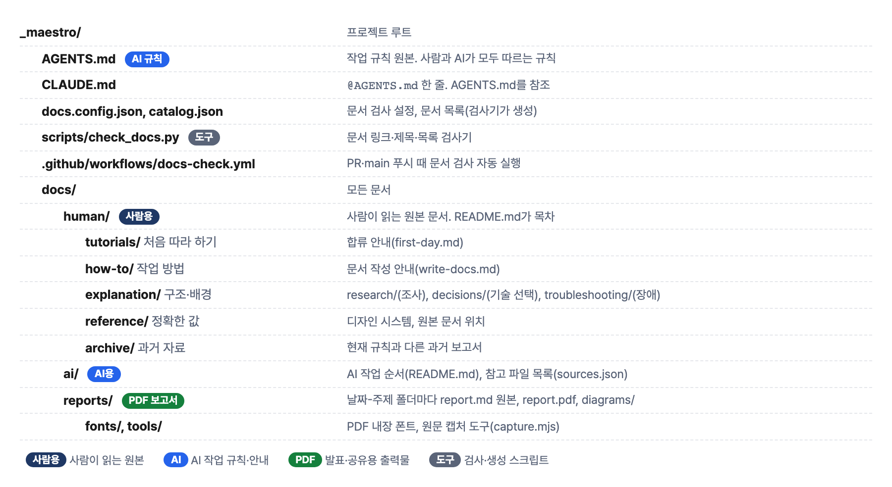
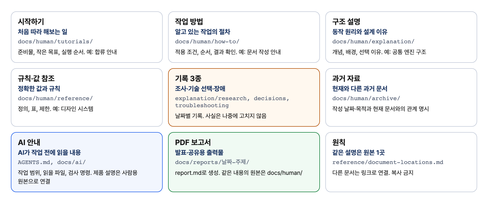
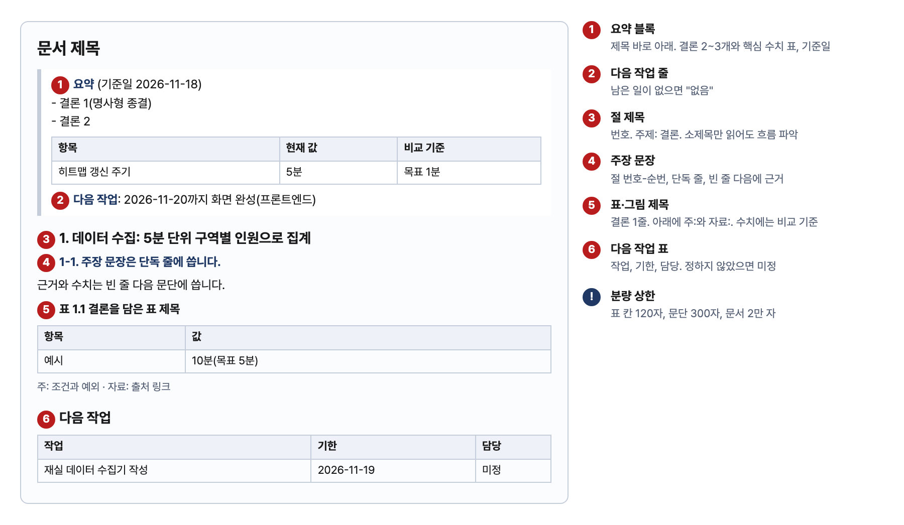
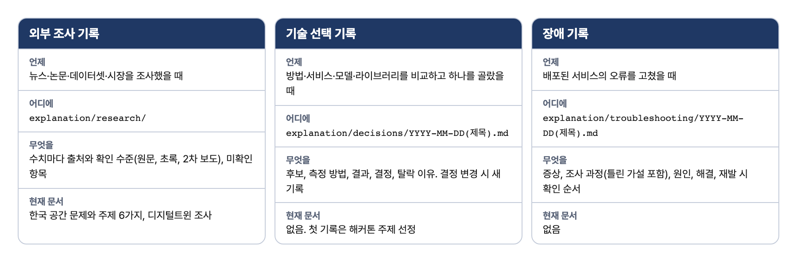
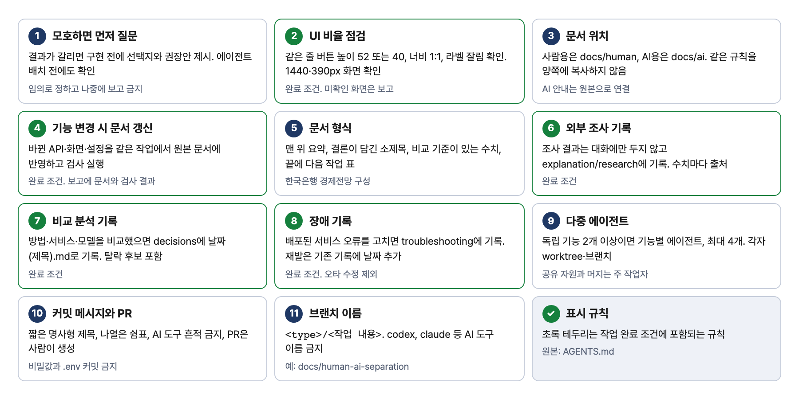
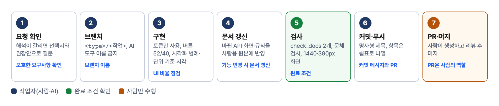
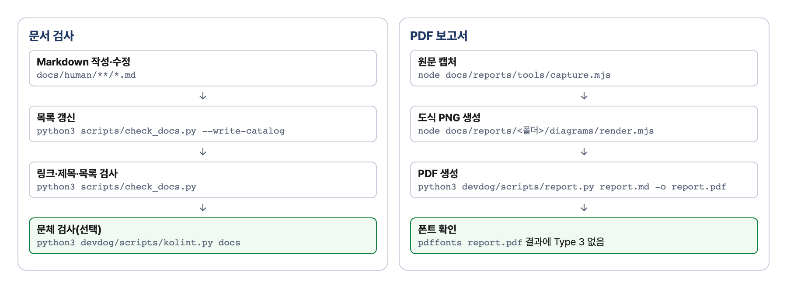

# Maestro 팀 합류 안내

> **요약** (기준일 2026-11-19)
>
> - Maestro는 해커톤 과제 4(ES 클라우드)의 도면 기반 건물 운영 디지털트윈 프로젝트. 2026-11-20 Frontend(`frontend/`)와 Lambda(`lambda/`) 첫 구현
> - 모든 작업은 `AGENTS.md` 규칙 11개를 따르며, 그중 5개(UI 비율, 문서 갱신, 조사·비교·장애 기록)는 완료 조건
> - 첫날 할 일은 규칙과 조사 보고서 읽기, 도구 준비, 저장소 공유 방식 확정. `_maestro`는 아직 독립 Git 저장소가 아님
>
> | 항목 | 현재 값 | 비고 |
> |---|---|---|
> | 해커톤 시작일 | 2026-11-19 | 종료일, 심사 기준 미확인 |
> | 기능 요구사항 | 21개 | 기본 7, 고급 10, 확장 2, 2차 2 |
> | PDF 보고서 | 5건 | 해외 동향, 한국 주제, 이 안내, 이전 기획·설계, 설계서 |
>
> **다음 작업**: 저장소 초기화와 원격 연결, 기술 스택 확인(팀 전체)

처음 합류한 팀원과, 팀원이 함께 쓰는 AI 코딩 도구를 위한 안내입니다. 규칙 원본은 `AGENTS.md`이며, 이 문서와 다르면 `AGENTS.md`가 우선합니다. 같은 내용의 PDF는 [합류 안내 PDF](<../../reports/2026-11-18-onboarding/온보딩 report.pdf>)입니다.

## 1. 프로젝트 현황: 주제 확정, 기획·설계 단계

**1-1. 2026-11-19에 주제를 정했고, 서비스 기획·설계·요구사항 문서가 있습니다.**

공고의 기간, 제공 데이터, 심사 기준은 확인하지 못했습니다. 확인한 값은 [문서 목차](../README.md) 1절 표에 기록하십시오.

| 문서 | 내용 |
|---|---|
| `AGENTS.md` | 사람과 AI가 따르는 규칙 11개 |
| [서비스 기획](../explanation/service-plan.md) | 고객, 문제, 6단계 기능, 화면, 추천, 범위 |
| [시스템 설계](../explanation/architecture.md) | 처리 흐름, 구조, 데이터 모델, 자연어 도구, 추천 규칙 |
| [요구사항](../reference/requirements.md) | 기능 21개, 비기능 8개, 완료 기준 |
| `DESIGN.md` | 웹 화면 시각 디자인 가이드 |
| `frontend/README.md`, `lambda/README.md` | 코드 실행·테스트·배포 명령 |
| [문제 배경과 시장 조사](../explanation/research/maintenance-background-market.md) | 자료 43건, 경쟁 5개 유형의 부족한 점, 차별점 |
| [한국 공간 문제와 주제 6가지](../explanation/research/korea-space-topics.md) | 주제 후보 6개, 공공데이터, 경쟁·시장, 평가 |
| [디지털트윈 조사](../explanation/research/digital-twin-survey.md) | 해외 기술 동향, 논문, 경쟁 제품 |
| [디자인 시스템](../reference/design-system.md) | 색 토큰, 버튼 높이, 공간 시각화 규칙 |
| [문서 작성 안내](../how-to/write-docs.md) | 보고서 형식, 말투, 검사, PDF 생성 |

## 2. 폴더 구조: 사람용 원본, AI 안내, PDF 출력물, 도구

**2-1. 모든 문서는 `docs/` 아래에 있으며, 사람용 문서가 원본입니다.**

AI용 문서와 PDF는 원본으로 연결하거나 원본에서 생성합니다. 코드 폴더는 주제 확정 후 추가합니다.

## 3. 문서 체계: 목적별 폴더, 보고서 형식, 기록 3종

**3-1. 문서 폴더는 독자가 문서를 여는 목적으로 정하고, 같은 설명은 원본 1곳에만 씁니다.**

원본 위치는 [원본 문서 위치](../reference/document-locations.md)에서 확인하십시오.

**3-2. 모든 사람용 문서는 보고서 형식이며, 첫 화면에 결론을 씁니다.**

주장 문장과 굵은 강조 소제목은 단독 줄에 쓰고 빈 줄 다음에 근거를 씁니다. 상세 규칙은 [문서 작성 안내](../how-to/write-docs.md) 1절입니다.

**3-3. 조사, 기술 선택, 장애는 날짜별 기록으로 남기고 과거 사실을 고치지 않습니다.**

## 4. 작업 규칙: AGENTS.md 규칙 11개, 완료 조건 5개

**4-1. 규칙 11개 중 초록 테두리 5개는 작업 완료 조건입니다.**

**4-2. 작업은 요청 확인부터 PR까지 7단계이며, PR 생성과 머지는 사람이 합니다.**

| 항목 | 규칙 | 예시 |
|---|---|---|
| 브랜치 | `<type>/<작업 내용>`, AI 도구 이름 금지 | `docs/human-ai-separation` |
| 커밋 제목 | 짧은 명사형, 항목은 쉼표로 나열 | `재실 히트맵 범례 단위 누락 수정` |
| 트레일러 | `Co-Authored-By` 등 AI 도구 흔적 금지 | 없음 |
| 비밀값 | API 키, 토큰, `.env` 커밋 금지 | 인증키는 로컬 `.env`에만 보관 |

**4-3. 화면은 시맨틱 토큰만 쓰고, 공간 시각화는 범례·단위·데이터 기준 시각을 항상 표시합니다.**

이모지, 제목 위 영문 라벨, 제목 아래 회색 설명 문장은 쓰지 않습니다. 같은 줄 버튼은 높이 52 또는 40, 너비 1:1이며 1440·390px 화면으로 확인합니다.

**4-4. AI 도구는 `AGENTS.md`, `docs/ai/README.md`, `docs/ai/sources.json` 순서로 읽고 사람과 같은 규칙을 따릅니다.**

독립 기능이 2개 이상이면 기능별 에이전트를 최대 4개까지 배치하며, 배치 전에 사용자에게 확인합니다. 에이전트마다 별도 worktree와 브랜치를 쓰고, 공유 자원과 머지는 주 작업자가 맡습니다.

## 5. 도구와 첫날: 검사는 Python, PDF는 devdog·Node.js·Chrome

**5-1. 문서를 고치면 `check_docs.py` 2개를 실행하고, PDF가 필요할 때만 생성 흐름을 사용합니다.**

| 도구 | 용도 | 설치·경로 |
|---|---|---|
| Python 3.8 이상 | `scripts/check_docs.py` 문서 검사 | 표준 라이브러리만 사용 |
| devdog 저장소 | `report.py`(PDF), `kolint.py`(문체 검사) | github.com/taehun2123/devdog 복제 |
| Node.js, Playwright | 원문 캡처, 도식 PNG 생성 | `PLAYWRIGHT` 환경변수로 설치 경로 지정 |
| Chrome | PDF 출력 | 자동 탐색, 실패 시 `--chrome` 지정 |

주: 캡처·도식 스크립트의 Playwright 기본 경로는 작성자 PC 기준입니다.

**5-2. 첫날에는 아래 순서로 진행하십시오.**

| 순서 | 할 일 | 확인 방법 |
|---|---|---|
| 1 | `AGENTS.md` 읽기 | 규칙 11개와 완료 조건 5개 설명 가능 |
| 2 | [문서 목차](../README.md)와 [문서 작성 안내](../how-to/write-docs.md) 읽기 | 새 문서의 폴더와 형식 선택 가능 |
| 3 | [서비스 기획](../explanation/service-plan.md)과 [요구사항](../reference/requirements.md) 읽기 | 과제 6단계와 기본·고급·확장 구분 설명 가능 |
| 4 | Python, devdog, Node.js 준비 | `python3 scripts/check_docs.py` 오류 0건 |
| 5 | AI 도구에 저장소 열기 | AI가 `AGENTS.md` 규칙을 요약하는지 확인 |

## 다음 작업

| 작업 | 기한 | 담당 |
|---|---|---|
| `_maestro` 독립 Git 저장소 초기화와 원격 저장소 연결 | 2026-11-19 | 미정 |
| 해커톤 공고 확인과 문서 목차 개요 표 기록 | 2026-11-19 | 미정 |
| 기술 스택 확인과 기술 선택 기록 작성 | 미정 | 팀 전체 |
| 캡처·도식 스크립트의 Playwright 경로를 저장소 기준으로 변경 | 미정 | 미정 |
| `aws configure --profile maestro` 후 SAM 첫 배포 | 미정 | 미정 |
